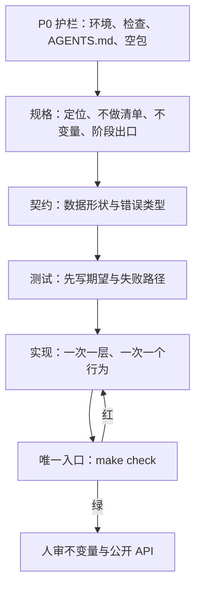

# 用 AI 写项目：方案全景扫描

> 更新时间：2026-09-11
> 文档类型：全景扫描（landscape）+ 推荐方案
> 数据来源：
> - [Cursor Rules](https://cursor.com/docs/context/rules)、[Cursor Agent Skills](https://cursor.com/docs/skills)（官方文档，2026）
> - [AGENTS.md](https://agents.md/)（Agentic AI Foundation / Linux Foundation）
> - [Agent Skills 规范](https://agentskills.io/specification)、[agentskills/agentskills](https://github.com/agentskills/agentskills)
> - [GitHub Spec Kit](https://github.com/github/spec-kit/) 与 [SDD 概念页](https://github.github.com/spec-kit/concepts/sdd.html)（1.0.0，2026-08-21）
> - 二级验证：Karpathy「vibe coding」原帖（2025-02，经 Engadget / CSA 转述）、CSA Research Note（2026）、Cycode / Augment Code 评述
> - 本仓库对照：`projects/littleagent/AGENTS.md`、`docs/architecture.md`、`docs/roadmap.md`

本文回答一件事：**用 AI 从零写一个会长期活下去的项目，该准备什么、按什么顺序做、哪些方案能用、本仓库该选哪条路。**

---

## 目录

1. [问题域描述](#1-问题域描述)
2. [方案分类概览](#2-方案分类概览)
3. [各方案简介](#3-各方案简介)
4. [特性对比矩阵](#4-特性对比矩阵)
5. [成熟度与生态矩阵](#5-成熟度与生态矩阵)
6. [约束层：项目必须准备什么](#6-约束层项目必须准备什么)
7. [推荐工作流：从 0 到可合并](#7-推荐工作流从-0-到可合并)
8. [风险与失败模式](#8-风险与失败模式)
9. [与本仓库的落地建议](#9-与本仓库的落地建议)
10. [推荐路径](#10-推荐路径)
11. [知识盲区](#11-知识盲区)

---

## 1. 问题域描述

核心问题不是「怎么让模型多写几行代码」，而是：**如何把一次会话里的聪明，变成跨会话、跨人和跨工具都稳定的工程产出。**

LLM 在两次补全之间没有记忆。Cursor 官方把 Rules 的作用说成：把持久指令注入每次请求的模型上下文（[Cursor Rules](https://cursor.com/docs/context/rules)）。因此「项目约束」不是可选文档，而是 Agent 的运行时输入。

要解决的需求特征：

| 特征 | 说明 |
|------|------|
| 跨会话 | 新开对话后，Agent 仍知道边界、命令、不变量 |
| 跨工具 | Cursor / Claude Code / Codex 读同一份政策，不各写一套 |
| 可验证 | 「做完了」有唯一检查入口，不靠模型自报 |
| 可演进 | 约束随真实失误更新，不一次写死百科全书 |
| 可缩放 | 始终生效的文字短；细节按文件或按任务加载 |

Karpathy 在 2025 年 2 月把「完全交给感觉、忘记代码存在」称为 vibe coding。这条路适合一次性原型。要长期维护的项目，需要把 **规格、约束、机检** 放在代码之前——GitHub Spec Kit 把这条路径叫 Spec-Driven Development：规格成为可执行物，而不是写完就扔的脚手架（[SDD 概念页](https://github.github.com/spec-kit/concepts/sdd.html)）。

**信心：高。** 官方文档与开放标准在「Agent 需要仓库内持久指令」这一点上一致。

---

## 2. 方案分类概览

按「谁当真相、什么时候写代码」分成四类。它们可以叠用，不是互斥宗教。

| 分类 | 代表方案 | 核心思路 |
|------|----------|----------|
| **对话驱动（Vibe）** | 纯聊天 + Agent 模式，几乎无仓库约束 | 用自然语言连续改，靠人眼和感觉验收 |
| **约束驱动（Harness）** | `AGENTS.md` + `.cursor/rules` + Skills + `make check` | 先写边界与检查，再让 Agent 在护栏里写 |
| **规格驱动（SDD）** | GitHub Spec Kit：Spec → Plan → Tasks → Implement | 先落可执行规格，再拆任务，最后实现 |
| **编排驱动（Multi-agent）** | 规划 / 实现 / 评审分角色、分上下文 | 写代码的人不评自己的代码；阶段之间交制品不交聊天记录 |

2026 年较稳的组合是：**约束层常驻 + 规格管功能 + 机检当完成定义**。纯 vibe 只留给可扔掉的实验。编排层按需要加，不要一上来就上多 Agent。

**信心：高。** 分类来自官方产品面（Cursor / Spec Kit / Agent Skills）与本仓库已落地实践的交叉。

---

## 3. 各方案简介

### 3.1 对话驱动（Vibe Coding）

人连续描述意图，Agent 直接改仓库。几乎不写规格，也很少写 `AGENTS.md`。

- **优点**：启动成本最低，探索 UI / 一次性脚本很快。
- **缺点**：未陈述的需求会被模型用「看起来合理」的默认值填满；跨会话丢失决策；测试常由同一模型按实现反写，验收是自证。
- **适用**：明确可扔的原型、个人工具、需求本身还在摸索。
- **不适用**：库、有不变量的框架、多人仓库、安全敏感路径。

### 3.2 约束驱动（Agent Harness）

先准备 Agent 能读、机器能拦的护栏，再写功能。Cursor 把这套拆成 Rules / User Rules / Team Rules / `AGENTS.md`（[官方 Rules](https://cursor.com/docs/context/rules)）；跨工具的硬政策放 `AGENTS.md`（[agents.md](https://agents.md/)）；偶发流程做成 Skill（[Agent Skills](https://agentskills.io/specification)）。

关键事实：规则是提示，不是编译器。Cursor 自己建议风格交给 linter，不要把整本 style guide 塞进规则。Augment 等评述记录过：Agent 能背出 `CLAUDE.md` / `AGENTS.md` 却不遵守，尤其是文件变长、上下文被代码挤满之后。能进 CI 的约束才算硬的。

本仓库 `littleagent` 已走这条路：`AGENTS.md` 写边界与不变量，`import-linter` / `mypy --strict` / `make check` 机检。

### 3.3 规格驱动（Spec-Driven Development）

GitHub Spec Kit 的默认过程是 **Spec → Plan → Tasks → Implement**。每阶段产出 Markdown 制品，供下一阶段的 Agent 当输入，而不是靠聊天记录续命。工具本身 agent-agnostic，支持 Cursor、Claude Code、Codex、Copilot 等三十余种集成（[Spec Kit](https://github.com/github/spec-kit/)）。

- **优点**：需求歧义在写代码前暴露；跨会话有制品可接；实现与验收对照同一份规格。
- **缺点**：小改动（错字、重命名）上全套规格是浪费；规格不更新就会和代码一起漂。
- **适用**：新项目 0→1、跨越多文件 / 多会话的功能、需要阶段出口的路线图。

`littleagent` 的 `docs/roadmap.md`（契约优先、阶段出口）是手工版 SDD，不一定要引入 Spec Kit CLI。

### 3.4 编排驱动（分角色 Agent）

把「想清楚 / 写出来 / 验一下」拆成不同上下文：规划 Agent 只出规格，实现 Agent 只读规格和任务，评审 Agent 读 diff 和规格、不继承实现过程的自我辩护。LogRocket 等文章把这称为 harness：阶段之间交制品，QE 不给自己打分。

- **优点**：能压住「实现者自评通过」。
- **缺点**：编排本身会引入漂移、权限和并发问题；没有规格的多 Agent 只是把糊涂事做复杂。
- **适用**：已经有规格和机检，还要压自评偏差时再加。

---

## 4. 特性对比矩阵

| 特性 | Vibe | 约束驱动 | 规格驱动 | 编排驱动 |
|------|------|----------|----------|----------|
| 启动成本 | 极低 | 中（先写护栏） | 中高（先写规格） | 高 |
| 跨会话稳定性 | 差 | 好 | 很好 | 好（靠制品） |
| 跨工具可移植 | 无 | `AGENTS.md` 可移植 | Spec Kit 多 Agent | 视编排绑定 |
| 需求歧义暴露时机 | 写完才发现 | 边界清晰，功能仍可能糊 | 写代码前 | 取决于规格质量 |
| 完成定义 | 人眼 / 模型自报 | 单一检查命令 | 规格验收 + 检查 | 独立评审 + 检查 |
| 适合长期库 | 否 | 是 | 是 | 可选增强 |
| 被模型忽略的风险 | 无约束可忽略 | 散文规则会被忽略 | 规格不更新则漂 | 角色指令被忽略 |
| 主要成本 | 后期返工、安全债 | 维护约束与检查 | 维护规格 | 编排与上下文隔离 |

核心差异一句话：**Vibe 把思考推迟到返工；约束把「不能做什么」提前；规格把「要做成什么样」提前；编排把「谁说了算」拆开。**

---

## 5. 成熟度与生态矩阵

| 方案 / 标准 | 诞生 / 关键节点 | 治理 | 主要采用面 | 成熟度 |
|-------------|-----------------|------|------------|--------|
| Vibe coding（实践） | 2025-02 Karpathy 命名；2025-11 Collins 年度词 | 无标准 | 个人原型、黑客马拉松 | **主流口语，非正式方法** |
| AGENTS.md | 由 Codex / Amp / Cursor / Jules / Factory 等协作；现由 Linux Foundation 下 AAIF 托管 | 开放格式，无强制 schema | 官方称 60k+ 开源仓库；Cursor、Codex、Gemini CLI、Aider、Zed 等原生读取 | **行业标准（命名与发现）** |
| Cursor Project Rules（`.mdc`） | 替代根目录 `.cursorrules` | Cursor 产品 | Cursor 专用，可 glob / alwaysApply | **主流稳定（Cursor 内）** |
| Agent Skills（`SKILL.md`） | Anthropic 提出，开放为 [agentskills.io](https://agentskills.io/specification) | 开放规范 | Cursor、Claude Code、Codex 兼容目录 | **早期采用 → 主流稳定**（2026 已多产品落地） |
| GitHub Spec Kit | 约 2025 起步，2026-08-21 发 1.0.0 | GitHub 开源 + 社区 extension | 30+ Agent 集成 | **早期采用 / 工具成熟、方法仍在演进** |
| 机检护栏（lint / type / 分层 / 测试） | 传统工程 | 各语言工具链 | 所有正经仓库 | **行业标准** |

成熟度等级按本仓库调研模板：实验性 / 早期采用 / 主流稳定 / 行业标准。

**信心：中到高。** 「60k+ 仓库」来自 [agents.md](https://agents.md/) 官网自述，未在本文独立复核计数；Spec Kit 集成数随版本变化，以官方 integrations 页为准。

---

## 6. 约束层：项目必须准备什么

用 AI 写项目，**约束比功能清单更能决定最终形态**。准备顺序应当是：机器能拦住的 → Agent 每轮必读的 → 按文件注入的 → 按任务加载的。

### 6.1 Cursor 实际会吃哪些表面

| 表面 | 放哪 | 何时生效 | 适合放什么 |
|------|------|----------|------------|
| 跨工具硬政策 | 根或子树 `AGENTS.md` | 编辑该目录附近文件时；更近的文件优先 | 产品边界、不变量、唯一检查命令、安全红线 |
| 按文件注入 | `.cursor/rules/*.mdc` | `alwaysApply` / `globs` / 描述匹配 / `@` 点名 | 语言或目录惯例，带正反例 |
| 工作流 | `.cursor/skills/*/SKILL.md` 或 `.agents/skills/` | 任务匹配或 `/skill-name` | 发版、TDD、调研、排错等多步流程 |
| 忽略面 | `.cursorignore` | 始终 | 密钥、大体量生成物、无关数据 |
| 用户偏好 | Cursor User Rules | 所有仓库的 Agent Chat | 个人语气与习惯，不要写成项目政策 |
| 团队政策 | Cursor Team Rules（Team / Enterprise） | 组织级，可强制 | 合规底线；官方提醒：AI 指引不能当唯一安全控制 |

官方优先级（冲突时）：**Team Rules → Project Rules → User Rules**。`AGENTS.md` 的嵌套规则是：**离正在改的文件越近越优先；用户当前对话指令覆盖文件。**（[Cursor Rules](https://cursor.com/docs/context/rules)、[agents.md FAQ](https://agents.md/)）

`.cursorrules` 单文件是遗留格式。新项目用 `.cursor/rules/*.mdc`；跨工具政策以 `AGENTS.md` 为权威，`.mdc` 只表达 `AGENTS.md` 表达不了的 glob 注入。

### 6.2 `AGENTS.md` 里必须写清的内容

[agents.md](https://agents.md/) 把该文件定义为「给 Agent 的 README」：人类看 `README.md`，Agent 看命令、测试和约定。建议覆盖：

1. **产品边界**：做什么、不做什么。越界先讨论，不要直接实现。
2. **架构不变量**：依赖方向、所有权、状态只能怎么表达。写成「违反即缺陷」。
3. **规模与依赖预算**：单文件上限、核心依赖白名单、禁止再建 `utils/`。
4. **类型与状态纪律**：全量注解、禁裸 `Any`、禁 `x or default` 吞掉合法空值。
5. **测试与完成定义**：测边界不测 mock；修 bug 先写会失败的回归；**唯一完成入口是哪条命令**。
6. **环境与命令**：解释器、依赖只从哪声明、人与 Agent 共用哪条检查。
7. **安全与 Git**：不提交密钥、不改 git config、不 force push、不绕过 hook。

细节文档（架构、环境、路线）用指针链出去，不要整本贴进 always-on 文件。Cursor 建议规则保持可执行、带例子、引用文件而不是复制文件；实践上 always-on 文本还应远短于官方 500 行上限——越长越容易被挤出有效注意力。

### 6.3 规则 vs 技能 vs 机检

| 东西 | 本质 | 该不该 always-on |
|------|------|------------------|
| `AGENTS.md` / alwaysApply 规则 | 每轮都应成立的政策 | 是，但必须短 |
| glob `.mdc` | 打开某类文件才需要的惯例 | 否 |
| Skill | 偶发、有步骤的工作流 | 否；只加载 name/description，命中再读全文 |
| `make check` / CI | 真正的硬约束 | 是；与散文重复时以机器为准 |

Skill 采用渐进披露：启动时只进元数据，命中后再读 `SKILL.md`，脚本和参考按需再读（[Agent Skills 规范](https://agentskills.io/specification)）。带编号步骤的「如何发版」不该写成 always-on 规则；Cursor 2.4 起可用 `/migrate-to-skills` 把「智能应用」型规则迁到 Skill。

### 6.4 能机检的，不要只写给人看

散文说「不要反向 import」，检查脚本删不掉 shim，过两轮就会加回来。正确顺序：

1. 先写成 `AGENTS.md` 硬规则
2. 立刻配 ruff / mypy / import-linter / 测试 / 单一 `make check`
3. 再决定要不要加一条短 `.mdc` 提醒 Agent 去跑检查

Cursor 官方原话方向一致：整本 style guide 交给 linter，不要复制进规则。

### 6.5 一份可套用的目录

```text
myproject/
├── AGENTS.md                      # 硬政策
├── README.md                      # 给人看，不承担约束
├── .cursorignore
├── .cursor/
│   ├── rules/
│   │   ├── python.mdc             # globs: **/*.py
│   │   └── tests.mdc              # globs: tests/**/*.py
│   └── skills/
│       └── make-check/            # 完成定义工作流（可选）
├── docs/
│   ├── architecture.md
│   └── roadmap.md
└── Makefile / pyproject.toml      # 机器真相
```

多工具并存时：`CLAUDE.md` 做成指向 `AGENTS.md` 的符号链接，避免两套政策。

**信心：高。** 表面划分来自 Cursor / AAIF / Agent Skills 一级来源；「机检优先」由官方建议与本仓库 `littleagent` 实践交叉验证。

---

## 7. 推荐工作流：从 0 到可合并

下面是约束驱动 + 轻量 SDD 的合成路径，不强制安装 Spec Kit。适合本仓库这类「要长期活的库」。



### 阶段 0 — 护栏，不写业务

- 钉解释器与依赖所有权（谁装包、声明写在哪）。
- 落格式化、lint、类型、分层、测试，收成 **一条** 命令。
- 写 `AGENTS.md`：边界、不变量、命令、提交前检查。
- 故意制造一条应被拦住的违规，确认检查为红，再删掉。

没有这一阶段，后面的 Agent 会自带通用框架习惯进仓库。

### 阶段 1 — 规格，不写实现

用短文回答：

- 这是库还是运行时？
- 第一版明确不做哪些？
- 哪几条不变量违反就是缺陷？
- 每个阶段的出口条件是什么（可观察，不是「差不多了」）？

出口条件必须能被命令或测试判定。`littleagent` 的「故意加反向 import 必须被 `lint-imports` 抓住」就是合格出口。

### 阶段 2 — 契约 → 测试 → 实现

一次只动一层。一个改动能用一句话说清它保护了什么行为。模型替身用脚本化 fake，不 mock 内部。故障要注入：超时、取消、非法参数、依赖失败。

### 阶段 3 — 完成定义

人和 Agent 用同一条检查。模型说「已完成」不算完成。新增行为的测试应能在改动前失败。触及不变量时，提交说明里写它如何仍然成立。

### 阶段 4 — 人审什么

人不必重做格式化。人要看：

- 有没有悄悄扩大产品边界
- 公开 API 是否被当成内部路径用
- 测试是在测行为还是在测 mock
- 依赖是否先声明再安装
- 安全相关是否被「先能跑」绕开

**信心：高（流程形态）；中（不必上 Spec Kit CLI）。** 流程与 littleagent P0/P1 及 SDD 阶段同构；是否引入 Specify 取决于团队是否要标准化斜杠命令，不是正确性前提。

---

## 8. 风险与失败模式

| 风险 | 级别 | 表现 | 缓解 |
|------|------|------|------|
| 散文当硬约束 | 高 | Agent 能复述规则但不遵守 | 机检；always-on 文本保持短 |
| 规格与代码双漂 | 高 | 测试绿但行为已偏离子规格 | 阶段出口对照规格；改行为先改规格 |
| 自证测试 | 高 | 同一模型按实现写测试，锁死错误行为 | 先写测试；注入故障；关键路径考虑变异测试 |
| 幻觉依赖 | 高 | 安装不存在或被抢注的包 | 依赖只从声明文件装；禁止未声明 `pip install` |
| 安全债被速度放大 | 高 | 未审代码以人写不出的速度进主干 | 密钥扫描、SAST、人审授权路径；Agent 不直接碰生产 |
| 上下文膨胀 | 中 | always-on 规则过长，后半段等于没写 | 分层加载；细节用指针 |
| 两套政策 | 中 | `AGENTS.md` 与 `.mdc` / User Rules 互相打架 | 单一权威；其余只引用 |
| 过度编排 | 中 | 没规格就上多 Agent | 先约束和规格，编排后加 |
| 对人审查的过度自信 | 中 | 开发者相信「AI 写的更安全」 | 把 AI 产出当未审 junior 代码 |

安全数字供决策参考，不作本仓库的独立复现：

- Cycode 综述称近半数 AI 生成代码未过基础安全测试，并把幻觉依赖、密钥泄漏、跳过评审列为主要风险（[Cycode，2026 评述](https://cycode.com/blog/vibe-coding-security/)）。
- Georgia Tech 团队在约 4.3 万条安全公告中追到 74 个可归因 AI 生成的漏洞（Engadget 转述，2026）；作者估计漏报倍数为 5–10 倍。
- Augment 引用的研究表明：AI 生成测试里有相当比例会在错误实现上通过——**测试与实现同模型时，绿不等于对。**

**信心：中。** 安全比例来自第三方研究与转述，方法与样本窗口不同，不宜合成一个「AI 代码缺陷率」。结构结论（速度放大未审缺陷、自证测试不可靠）比具体百分比更稳。

---

## 9. 与本仓库的落地建议

`vibe-coding` 是多项目容器。`littleagent` 已经具备推荐方案的骨架，缺的是 Cursor 专用薄层，而不是第二份总政策。

| 已有 | 作用 | 建议 |
|------|------|------|
| `projects/littleagent/AGENTS.md` | 硬政策 | 保持为权威；不要再写平行的 always-on 长文 |
| `docs/architecture.md` | 解释为什么 | Agent 需要时再读 |
| `docs/python-environment.md` | 环境所有权 | 保持「只声明一次」 |
| `docs/roadmap.md` | 阶段出口 | 继续当轻量规格 |
| `projects/skills/tech-research/` | 调研工作流 | 已是合格 Skill 形态 |
| `.cursor/rules`、`.cursorignore` | Cursor 注入 / 忽略 | littleagent 尚未补；按需加短 `.mdc` |
| `docs/vibecoding方法论.md` | 空文件 | 不要再写第二套方法；需要入口时改成指向本文 |

仓库根 `README.md` 仍只描述 `vibe-vue`，与当前多项目现实不一致。这不影响 Agent 写 `littleagent`（子树有自己的 `AGENTS.md`），但会误导只读根 README 的人。属文档债，不是本调研的修复范围。

新开同容器内的项目，复制 littleagent 的顺序即可：先 P0 护栏，再规格与契约，最后实现。不要先让 Agent「搭一个能跑的框架」。

---

## 10. 推荐路径

按场景选，不要按工具广告选。

- **要扔的原型、探 API、画 UI** → 纯 vibe。约定期限，到期要么删，要么补 P0 再留下。
- **要长期活的库或服务（本仓库主场景）** → **约束驱动 + 轻量规格**：`AGENTS.md` + 单一 `make check` + 阶段出口。不强制 Spec Kit。
- **多人、多工具（Cursor + Claude Code + Codex）** → `AGENTS.md` 做唯一政策；`CLAUDE.md` 符号链接；`.mdc` 只承载 glob。
- **功能跨越多会话、需要标准斜杠命令** → 在已有护栏上加 Spec Kit（`specify init --integration cursor` 或 skills 模式）。
- **已经出现自评通过、规格被悄悄改写** → 再加独立评审 Agent / Bugbot / 安全审查，仍以机检为门。

本仓库当前推荐：**不要引入新的项目管理器或第二套方法论文件；把 littleagent 的 P0→契约→测试→实现当成默认方案，需要时只补 `.cursor/rules` 与 `.cursorignore`。**

**信心：高（对本仓库）；中（对「所有团队都应拒绝 Spec Kit CLI」）。** 后者取决于协作规模，不是技术对错。

---

## 11. 知识盲区

| 未决问题 | 为什么未决 | 影响 |
|----------|------------|------|
| AGENTS.md「60k+ 仓库」的独立计数 | 仅官网自述 | 不影响「应使用该文件名」的结论 |
| Cursor 将 `AGENTS.md` 与 Project Rules 合并时的精确 token 预算 | 未做本机探测 | 仍应按「always-on 越短越好」操作 |
| Spec Kit 1.0 之后规格漂移检测是否覆盖「代码 vs 规格」 | 官方明确不规定规格如何随需求变更；第三方评述称多数工具只分析制品之间、不对比运行实现 | 不能把 Spec Kit 当成自动对齐保证 |
| 本机 / 本团队的 AI 代码缺陷率 | 无内部基线 | 用检查与评审，不用行业百分比当 KPI |
| `docs/vibecoding方法论.md` 原作者意图 | 文件为空 | 本文不覆盖其内容 |

---

## 自检记录

- **完整性**：四类方案、约束层、工作流、风险、本仓库建议、盲区均已覆盖；关键结论均有一级或二级来源。
- **准确性**：安全统计标明转述与信心「中」；未把第三方百分比写成内部事实。Cursor「AGENTS.md 是 Rules 的简单替代」与社区「两者叠用」已作为场景差异写出，不假装只有一种官方唯一用法。
- **可操作性**：第 10 节按场景给出选择；对本仓库给出「补什么、不补什么」。
- **修正**：初稿避免把 empty `vibecoding方法论.md` 写成权威；避免推荐付费 Team Rules 作为前置条件。
