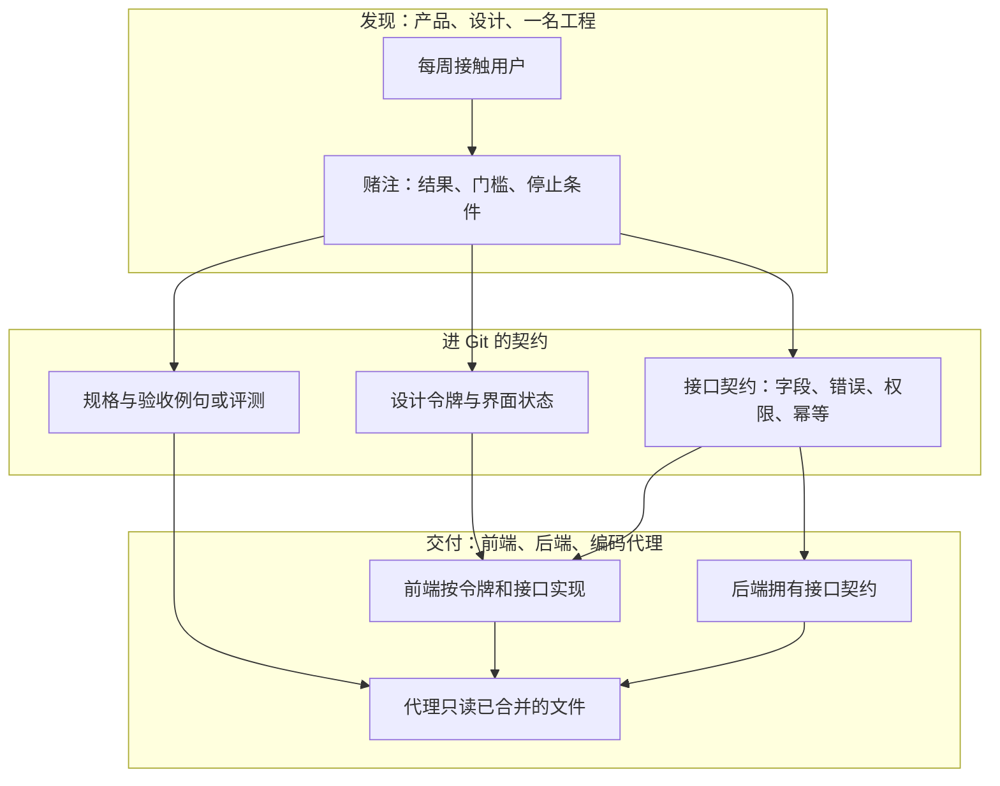

# AI 开发项目中产品、设计、前端、后端的合作方式：全景扫描

> 更新时间：2026-10-09
> 文档类型：全景扫描（landscape）
> 调研深度：深度分析（问题域已由需求明确；深度按立项调研处理）
> 数据来源：
> - 一级：Marty Cagan，[Dual-Track Agile](https://www.svpg.com/dual-track-agile/)（2012-09-17，文首更新说明已弃用该术语）、[Discovery vs Delivery](https://www.svpg.com/discovery-delivery/)、[Process vs. Model](https://www.svpg.com/process-vs-model/)、[Beyond Lean and Agile](https://www.svpg.com/beyond-lean-and-agile/)
> - 一级：Teresa Torres，[The Product Trio](https://www.producttalk.org/product-trio/)（2021-05-05）、[Who’s Responsible for What in the Product Trio?](https://www.producttalk.org/responsibility-in-a-product-trio/)、[Why Product Trios Should Interview Customers Together](https://www.producttalk.org/interview-customers-together/)（2020-03-11）
> - 一级：Ryan Singer / Basecamp，[Shape Up](https://basecamp.com/shapeup/0.3-chapter-01) 第 1、2、6、7、8 章（在线书，2026-10-09 检索）
> - 一级：GitHub [Spec Kit](https://github.com/github/spec-kit/) README 与 [changelog 1.1.2](https://github.com/github/spec-kit/blob/main/CHANGELOG.md)（仓库创建 2025-08-21，1.1.2 发布 2026-10-07，MIT）
> - 一级：W3C Design Tokens Community Group，[Design Tokens 2025.10](https://www.designtokens.org/TR/2025.10/)（2025-10-28，社区组最终报告，不是 W3C 标准轨道）
> - 三级：Daniel Huber，[Each Role Owns a Contract](https://www.agent-engineering.ch/articles/each-role-owns-a-contract/)（2026-04-29，作者标明为待验证假设）
> - 三级：Kevin Owens，[The AI-Native Product Operating Model](https://kevinowens.com/writing/ai-native-product-operating-model)（2026-07-21，2026-09-16 更新）
> - 四级辅助：设计令牌进 Git 与预览评审的实践文（Will Chan）、`DESIGN.md` 实践文（沐风）、单项目契约先行报道（创锋一号）、TRAE 社区技能契约表、AI 设计工具流程文（AI Stack Nav，2026-04-20）

本文回答：在编码可以由代理完成的项目里，产品、设计、前端、后端应该怎样合作，有哪些已经写下来的合作模型，以及一个中小团队现在可以选哪条组合。

---

## 目录

1. [问题域描述](#1-问题域描述)
2. [方案分类概览](#2-方案分类概览)
3. [各方案简介](#3-各方案简介)
4. [特性对比矩阵](#4-特性对比矩阵)
5. [成熟度与生态矩阵](#5-成熟度与生态矩阵)
6. [推荐路径](#6-推荐路径)
7. [九个覆盖维度](#7-九个覆盖维度)
8. [来源之间的分歧](#8-来源之间的分歧)
9. [知识盲区](#9-知识盲区)
10. [自检记录](#10-自检记录)

---

## 1. 问题域描述

要解决的问题：AI 把「写代码」变快之后，产品、设计、前端、后端怎样分工，才不会把时间耗在等待签核、规格漂移和前后端对不齐上。

关键需求特征：

| 特征 | 说明 |
|------|------|
| 四种角色都在 | 产品定结果，设计定用户看见的状态，后端定系统交换，前端把两者做成界面 |
| 实现者可以是人或代理 | 契约必须能被下一次会话读到，不能只活在聊天里 |
| 发现和交付同时存在 | 还在验证的想法，和已经决定要做完的切片，不能混成一份散文 |
| 模型行为不确定 | 「回答要准确」无法验收；需要例句、分数和停止条件 |
| 中小团队 | 正式流程要放在角色接缝上，小队内部仍靠短对话 |

**结论（信心：高）：** 合作失败的常见形态是顺序交接。产品写需求，设计交稿，后端做接口，前端最后接。Cagan 在 2012 年把这描述为 Scrum 内部的小型瀑布；Torres 在 2021 年仍把它写成这三种角色的历史默认。编码加速不会自动取消这条链，它只是让等待和返工变得更显眼。Huber（2026-04）把同一现象写成：实现变短，签核、变更和验收变成队列。两篇相差十四年，描述的是同一类等待。

---

## 2. 方案分类概览

| 分类 | 代表方案 | 核心思路 |
|------|----------|----------|
| 顺序交接 | PRD → 设计稿 → 接口文档 → 前端 | 每角色把产物交给下一角色，上一环定稿后下一环才开工 |
| 共同负责 | 产品三人组 + 持续发现与持续交付 | 产品、设计、工程对同一结果共同负责，发现和交付并行 |
| 固定胃口 | Shape Up | 先把问题和方案塑形到一个时间胃口里，下注后再给团队完整周期 |
| 规格驱动 | GitHub Spec Kit | 规格、计划、任务进仓库，编码代理按这些文件实现 |
| 接缝契约 | 设计令牌 + 接口契约 + 角色所有权 | 每个角色拥有一份可版本化、可检查的约定，两端按约定并行 |
| 评测驱动 | AI 原生产品运作 | 模型行为的规格是可执行评测和开工前写好的停止条件 |

这些分类可以叠用。顺序交接是对照基线。后五类解决的是不同层：谁一起做决定、一次做多久、代理读什么、前后端和设计以什么对齐、模型功能怎样算做完。

---

## 3. 各方案简介

### 3.1 顺序交接

产品先写需求，设计再出界面，后端按界面或文档做接口，前端最后实现。每一跳都依赖上一跳「定稿」。

Cagan 写明，这种流程让每个人继承前人的约束，工程和设计没有一起解价值、可用性、可行性和商业可行性。Torres 写明，三人组的反面就是产品写需求、设计画稿、工程写代码。AI 设计工具流程文（2026-04）仍描述一条改进过的顺序：产品用模型出初稿，设计师拉回设计系统，前端再用开发模式读标注。工具变了，交接顺序还在。

适用：需求、界面和接口都已经稳定，且团队只是在执行一份外部已签的合同。探索期和模型行为不适合这条路。

### 3.2 产品三人组与持续发现

Torres 定义的产品三人组是产品经理、设计师、软件工程师。三人共同对「值得要、商业上成立、做得到、用得了、符合伦理」负责。她明确反对把可行性只派给工程师、把可用性只派给设计师，因为最可用的方案可能做不到，拆开责任会让两人对立。发现活动包括一起访谈用户、一起画机会、一起选方案、一起做小测试。持续发现的最低标准是：做产品的团队每周接触用户，做小型研究，对准一个产品结果。

Cagan 后期不再使用「双轨敏捷」这个名字，因为名字让人去画流程，而不是守原则。他保留的模型是：发现和交付是并行的活动，不是两个阶段；由同一个跨职能团队负责；产品经理和设计师大部分时间在发现，工程师大部分时间在交付，但每个人都要参加两边。他把「发现团队」和「交付团队」拆开视为损害授权的反模式。

适用：还在判断该不该做、做成什么样的功能。前端和后端在这套文本里都算「工程」，不按端拆成两个发现小组。

### 3.3 Shape Up

Basecamp 的公开方法用六周构建周期。塑形和构建是两条并行轨道：周期内团队构建上一轮已经下注的工作，少数人在旁边塑形下一轮可能的项目。塑形要写出胃口（这件事值多少时间），而不是先估完再排期。定稿的载体是 pitch：问题、胃口、方案、兔子洞、明确不做的事。冷却期的下注桌决定下一周期做哪几份 pitch。Basecamp 的下注桌是 CEO、CTO、一名高级程序员和一名产品策略师。下注意味着这六周不被打断；默认不延期，超时就停，这是断路器。没有一份要持续梳理的总待办。

适用：希望 AI 变快之后范围不跟着膨胀的团队。文本没有规定前后端如何切分，也没有规定设计稿的文件格式。

### 3.4 规格驱动（Spec Kit）

GitHub Spec Kit 把规格放在代码前面。README 给出的主路径是：项目只写一次 constitution；每个功能走 specify（做什么、为什么）→ plan（技术计划）→ tasks → implement → converge。生产功能在计划前用 clarify 消除歧义，计划后用 checklist 和 analyze 做一致性检查。仓库 2025-08-21 创建，MIT。2026-10-09 两次页面抓取把星标显示为 132,988 和 140,506，且 Stars 与 Watchers 被标成同一数字，精确星标不稳定；可以确认的是十万级关注。changelog 中 1.1.2 的日期是 2026-10-07。README 称首次提交约一年后发布 1.0.0。

Spec Kit 定义的是代理如何读规格，没有把 specify 的章节分给产品、设计、前端或后端。社区的 Product Spec 扩展能从 `spec.md` 生成给干系人看的派生文档，那是扩展，不是核心命令。

适用：已经决定要做的功能，需要让编码代理跨会话遵守同一份规格。它不代替「该不该做」的发现。

### 3.5 接缝契约

这一类把对齐物从聊天和截图改成可差异的文件。

设计侧的公开格式是 Design Tokens Community Group 的 2025.10（2025-10-28）。它用 JSON 在工具之间交换颜色、间距、字体等设计决定，并带解析模块做主题。发布说明写明它不是 W3C 标准轨道上的推荐标准；Style Dictionary、Tokens Studio 有参考实现，Figma、Sketch、Penpot 等在实现或已支持。Will Chan 的实践文把令牌文件放进仓库，由它生成设计库和 CSS，漏生成则 CI 失败；设计师在部署预览上评审。

接口侧没有一份同等地位的「团队协作标准」，但 Huber 把后端拥有的契约写成模式、错误语义和性能限制，前端按这份契约构建。创锋一号的单项目报道（四级）记录了同一失败：契约没写到字段类型和可空，后端代理生成整数，前端代理理解成字符串；错误码没写进契约时，代理会自己编一套。这是一个案例，不能当成普遍速率。

Huber 的整套角色表是：项目负责人拥有信任链，业务分析拥有需求，前端设计拥有令牌和组件规格，前端拥有组件实现，后端拥有 API 契约，测试拥有可执行验收，业务方拥有按固定节奏的验收。他写明这是假设。自然单位是 3 到 6 人、端到端拥有一个产品面的小队；小队内部少用正式契约，契约放在与外部的接缝。起步方法是先给每次交接打时间戳，只把最慢的那一份产物搬进 Git。

适用：前后端、设计与代码、人或代理之间已经出现等待或对不齐。遗留系统和强合规系统里，Huber 认为负载在上下文和合规，编码加速抵消不了。

### 3.6 评测驱动

Owens（2026-07，9 月更新）讨论的是组织怎么对待不确定的软件，不是某一份接口。和本问题直接相关的判断有三条。第一，路线图假设投入就能交出功能；模型工作做不到这一点，每笔赌注要有质量门槛、开工前写好的停止条件、复查日期。第二，散文规格无法证伪，「回答要准确并在不确定时升级」是愿望；替代物是可执行评测，写评测是产品工作，因为它决定哪种错误可容忍、哪种难堪、哪种一票否决。第三，不要把模型能力放进一个单独的人工智能小组当服务台；产品三人组自己要能读失败模式和每千次请求的成本。

发现要同时看三样：评测质量、真实使用上每完成一次任务的成本、环里的人是否留下了模型输出。

适用：行为由模型、提示或检索决定的功能。普通表单和确定性接口仍用验收例句，不必上评测集。

---

## 4. 特性对比矩阵

| 特性 | 顺序交接 | 三人组与持续发现 | Shape Up | Spec Kit | 接缝契约 | 评测驱动 |
|------|----------|------------------|----------|----------|----------|----------|
| 产品做什么 | 先写完需求再交出 | 与设计和工程共同对结果负责，每周接触用户 | 参与塑形和 pitch，或坐在下注桌 | 提供 specify 的「做什么、为什么」 | 拥有需求或验收；模型功能则拥有评测 | 拥有质量门槛、停止条件、评测例句 |
| 设计做什么 | 需求定稿后出稿 | 与产品、工程一起访谈、出方案、做可用性 | pitch 里用粗笔草图定边界，细节留给构建期 | 核心流程未规定 | 拥有令牌、状态和可对照夹具 | 把不确定、拒绝、低置信画成状态 |
| 前端做什么 | 等设计和接口 | 作为工程参加发现，大部分时间在交付 | 在已下注的周期内自己拆细节 | 按 tasks 实现界面 | 按设计契约和接口契约实现 | 实现评测覆盖到的界面状态 |
| 后端做什么 | 按文档做接口 | 同上，文本不按端拆开 | 同上 | 在 plan 里写技术做法，再实现 | 拥有接口契约；实现者可以是任何人 | 提供工具定义、成本和使用事实 |
| 能否并行 | 上一环定稿才下一环 | 发现与交付并行 | 塑形与构建并行 | 单功能管道是顺序的；多个功能可以并行 | 稳定子集合并后两端可并行 | 评测可在实现之前写 |
| 代理读什么 | 聊天、截图、过期文档 | 原型和共同结论，默认可不落文件 | pitch | constitution、spec、plan、tasks | 令牌文件、接口契约、验收 | 评测集和停止条件 |
| 完成的含义 | 各角色把自己的稿交出去 | 业务结果，不只是功能上线 | 六周内交出 pitch 里的那一块，否则停 | converge 报告已收敛 | 实现与契约一致，检查失败就不能合并 | 达到分数门槛，否则按停止条件退役 |
| 主要代价 | 等待和返工 | 三人要一起花时间在用户和决策上 | 要有人会塑形；未下注的工作被丢掉 | 规格质量决定生成质量；角色所有权要自己补 | 写契约比写代码难；业务方不天然按契约思考 | 要有真实例句和成本数据，散文团队会不适应 |

---

## 5. 成熟度与生态矩阵

成熟度等级沿用本模板：**实验性** / **早期采用** / **主流稳定** / **行业标准**。合作模型多数不是软件仓库，「Stars」列只在有仓库时填写。

| 方案 | 公开文本时间 | 仓库星标 | 最近可核对版本 | 主要采用方 | 成熟度 |
|------|----------------|----------|----------------|------------|--------|
| 顺序交接 | Cagan 2012 已将其标为内部瀑布；Torres 2021 仍视为历史默认 | 不适用 | 不适用 | 大量功能团队和外包交接 | 行业里仍常见的旧默认 |
| 三人组与持续发现 | Torres 2020–2021；Cagan 持续更新 SVPG 文章 | 不适用 | 不适用 | SVPG 与 Product Talk 所训练的产品团队 | 主流稳定（原则稳定；「双轨」这个名字已被作者弃用） |
| Shape Up | 在线书仍由 Basecamp 托管，2026-10 可全文阅读 | 不适用 | 不适用 | Basecamp 自身；外部采用缺少对照统计 | 早期采用（文本稳定，跨公司证据不足） |
| Spec Kit | 仓库创建 2025-08-21 | 2026-10-09 抓取为十万级，两次数字不一致 | 1.1.2（2026-10-07） | GitHub 开源项目，多代理可用 | 早期采用（工具热度高，跨角色交付效果无官方对照实验） |
| 设计令牌格式 | 2025-10-28 第一份稳定社区报告 | 不适用 | 2025.10 | 设计系统工具（Style Dictionary、Tokens Studio、Figma 等在实现） | 早期采用（格式稳定，但是社区组报告，不是 W3C 标准） |
| 角色所有权模型 | Huber 2026-04-29 | 不适用 | 不适用 | 作者自述尚未被团队实证 | 实验性 |
| 评测驱动 | Owens 2026-07-21 / 2026-09-16 | 不适用 | 不适用 | 作者的顾问观察，无公开采用名录 | 早期采用（判断与 Cagan 的「结果重于功能」同向，评测做法本身证据仍是单文） |

---

## 6. 推荐路径

推荐是组合，不是六选一。

- 还在判断该不该做 → 用三人组。产品、设计、至少一名工程一起看原型和用户，不把发现交给另一个小组。前端或后端谁更贴近风险，谁参加这一轮发现。
- 已经决定要做，但范围会随编码变快而膨胀 → 用 Shape Up 的胃口和断路器。先写值得花的时间、兔子洞和明确不做的事，再让代理实现。
- 交给编码代理的功能 → 用 Spec Kit 的 specify → plan → tasks → implement → converge。产品对 specify 的结果和验收负责，工程对 plan 负责，设计把状态和令牌写进规格或单独文件，而不是只留在画板。
- 前后端或设计与代码已经对不齐 → 先量交接等待，把最慢的那一份搬进 Git。设计侧优先用 2025.10 设计令牌；接口侧把字段类型、可空和错误码写进契约。前端同时消费这两份，不从聊天里发明第三份。
- 行为由模型决定 → 产品写评测和停止条件。设计补上部分结果、拒绝、低置信和人工接管。后端记录工具定义和单次任务成本。三项里有一项过不了门槛，就按停止条件停，而不是改交付日期。

**结论（信心：中）：** 对一个同时有产品、设计、前端、后端的 AI 项目，默认组合是「三人组做发现，Shape Up 的胃口限制范围，Spec Kit 加令牌和接口契约做交付，模型功能再加评测」。信心是中，因为组合本身没有一份公开对照实验；每一层都有独立来源，叠在一起是本扫描的综合判断。

不要单独成立一个人工智能小组来替产品小队写规格或读失败模式。Owens 把这写成服务台队列。Cagan 把发现和交付拆组写成同一类反模式。

---

## 7. 九个覆盖维度

深度分析要求覆盖技术调研的九个维度。合作模型不是运行时软件，下表是这些维度在本问题域里的对应事实。

| 维度 | 在本问题里指什么 | 已核对的事实 |
|------|------------------|--------------|
| 架构与原理 | 信息怎么流动 | 三人组是共同决策；Shape Up 是塑形轨道与构建轨道并行；Spec Kit 是单功能的规格管道；契约模型是接缝上的文件。见第 8 节，它们并不互相替代 |
| 性能与基准 | 周期和吞吐 | 没有找到在同一 AI 编码条件下对比这些模型的公开基准。Shape Up 规定六周加断路器，这是设计出来的周期，不是实测加速比。Huber 认为实现变短后队列移到签核，未给出各队列的天数分布 |
| 功能特性 | 角色与制品 | 见第 4 节矩阵 |
| 安全性 | 谁有权做不可逆决定 | 三人组共同承担伦理与可行性。Shape Up 的下注桌才有权承诺下一周期。评测驱动要求停止条件在开工前写好。接口契约把权限和错误语义写进文件，避免代理自编 |
| 部署与运维 | 节奏 | Torres：每周用户接触。Shape Up：六周构建、冷却期下注。Spec Kit：每个功能一轮 specify 到 converge。Huber：先给交接打时间戳 |
| 社区与生态 | 出处与采用 | 见第 5 节。Spec Kit 热度高；合作模型本身大多没有星标可引用 |
| 成本 | 协调成本 | 顺序交接的成本在等待。三人组的成本在共同访谈和决策时间。契约的成本在写和批准文件；Huber 写明小团队内部正式契约过多会得不偿失 |
| 学习曲线 | 引入难度 | 三人组要改「我只对可用性负责」的习惯。Shape Up 依赖塑形能力。Spec Kit 要会写规格并跑命令。令牌文件要设计工具和代码从同一 JSON 生成。评测要求产品会判断错误等级 |
| 适用场景 | 何时选用 | 见第 6 节 |

---

## 8. 来源之间的分歧

**分歧 1：合作靠坐在一起，还是靠交接文件。**

Cagan 和 Torres 写的是共同负责，并明确反对「每角色把产物交给下一角色」。Huber、设计令牌规范和 Spec Kit 写的是可检查的文件，并认为没有文件就无法并行、无法让代理跨会话遵守。

判断（信心：中）：两层同时成立。发现阶段由人一起做决定，决定写入文件；交付阶段人和代理只消费已合并的文件。Huber 自己也写了，3 到 6 人的小队内部少用正式契约，契约放在接缝。把三人组理解成「不许写文件」，或把契约理解成「恢复瀑布」，都超出了原文。

**分歧 2：「两条轨道」不是同一件事。**

Cagan 已弃用 Dual-Track 这个名字，担心它被画成流程。他要的是发现与交付并行、同一团队。Shape Up 也有两条轨道，但是塑形对构建保密，直到下注。Spec Kit 在单个功能上是 specify 然后 plan 然后实现，看起来像阶段。

判断（信心：高）：用词相同，结构不同。本扫描把「持续发现」用于该不该做，把「塑形 / 下注」用于范围和周期，把 Spec Kit 用于已经下注的那一个切片。不把三者都叫做双轨。

**分歧 3：星标能否说明 Spec Kit 已经是团队协作标准。**

2026-10-09 对同一仓库的两次抓取给出 132,988 和 140,506，且 Stars 与 Watchers 相同。热度是真实的，精确值和「因此前后端会合作得更好」之间没有证据。

判断（信心：高）：星标只说明工具被大量关注。跨角色交付效果仍是知识盲区。

---

## 9. 知识盲区

- 没有公开实验比较「三人组」「Shape Up」「Spec Kit」「角色契约」在使用编码代理之后的周期时间、返工率或缺陷率。
- Cagan、Torres、Shape Up 都把工程当成一个角色。前端与后端分开拥有契约，主要来自 Huber 的假设和实践文，不是上述一级文本的原话。
- 本次没有检索到阿里、腾讯、字节等中文产品组织的现行内部手册。中文材料停留在社区文章和单项目报道。
- Spec Kit 核心没有规定产品、设计、前端、后端各写哪一节。这个所有权是本扫描的建议，不是官方命令。
- Design Tokens 2025.10 是社区组最终报告。它自己写明不是 W3C 标准，也不是标准轨道文档。
- OpenAPI 作为 HTTP 接口的通用描述被实践文和 Huber 同时提到。本次没有重读 OpenAPI 规范正文，因此不引用具体版本号。
- Owens 与 Huber 都是单作者文章。其中与 Cagan、Torres、Shape Up、Spec Kit、设计令牌规范一致的部分，信心高于文章里独有的组织建议。

---

## 10. 自检记录

| 清单 | 结果 | 说明 |
|------|------|------|
| 完整性 | 通过 | 四种角色的合作、可选模型、推荐组合都已回答；九个维度有对应表；优劣势在第 4 节「主要代价」；盲区在第 9 节 |
| 准确性 | 通过 | 关键结论均有信心标注。星标矛盾已写入第 8 节，且未当作决策依据。Huber 的独有建议保持为实验性，未升格成已证实模式。低信心的单项目天数和字段事故只作为案例，不作为关键结论 |
| 可操作性 | 通过 | 第 6 节按场景给出组合。风险写在成熟度、代价和 Huber 的遗留系统限制里。顺序交接保留为对照，而不是被悄悄删掉 |

本次修正：初稿若把「双轨敏捷」写成 Cagan 的现行推荐名，会与他文首更新冲突，已改为「持续发现与持续交付」，并单列 Shape Up 与 Spec Kit 的不同轨道。初稿若引用单一星标数字，会在两次抓取不一致时失败，已改为十万级并记录分歧。
