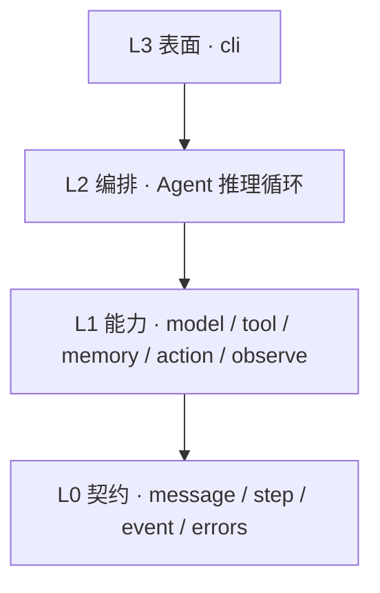

# littleagent 设计概览

> 更新时间：2026-09-09
> 文档类型：概览（explanation）
> 项目位置：`projects/littleagent`
> 完整文档：`projects/littleagent/docs/architecture.md`（架构）、`projects/littleagent/docs/roadmap.md`（路线）、`projects/littleagent/AGENTS.md`（约束）

本文是概览，只讲定位、关键决策与阶段。细节一律以项目内文档为准。

## 是什么

一个进程内、async-first、协议驱动的极简 Agent 框架。模型产出动作，框架负责解析、执行、记忆、再喂回模型。

它是 **库**，不是运行时：一次 `await agent.arun(task)` 就是一次函数调用，没有常驻进程、没有多租户、没有审批流、没有渠道接入。

## 四个奠基决策

- **async 为核心**。流式输出、并行工具调用、取消传播本质都是异步的；同步核心只能靠线程池绕，且取消无法贯穿。核心全 async，同步入口是薄包装，`asyncio.run` 全仓库只出现一次。
- **动作范式注入，不继承**。「模型如何表达动作」做成 Agent 子类会让推理循环在每个子类里重复。这里只有一个 `Agent` 循环，范式是实现 `ActionStrategy` 协议的对象。第一版只做 Tool Calling，代码动作范式后期作为新文件插入，不改循环。
- **协议优先于继承**。模型、工具、记忆、动作范式全是 `Protocol`。收益是每个能力可单独替换、单独测试。
- **极简是硬指标，不是形容词**。核心运行时依赖只有 `httpx` + `pydantic`；单文件 ≤300 行；首个可用版本生产代码 ≤1500 行；新增文件必须立刻抵租。

## 分层

四层，依赖严格单向向下，由 `import-linter` 机检而非人工守护。



一条容易被忽略但很关键的附加约束：**L1 内部各模块互不 import**。`model/` 不认识 `tool/`，两者只通过 L0 的数据形状对话。否则「换一个模型后端」会牵动工具系统。

## 关键契约

`ActionStrategy` 是全框架最重要的缝：

```python
type ActionOutcome = Continue | Finish | Failed

class ActionStrategy(Protocol):
    def build_request(self, messages: Sequence[ChatMessage]) -> ModelRequest: ...
    async def apply(self, output: ChatMessage) -> ActionOutcome: ...
```

`ActionOutcome` 是封闭联合，循环用穷尽匹配处理，新增分支时类型检查强制所有调用点跟上。结束循环只能通过 `Finish`——不用异常做控制流，避免用户代码的 `except` 意外吞掉或拦住结束信号。

## 不变量（设计的真正内容）

约束比功能清单更能决定项目最终形态。核心几条：

- **每个动作恰好一条记录**。成功、失败、取消三条路径都产生且仅产生一个 `ActionStep`。「什么都没发生也没有记录」是最难排查的缺陷类型，比崩溃更糟。
- **默认值不吞合法值**。禁 `x or default`，它把 `0`、`""`、空容器误判为「未传」。用 `None` 哨兵；`max_steps=0` 报错而非静默变默认值。
- **事实记录在其发生之处**。任务附件属于 `TaskStep`，工具产物属于产生它的那步；禁重复注入每一步导致上下文线性膨胀。
- **取消贯穿全链路**。走 asyncio 原生取消；「在下一步开头检查布尔标志」在长工具调用期间根本停不下来，不算实现了取消。
- **超时即取消，不承诺硬杀**。外部进程可能仍在运行，语义必须诚实。
- **序列化从字段派生**，配 round-trip 测试。手写导出字典必然随字段增加而漏项。
- **代码执行不是安全边界**。若将来引入代码执行，本地执行器永不宣称隔离；隔离靠进程或容器边界。

## Python 如何管理

完整规则见 `projects/littleagent/docs/python-environment.md`，这里只列决策。

**职责单一化**是整套规则的出发点：conda 只提供解释器与环境隔离，`pyproject.toml` 是依赖的唯一声明来源，`environment.yml` 只记解释器与 channel，pip 只负责按声明安装。conda 和 pip 都能装 Python 包，两边都装就会有两份元数据互相覆盖，故障现象是「明明装了却 import 不到」；把包的所有权完全交给 pip + pyproject 就没有这个问题。也因此不叠第三层项目管理器（uv / poetry / pdm）。

```bash
conda create -n littleagent -c conda-forge --override-channels python=3.14.7 pip
conda activate littleagent
pip install -e . --group dev
```

pip 与 pyproject 的配合有个容易被忽略的点：`pyproject.toml` 里 `[build-system]` / `[project]` / `[dependency-groups]` 是 pip 读的，`[tool.ruff]` / `[tool.mypy]` / `[tool.pytest.ini_options]` / `[tool.importlinter]` pip 完全不读、由各工具自己读。两类内容读者不同，这才让一个文件能同时当依赖声明和全工具配置中心。开发依赖放 PEP 735 的 `[dependency-groups]` 而不是 extras，因为 extras 会进发布元数据，会把 ruff、mypy 泄漏给使用者。可编辑安装也不只是图方便——分层检查要求 `littleagent` 是可导入的已安装包。

**Python 3.14.7**——当前最新稳定版，3.15 只有 rc，不拿预发布版做地基。系统 Python 3.9.6 与 conda base 3.9.12 都不碰。版本策略刻意分两层：`pyproject.toml` 写 `requires-python = ">=3.14"` 作为对使用者的宽松承诺，开发环境则钉到精确的 3.14.7，这样 `make check` 的绿色才有确定含义。

**依赖约束不钉死**：`httpx>=0.28,<1`、`pydantic>=2.13,<3`——下界取最低可用版本，上界按主版本封顶。littleagent 是库，会被装进别人的环境，钉死精确版本必然引发冲突。

**现阶段不生成锁文件**，这是有前提的决定：共 2 个运行时依赖 + 5 个 dev 工具，维护成本高于收益。触发条件写进了文档——接入 CI、出现第二台机器、或某次依赖漂移让 `make check` 意外变红，就引入 `pip-compile` 只锁开发环境。

`make check` = `ruff format --check` + `ruff check` + `mypy --strict` + `lint-imports` + `pytest`，人和 AI 用同一条命令。

两处实测结论也记进了文档：选最新 Python 的主要风险是 wheel 覆盖，已逐个核实（`grimp` 与 `mypy` 有 `cp314` wheel，其余声明支持 3.14，`httpx` 是纯 Python 包），所以分层检查能用现成工具；本机 conda 4.12.0 的经典 solver 很慢（一次 `conda search` 耗时 91 秒），因此固定加 `-c conda-forge --override-channels` 缩小求解范围，仍卡就装 `conda-libmamba-solver`。

## 阶段

- **P0 环境与护栏**：conda 环境、pyproject、五件套检查、`Makefile`、`AGENTS.md`。出口：`make check` 全绿，且一条故意的反向 import 能被抓到。
- **P1 最小闭环**：契约四件套、模型后端、工具系统、记忆投影、Tool Calling 范式、推理循环。出口：用脚本化 `FakeModel`（无需真 key）跑通多步闭环，并覆盖步数耗尽、参数不合法、工具报错、模型报错四条失败路径。
- **P2 可观测与可取消**：流式事件、计量收口、取消传播。
- **P3 表面**：CLI、同步入口、真实模型 example。
- **P4 补齐基础能力**：规划步、多层 Agent、外部工具协议、代码动作范式、持久化记忆。除规划步外均不触碰 `agent.py`。

P0 + P1 构成一个自洽可用的框架，是建议的首个落地范围。
