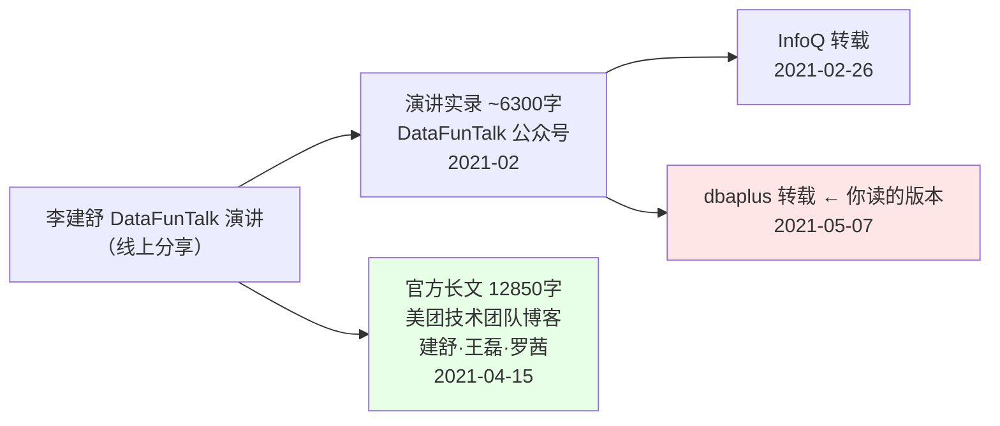
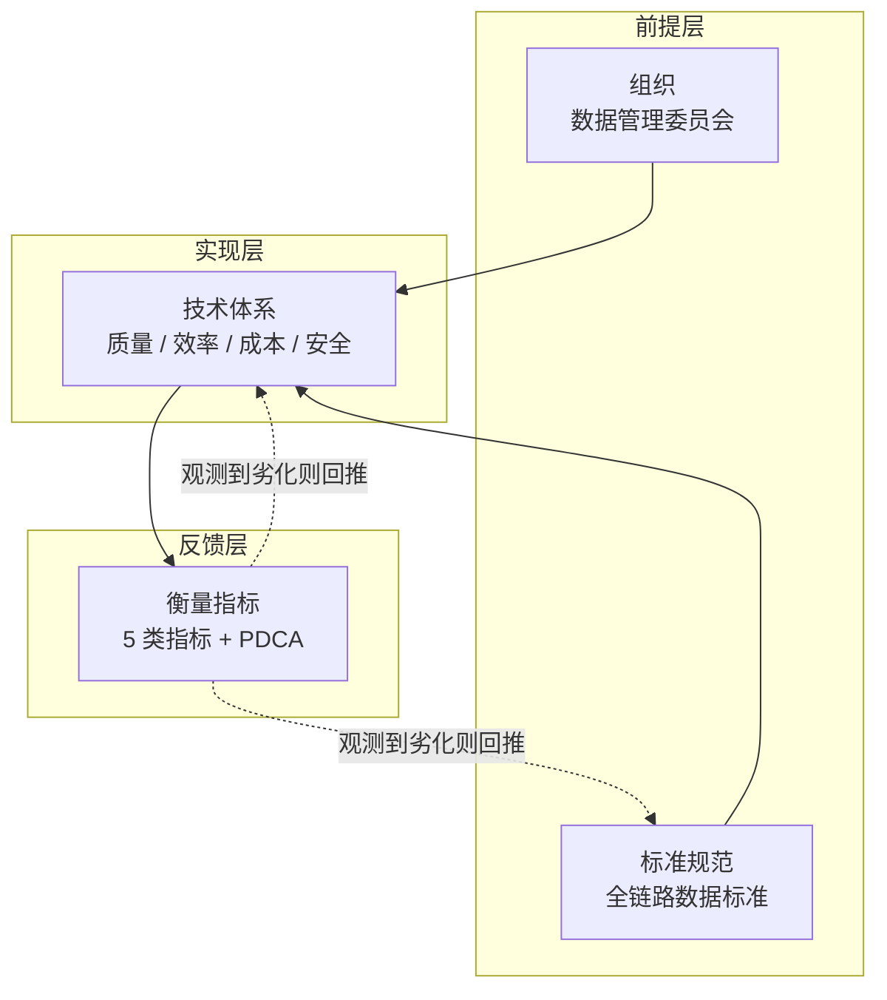
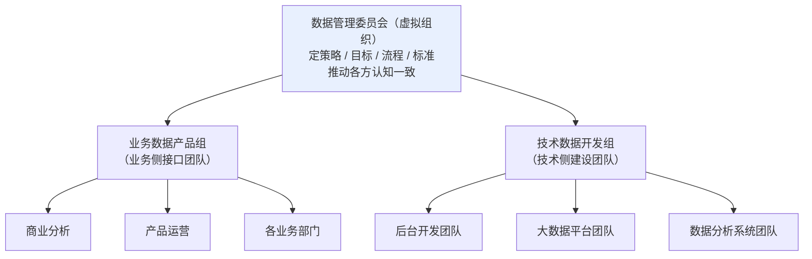
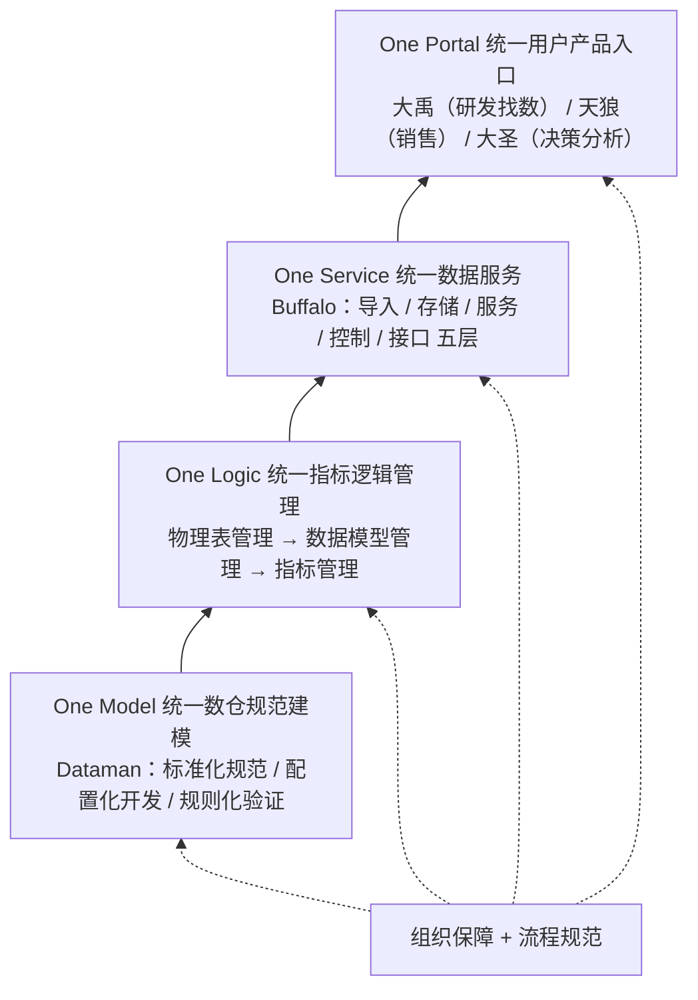
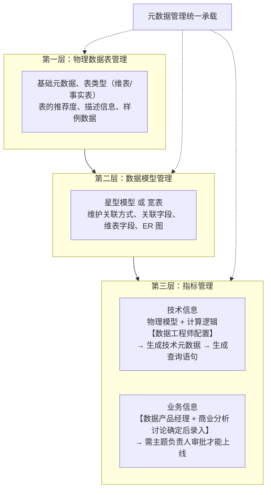
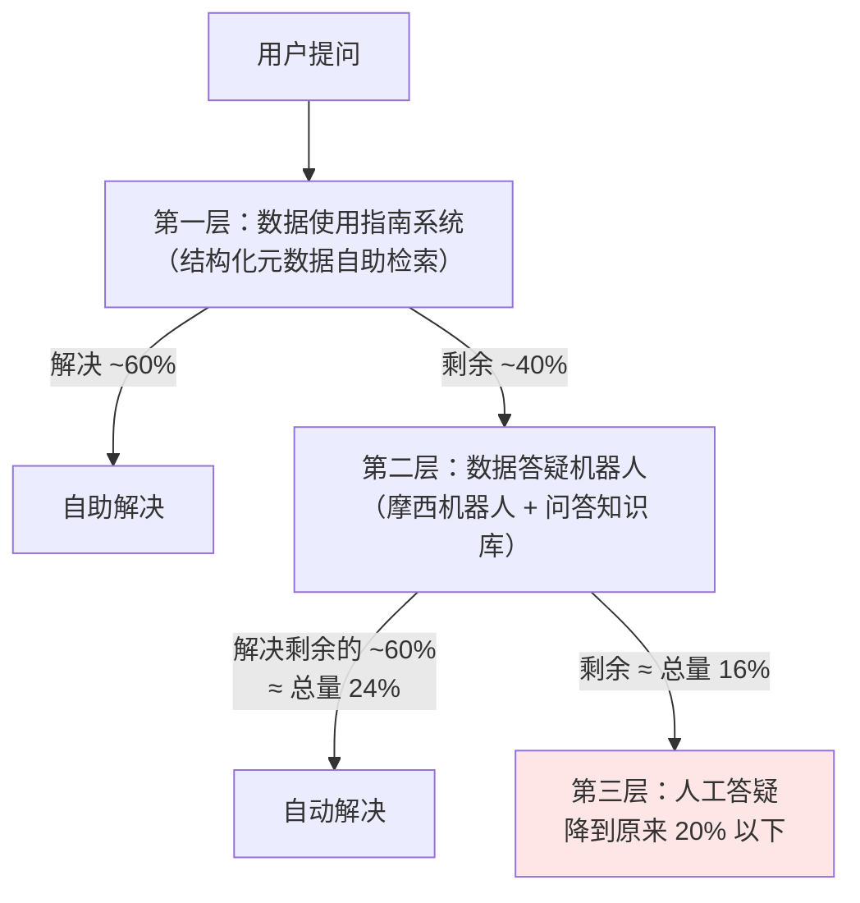
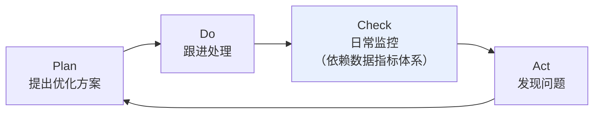
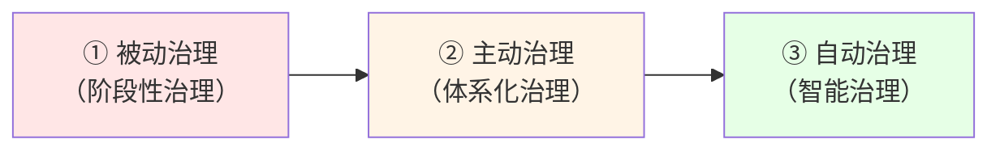

# 美团酒旅数据治理实践 深度调研

> 更新时间：2026-08-27
> 调研模式：深度分析（tech-research skill / 模板 B 深度调研）
> 调研对象：dbaplus《美团：掉进数据治理无止境的坑，我是怎么爬出来的？》（2021-05-07）
>
> **数据来源**（按来源级别排序）：
>
> | # | 来源 | 类型 | 级别 | 日期 | 字数 |
> |---|------|------|------|------|------|
> | S1 | [美团技术团队《美团酒旅数据治理实践》](https://tech.meituan.com/2021/04/15/data-governance-in-meituan-jiulv.html) 建舒/王磊/罗茜 | 官方长文 | 一级 | 2021-04-15 | 12850 |
> | S2 | [dbaplus《掉进数据治理无止境的坑》](https://dbaplus.cn/news-73-3799-1.html) 李建舒 | 演讲实录转载 | 三级 | 2021-05-07 | ~6300 |
> | S3 | [InfoQ《美团酒旅数据治理实践》](https://www.infoq.cn/article/lywkkawrij1mbvvyoirs) | 同源实录转载 | 三级 | 2021-02-26 | 6299 |
> | S4 | [美团技术团队《美团配送数据治理实践》](https://tech.meituan.com/2020/03/12/delivery-data-governance.html) 王鹏/家豪 | 官方长文（横向交叉验证） | 一级 | 2020-03-12 | 12429 |
> | S5 | [美团技术团队《数据治理一体化实践之体系化建模》](https://tech.meituan.com/2022/02/24/Systematic-Modeling-Of-Data-Development-And-Governance-Integration-Practice.html) 王鹏/新兴/晓飞 | 官方长文（后续演进验证） | 一级 | 2022-02-24 | — |
>
> **时效性标注**：本文所解读的实践发生于 2019–2021 年。按 tech-research skill 的时效性阈值，数据治理方法论属"中速演进"（阈值 24 个月），本文全部事实性数据均已**超过阈值 3 年以上，标注为"可能过时"**。本报告按用户要求只做原文深度解读，不做 2026 年业界对标，时效性影响仅在第 11 章做边界提示。

---

## 目录

1. [核心结论速览](#1-核心结论速览)
2. [关键前置发现：你读到的是删节版](#2-关键前置发现你读到的是删节版)
3. [背景：为什么美团酒旅必须治理](#3-背景为什么美团酒旅必须治理)
4. [治理总体策略：四要素框架](#4-治理总体策略四要素框架)
5. [标准化与组织保障：虚拟委员会的取舍](#5-标准化与组织保障虚拟委员会的取舍)
6. [技术体系之一：数据质量"四统一"](#6-技术体系之一数据质量四统一)
7. [技术体系之二：数据运营效率](#7-技术体系之二数据运营效率)
8. [技术体系之三：数据成本](#8-技术体系之三数据成本)
9. [技术体系之四：数据安全](#9-技术体系之四数据安全)
10. [衡量指标体系与 PDCA 闭环](#10-衡量指标体系与-pdca-闭环)
11. [治理效果：量化收益的正确读法](#11-治理效果量化收益的正确读法)
12. [三阶段成熟度模型](#12-三阶段成熟度模型)
13. [批判性解读：矛盾点、张力与盲区](#13-批判性解读矛盾点张力与盲区)
14. [可迁移的核心思想](#14-可迁移的核心思想)
15. [知识盲区与待验证清单](#15-知识盲区与待验证清单)
16. [关键结论信心评级汇总](#16-关键结论信心评级汇总)
17. [质量自检记录](#17-质量自检记录)

---

## 1. 核心结论速览

这篇文章的价值不在于提出了新方法论，而在于它是一份**罕见地把"组织设计取舍"和"量化收益"都写出来的中大厂治理实录**。

| # | 结论 | 信心 |
|---|------|------|
| 1 | 文章的真正骨架是一个反复复用的元模式：**事前定规范 → 事中用工具强制约束 → 事后用规则校验**。这个模式在数仓建模、指标管理、数据安全三处被完整复用了三遍 | 高 |
| 2 | 技术主线是**"四统一"（One Model / One Logic / One Service / One Portal）**，从数仓建模层层向上收口到用户入口，目标单一：消灭数据不一致 | 高 |
| 3 | 治理的落地路径被作者明确总结为 **"标准化 → 规范化 → 工具化"**，核心信念是"不靠人力和组织推动，靠系统代替人工" | 高 |
| 4 | 组织上刻意**没有**建专职治理团队，而是用"数据产品组 + 数据开发组"双核心的**虚拟委员会**。作者明确说明原因是专职组织"成本太高、阻力太大" | 高 |
| 5 | 量化收益中**最容易被误读的是"成本降低 40%"—— 这是"单均成本"，不是绝对成本**。同期业务高速增长，绝对成本很可能仍在上升 | 高 |
| 6 | 作者诚实承认治理停在"主动治理"和"自动治理"之间，**"自动治理"在本文中仍是愿景而非已交付能力** | 高 |
| 7 | 交叉验证发现一个反讽事实：文章开篇第一大痛点是"各业务部门数据标准不一致"，但**美团配送与酒旅两个 BU 的指标分类法和数仓分层命名本身就不一致**，且配送自己在 2 年内改了两次 | 高 |
| 8 | 文章存在若干内部张力，最突出的是**"数据运营只占工程师 5%~10% 时间"与"答疑时间减少 60%"并列**，意味着该项收益折算成工时仅为总工时的 3%~6% | 中 |

---

## 2. 关键前置发现：你读到的是删节版

这是开始解读前必须先讲清的一件事。

同一份内容存在**两个差异显著的版本**，你给的 dbaplus 链接是较短的那个：



我逐段比对了两版，差异不是"详略"而是**信息种类的缺失**：

### 2.1 官方长文有、实录版完全没有的内容

| 缺失内容 | 具体信息 |
|----------|----------|
| **"四统一"框架命名** | One Model / One Logic / One Service / One Portal —— 实录版只描述了这四件事，但没给出这个统领性命名，导致读者看不出这是一个有意设计的分层收口体系 |
| **内部系统真名** | `Dataman`（数仓规范化开发系统）、`Buffalo`（统一数据 API 服务平台）、`大禹`/`天狼`/`大圣`（三大产品门户）、`摩西机器人`（美团 AI 平台，答疑机器人底座）、`XT`（任务模板） |
| **4 条治理目标** | 提效、管安全、控成本、建标准提质量 —— 实录版直接跳到方案，没有目标陈述 |
| **全部量化收益** | 答疑时间↓>60%、单均成本↓~40%、任务增长率↓~60% —— **实录版一个数字都没有** |
| **生命周期具体数值** | 明细层保留全部历史、主题层 5 年、应用层 1~3 年 |
| **指标三分类的定义** | 原子指标 / 计算指标 / 复合指标 |
| **智能解析模块** | 一个指标绑定多个物理模型时，系统按数据量、存储性能、查询次数自动选最优模型 |
| **组织设计的理由** | "专门建立职能全面的治理组织成本太高、阻力太大"这一关键取舍说明 |
| **接口开发效率** | 定制化 API 从"几天"降到"1 小时内配置化完成" |
| **计算资源错峰的具体做法** | 批处理集中在凌晨 2 点~上午 10 点，把算法挖掘/用户标签/回刷等不敏感任务挪到 10 点后 |

### 2.2 实录版有、官方长文反而没有的内容

这是个意外发现，两版并非包含关系：

| 实录版独有 | 说明 |
|-----------|------|
| **数据安全五原则的完整文字** | 密文处置、最晚解密、最小范围提取、最小授权、全程审计。官方长文写到"按照三层系统控制加五个使用原则实现如下："后面接的是**图片**，纯文本版丢失了这五条 |
| **成本结构比例** | 70% 计算 / 20% 存储 / 10% 日志采集。官方长文只给"计算+存储超过 90%" |
| **成本治理三类清单的细项** | 计算类 4 项、存储类 4 项、日志类 3 项的并列清单 |
| **统一数据服务的五层架构** | 导入层 / 存储层 / 服务层 / 控制层 / 接口层，以及各层的存储选型逻辑（KV / MySQL / OLAP） |
| **答疑分流的具体数字** | 指南解 60%，机器人解剩余 40% 中的 60%，人工降到原来 20% 以下 |
| **B 端拉取 / C 端推送** | B 端按需调用（每天几万次额度）、C 端每天推送一次 |

> **实践建议（信心：高）**：这两版**必须合读**。只读 dbaplus 版会完全错过"四统一"的体系感和全部量化结果；只读官方版会错过安全五原则和成本结构比例。本报告以官方长文（S1）为骨架，用实录版（S2/S3）补全被图片吞掉的细节。

---

## 3. 背景：为什么美团酒旅必须治理

### 3.1 作者对"数据治理"的定位

作者给的定义（S1）比多数文章更克制，值得原样保留：

> 在数据产生、采集、加工、存储、应用到销毁的全过程中，每个环节都可能会引入各种质量、效率或安全相关的问题……**数据治理就是要不断消除引入的这些问题**。

关键在于它把治理定义为一个**持续对抗熵增的过程**，而非一次性项目。这与配送团队（S4）的表述互为印证：

> 我们不该把数据治理看作是一个阶段性的项目，它应该是一个贯彻数据建设各阶段的长期工程。

这解释了原文标题里"无止境的坑"的由来——**治理没有终态**。（信心：高，两个独立 BU 的官方文章表述一致）

### 3.2 通用五类治理问题

作者先给了一个行业通用的问题分类，再给酒旅的具体问题。两者是"总—分"关系，很多解读会把两者混为一谈：

| 类别 | 内容 | 作者的重要性判断 |
|------|------|-----------------|
| **质量** | 及时性、准确性、一致性、规范性、指标逻辑一致性 | 明确标注"这是最重要的问题" |
| **成本** | 数据膨胀快，大数据基础设施成本投入占比高且持续攀升 | — |
| **安全** | 用户数据泄露"甚至能左右整个业务的生死" | 措辞最重 |
| **标准化** | 多业务部门标准不一致，打通和整合时出问题 | — |
| **效率** | 开发与管理效率低，"很多时候是靠盲目地堆人力在做" | — |

### 3.3 酒旅业务的具体压力

时间线（S1 与 S2 一致）：

| 时间 | 事件 |
|------|------|
| **2014** | 酒旅成为独立业务部门 |
| **2017–2018** | 生产任务数以每年 **>1 倍**速度增长；数据量以每年 **>2 倍**速度增长 |
| **2018** | 已成为国内重要在线预订平台；数据产品入口 **>10 个**；Buffalo 统一数据服务平台**启动建设** |
| **2019 年初** | 五大问题集中暴露 |
| **2019** | 主动启动**体系化**数据治理 |
| **2021** | 自评处于"主动治理"与"自动治理"之间 |

> 增长率的含义值得停一下：任务数每年翻倍、数据量每年翻两倍，意味着**两年后任务量约 4 倍、数据量约 9 倍**。这是"如果不做治理……复杂性及成本负担都会变得非常之高"这句判断的量化基础。

2019 年初面临的五个具体问题（S1 原始顺序）：

| # | 问题 | 具体表现 |
|---|------|----------|
| 1 | **开发标准规范缺失** | "烟囱式"开发；工程师工作思路差异大；数仓内重复数据多；出问题排查难、耗时长 |
| 2 | **数据安全缺乏控制** | 业务线间共用数据多，各业务线**没有统一的数据权限管控标准** |
| 3 | **数据运营效率低下** | 工程师大量时间一对一答疑；知识无法沉淀；用户易用性没提升 |
| 4 | **数据成本增长过快** | 某些业务线大数据存储与计算的机器费用占比**已超过 35%** |
| 5 | **数据质量问题严重** | ① 数据冗余严重：新上线任务多、下线任务少、生命周期控制少；② 应用层"烟囱式"建设，指标口径无统一管理，**"同名不同义、同义不同名"现象频发** |

> **注意一个未说明的分母（信心：低，需标注）**："机器费用占比超过 35%"—— 占什么的 35%？S1 和 S2 均未说明分母是业务营收、技术总成本还是部门预算。这个数字因此**无法用于跨公司对标**，只能理解为"业务方感到痛"的定性信号。

### 3.4 四条治理目标

这是官方长文独有、实录版缺失的部分，但恰恰是理解后续所有技术选择的钥匙：

| # | 目标 | 对应后文哪一节 |
|---|------|---------------|
| 1 | 提高开发和运维效率，减少数据运营时间投入，提高自动化和系统化程度 | 第 7 章 运营效率 |
| 2 | 管理数据使用安全，建立审批流程和使用规范 | 第 9 章 数据安全 |
| 3 | 控制大数据成本，合理控制生命周期，减少冗余，及时归档清理冷数据 | 第 8 章 数据成本 |
| 4 | 建立全链路标准规范，系统化管理指标口径，保障数据一致性 | 第 6 章 数据质量 |

目标与技术章节**一一对应**，说明这篇文章的结构是目标驱动的，不是罗列工具。

---

## 4. 治理总体策略：四要素框架

作者把治理内容划分为四大部分，并明确了它们之间的**因果次序**（S1）：



原文的路径陈述是：

> 以标准化的规范和组织保障为**前提**，通过做技术体系整体**保证**数据治理策略的实现。同时，搭建数据治理的**衡量体系**，随时观测和监控数据治理的效果。

三点值得注意：

1. **组织和标准是前提，不是配套**。作者把它们放在技术之前，意味着先有共识与规则，才谈工具。
2. **技术是"保证"而非"实现"手段**。技术的作用是让已达成共识的标准**不可绕过**，而不是替代共识。
3. **衡量体系是独立的第四要素**。这是本文相比很多治理文章的一个明显加分项——大部分文章讲完技术就结束了，不回答"怎么知道治理有效"。

---

## 5. 标准化与组织保障：虚拟委员会的取舍

### 5.1 标准化的三个层面

作者把标准化拆成三件事，其中第三件最容易被忽略：

| 层面 | 内容 |
|------|------|
| 标准**制定** | 覆盖数据采集 → 数仓开发 → 指标管理 → 生命周期管理的全链路研发规范 |
| 标准**执行** | 靠技术体系强制（见第 6 章） |
| **组织保障** | 让标准在数据技术部门、业务部门、商业分析部门之间**达成统一** |

"从数据接入到消亡整个生命周期全部实现了标准化"（S1）——覆盖面是全链路，不是只管数仓。

### 5.2 为什么不建专职治理团队

这是全文**信息密度最高的一段**，也是实录版丢失得最可惜的一段：

> 根据美团数据管理分散的现状，专门建立一个职能全面的治理组织去监督执行数据治理工作的**成本有点太高**，在推动和执行上，**阻力也会比较大**。所以，在组织保障上，我们建立了**委员会机制**。

这是一个显式的、有条件的组织设计决策，前提是"美团数据管理分散"。它给出的推论是：**在数据权责已经分散到各 BU 的公司里，自上而下的专职治理团队会同时面临成本和阻力两个问题**。

### 5.3 委员会的双核心结构



职责划分（S1 原文）：

| 角色 | 职责 |
|------|------|
| **数据管理委员会** | 治理策略、目标、流程和标准的制定，推动所有相关团队**达成认知一致** |
| **业务数据产品组** | 数据标准、需求对接流程、指标统一管理、数据安全控制、业务方各部门协调推动 |
| **技术数据开发组** | 数据仓库、数据产品、数据质量、数据安全、数据工具的技术实现，技术团队协调推动 |

设计要点在于**双核心各自向自己熟悉的一侧辐射**：产品组协调业务侧，开发组协调技术侧。委员会本身不直接指挥末端团队，避免了虚拟组织最常见的失效模式（无权威、指令传不下去）。

实录版（S2）补了一条官方版没写的运作机制：**"还能定期在组织内同步信息"**——委员会的一部分价值是信息同步例会。

> **一个隐含约束（信心：中）**：这套结构依赖"业务侧存在一个稳定的数据产品团队"。如果业务侧没有对口的数据产品职能，双核心就塌成单核心，退化为技术团队单方面推标准——而这恰是作者想避免的局面。原文未讨论这个前提。

---

## 6. 技术体系之一：数据质量"四统一"

数据质量是四个技术方向里篇幅最大的，因为它对应第 3.3 节的问题 1 和 5。

### 6.1 待解决的四个质量问题

S1 列出的现状问题，与"四统一"是严格一对一的：

| # | 质量问题 | 对应解法 |
|---|----------|----------|
| 1 | 数仓规范性差，无统一强制约束，历史冗余严重 | **One Model** 统一数仓规范建模 |
| 2 | 应用层"烟囱式"建设，指标在多任务中生产，一致性无保障 | **One Logic** 统一指标逻辑管理 |
| 3 | 下游数据使用无法把控，准确性差，接口稳定性无保障 | **One Service** 统一数据服务 |
| 4 | 多个数据产品指标逻辑无统一定义，产品间数据不能对标 | **One Portal** 统一用户产品入口 |

### 6.2 整体架构：层层向上收口



设计意图很清晰：**在每一层都把出口收窄到唯一**。数仓只有一份主题数据，指标只有一处定义，服务只有一个平台，入口只有三个门户。一致性不是靠事后校验对齐，而是靠**物理上不给第二条路径**。（信心：高）

### 6.3 One Model：统一数仓规范建模

**要解决的三个具体问题**（S1）：历史数据冗余严重、同一指标在多个 ETL 中生产、不同时期数仓规范不同且审核耗人力。

**第一步：制定三类规范**

| 规范 | 内容 | 值得注意的地方 |
|------|------|---------------|
| **数据使用规范** | 查询时优先查主题层，**不再提供明细层和 ODS 层的查询访问入口** | 这是一个强约束——直接掐断了绕过主题层的可能，是"物理上不给第二条路径"的典型 |
| **主数据管理规范** | 数仓各主题数据**只有一份**，团队共建复用，不能重复开发 | 治理冗余的根本规则 |
| **数仓建模规范** | 分层、命名、码值、指标定义、分层依赖 | 最基础的规范 |

**第二步：Dataman 工具的三个模块**

这里体现了本文的元模式——事前/事中/事后：

| 模块 | 时点 | 做什么 |
|------|------|--------|
| **标准化规范** | 事前 | 把架构分层、字段管理、词根管理、公共维度、码值管理配置在系统中，ETL 开发时通过配置化实现命名、分层和码值 |
| **配置化开发** | 事中 | 用配置化方式生成 XT 任务模板，模板含数据模型基础信息，研发**只需在模板中写数据生产逻辑** |
| **规则化验证** | 事后 | 跟进底层元数据和标准化配置，定期扫描数仓规范性，判断不符合规范的任务和**高相似度的数据表** |

实录版（S2）补充了事后监控的输出形态：**"生成报告来看每个业务线、每个组、具体每个人的数仓规范性情况"**——即规范性被下钻到个人并公开。这是一个组织行为学层面的设计，官方长文没提。

实录版还给了一个具体的收益描述：命名工具打通 ETL 平台后，**"命名审核通过后，直接点击就能在 ETL 工具平台中生成一段代码，只需要将查询逻辑补充进去"**，以及"即便在几千个 ETL 里都有这个字段也能非常快地进行定位"。

> **核心洞察（信心：高）**：Dataman 的设计哲学是**让"合规"成为最省力的路径**。研发不是"被要求遵守规范"，而是"用工具生成骨架比手写更快，而工具生成的必然合规"。这比事后审核有效得多，因为它消除了合规与效率的对立。

### 6.4 One Logic：统一指标逻辑管理

三个方向：指标定义规范化、指标管理系统化、数据查询智能化。

**① 指标定义规范化**

| 方向 | 内容 |
|------|------|
| **管理规范化** | 与商业分析团队一起梳理指标逻辑标准和录入流程，制定新增/变更 SOP。指标定义、系统录入、指标认证、使用各环节严格流程管控，**由业务侧数据产品经理、业务侧数据管理员、数据工程师三方共同审批** |
| **体系规范化** | 指标分为**原子指标、计算指标、复合指标**三类，未来新增也按此分类 |

三方共同审批这一点值得注意：它把指标定义权从工程师手里拿走了一半，交给业务侧。这与配送团队（S4）的原则完全一致——"**业务团队负责指标的定义**，产研商分负责给出标准和工具"。（信心：高，两个 BU 一致）

**② 指标管理系统化：三层结构**



**技术信息与业务信息分离、分别由技术方和业务方维护**，是这套设计最关键的一点。它让同一个指标既有业务方认可的口径描述，又有工程师维护的可执行逻辑，且两者在系统中绑定。这正面回应了 3.3 节"同名不同义、同义不同名"的痛点。

注意"表的推荐度"这个字段——一个人工标注的、用于引导使用者选对表的信号，在第 7 章的数据指南里会再次出现。

**③ 数据查询智能化**

查询解析链路：

```
指定指标 → 定位数仓物理模型 → 获知取数逻辑（sum/count 等）
        → 从模型解析出底层物理表 → 结合指标+维度+筛选条件
        → 按不同存储引擎解析成不同查询语句 → 执行返回
```

**智能解析模块**（官方版独有，是全文技术含量最高的一点）：

原文描述的问题非常具体：一个指标常绑定多个底层物理模型，此时需要手动选一个作为生产底表。三个后果是——每次解析都要手动指定；研发**不确定哪个模型性能最好**；随着物理模型增多，**大量旧指标配置的关联模型不再是最优解，需要手动优化更改**。

解法：选择"智能模式"查询时，系统根据**模型的数据量、存储性能、查询次数**自动选取最优物理模型。

> **评价（信心：高）**：这是从"统一"迈向"自动"的一小步，也是第 12 章"自动治理"愿景在本文中**唯一已落地的实例**。它的价值不只是省事，而是解决了"配置随时间腐化"这一类治理系统的通病——静态配置的最优解会随数据分布变化而失效。

> **实录版的一处转录噪音**：S2/S3 写"数仓模型可能是星型模型、宽表、**循环模型**"，而官方长文（S1）只写"星型模型或宽表"。"循环模型"在维度建模中不是标准术语，**判定为演讲转录错误**，建议按官方版理解。（信心：中）

### 6.5 One Service：统一数据服务（Buffalo）

**要解决的三个问题**（S1）：

| 问题 | 具体表现 |
|------|----------|
| 开发效率低、稳定性差 | 工程师开发一个定制化 API **需要几天**；各接口单独维护，稳定性差 |
| 使用方式失控 | 数据同步到业务系统后**无法管控使用方式**，也监控不到是否被其他下游使用 |
| 一致性无保障 | 指标逻辑更改时业务系统不能及时调整，导致不同业务系统数据不一致 |

**建设背景**：从 **2018 年开始**，数据 BP 中心与分析系统中心合作建设统一数据 API 服务平台 **Buffalo**。（注意这个时间点早于 2019 年的体系化治理，见第 13.1 节的时间线辨析）

**五层架构**（这部分细节只在实录版 S2/S3 中有）：

| 层 | 职责 | 存储选型逻辑 |
|----|------|-------------|
| **导入层** | 数据接入 | — |
| **存储层** | 按使用场景选不同存储 | 按条件查单条 → **KV**；定性条件要求高的简单汇总 → **MySQL**；数据量大但频率低 → **OLAP 引擎** |
| **服务层** | 对存储引擎查询做封装 | — |
| **控制层** | 权限管理、参数校验、**业务资源隔离** | — |
| **接口层** | 聚合查询、KV 查询、详情查询、分组查询 | — |

**两种交付模式**：

| 模式 | 面向 | 机制 |
|------|------|------|
| **拉（按需调用）** | B 端应用 | 每天提供几万次调用额度 |
| **推（定时推送）** | C 端 | 例如每天推送一次最新数据 |

**三项收益**（官方版独有）：

- 开发效率：**1 小时内**完成一个接口的配置化开发（原为"几天"）；接口统一运维，稳定性大幅提高
- 管控：研发能了解数据被哪些下游使用、调用多少次、服务是否稳定
- **数据逻辑统一收口**：接口与数据逻辑**解耦**，数仓变更和指标逻辑变更后**下游无感知**

> **核心洞察（信心：高）**：第三项才是 One Service 的治理意义所在。前两项是效率收益，第三项是**架构收益**——它把"改指标口径"从一个跨团队协调事件降级为一次内部配置变更。这直接解决了配送团队（S4）描述的那个"灾难"：*"一旦指标口径发生变化，将是一个灾难，不仅影响评估是一个问题，涉及该指标的应用层逻辑调整对 RD 来说也是巨大挑战。"*

### 6.6 One Portal：统一用户产品入口

**问题**：2018 年酒旅有**超过 10 个**数据产品入口，用户找不到该看哪个；不同产品面向不同用户，数据使用场景和展示方式各不相同。

官方长文举了一个极具体的例子说明为什么这不只是"入口太多"的体验问题：

> 某些业务同学查看的 GMV **不包含民宿数据**，但是商业分析团队要看的 GMV **是包含民宿数据的**。

这说明入口混乱背后是**同一指标名在不同场景下口径本就不同**。因此解法不是"合并成一个入口"，而是**按用户和场景切成三类，保证每一类内部逻辑自洽**：

| 门户 | 面向用户 | 场景 |
|------|----------|------|
| **大禹** | 研发人员、检索数据信息的业务方 | 数据资产信息查询、了解元数据 |
| **天狼** | 销售 | 业务数据查询 |
| **大圣** | 管理者、商业分析团队 | 决策分析 |

一致性的保障链条（S2 表述更清楚）：

> 某一类用户只需要在一类入口里访问一类产品，不会出现同一类产品中的数据不一致。我们**又通过数据仓库的统一建模、数据指标管理保证了三大类底层数据集市的一致**。

即：**门户内一致靠场景切分，门户间一致靠 One Model + One Logic 兜底**。

> **核心洞察（信心：高）**：One Portal 是"四统一"里最反直觉的一环。它承认了一个现实——**不同用户对同名指标的口径诉求本来就可以不同**（GMV 含不含民宿）。治理的目标不是消灭这种差异，而是让差异**显式化、场景化、可追溯**，避免两个人拿着同名不同义的数字在会上对不上账。粗暴地"全公司只有一个 GMV"反而不可行。

---

## 7. 技术体系之二：数据运营效率

### 7.1 问题定位

作者把工程师工作分为**数据开发**和**数据运营**两部分，运营时间主要花在数据使用咨询和问题答疑上。

根本原因诊断（S1）：**信息不对称 + 信息检索能力弱**——团队建了很多模型和产品，但用户不知道怎么找到和使用。

用户的三个问题，两版表述略有差异但实质相同：

| 用户困境 | 具体问题 |
|----------|----------|
| **找数难** | 需要的数据有没有？在哪里能找到？ |
| **看不懂** | 数据以表和报表形式提供，逻辑和含义不够清晰易懂；不是研发的业务方看不懂含义、怎么关联、来源于哪个业务系统 |
| **不会用** | 指标的查询逻辑是什么？多个表怎么关联？怎么写 SQL？哪些产品能查到？ |

实录版把治理目标凝练为三个词：**找得到、看得懂、用得对**。

### 7.2 分层分流策略

核心思路是**用分层过滤把人工答疑挤到最后一环**：



算术校验：指南 60% + 机器人 40%×60% = 24%，合计 **84%** 自动化，残留 16%，与实录版"降到原来的 20% 以下"**自洽**。官方长文表述为"分类解答 80% 的问题"，与 84% 一致。（信心：高，两版数字互相验证）

### 7.3 数据使用指南系统

定位：**"业务数据信息的知识白皮书"**，提供最新、最全、最准确的指标口径、项目指标体系、数据表用法。

关键设计是**把业务场景和数据使用场景打通**——从业务场景分析，到用到的数据表、指标、数据产品全部串联，一站式解决查找、使用、分析：

| 信息类型 | 包含内容 |
|----------|----------|
| **数据表信息及使用方式** | 基础信息、**表的使用推荐度**、**SQL 查询样例**、数据更新时间、**数据就绪时间** |
| **指标信息** | 业务分类指标；指标详情页含定义、使用场景、统计维度、对应数据表、**所在数据产品**、**SQL 查询示例** |

实录版补充了检索能力：支持**分类检索和重点词检索**，并**提供排序进行重点推荐**，对每个主题数据分类描述。

> **核心洞察（信心：高）**：这套设计里最实用的三个字段是 **SQL 查询样例**、**表的使用推荐度**、**指标所在数据产品**。它们分别回答了"不会用"、"该用哪张表"、"哪里能看到"——即直接把三大困境映射为三个元数据字段。相比之下，纯粹罗列表名字段的数据字典解决不了任何一个。

### 7.4 数据答疑机器人

**知识库来源**：日常答疑中积累的咨询问题和答案。作者明确说明**为什么不用 Wiki**——"通过 Wiki 的方式维护效果较差"。

**技术底座**：美团 AI 平台的**摩西机器人**。

**工作机制**（实录版更详细）：把日常通讯工具上的问答总结成知识库 → 清洗和规则匹配 → 解析成"一问一答"对 → 通过规则和关键字匹配存储 → 用户输入问题时解析出可能的几个问题，把对应的几个答案一起抛给用户。

> **技术定位提示（信心：高）**：这是 **2019–2021 年的规则/关键词匹配 + 检索式问答**，不是语义理解。原文明确说"通过一定的规则匹配"、"通过一些规则和关键字匹配后存起来"，以及"抛给他几个答案"（说明无法精确定位单一答案）。这一实现细节是全文时效性最弱的部分。

---

## 8. 技术体系之三：数据成本

### 8.1 成本结构

| 来源 | 计算 | 存储 | 日志采集 |
|------|------|------|----------|
| 实录版 S2/S3 | 70% | 20% | 10% |
| 官方版 S1 | 计算 + 存储 **> 90%** | | — |

两版一致（70+20=90）。治理重点因此明确放在计算和存储。（信心：高）

### 8.2 三类资源的治理措施

**计算资源**（官方版给了每一项的具体做法，实录版只有清单）：

| 措施 | 具体做法 |
|------|----------|
| **租户拆分和整合统一管理** | 提高资源池总量和总体使用率 |
| **分散利用计算资源（错峰）** | 夜间批处理集中在**凌晨 2 点~上午 10 点**，导致一天中只有 1/3 时间资源被充分利用，且这段时间还不够用、需要用平台的**配置外弹性资源**（更贵）。做法是把对就绪时间不敏感的任务（**算法挖掘、用户标签、数据回刷**）挪到 10 点之后 |
| **超长任务优化** | 少数大任务执行时占用大部分计算资源，导致其他任务变慢或占用配置外弹性资源。每天统计监控，发现**执行超过 2 小时**或占资源多的任务及时优化 |
| **无效任务清理** | 通过任务产出数据的**使用情况**判断是否无效，下线无效任务 |

> **错峰这一条是全文最具可操作性的成本洞察（信心：高）**：它的经济学不是"少用资源"，而是**用已付费的闲置时段替换按需计费的弹性资源**。识别"对就绪时间不敏感的任务"是关键前提——需要有 SLA 元数据才能做到。

**存储资源**：

| 措施 | 具体做法 |
|------|----------|
| **数据生命周期控制** | 按分层配置：**明细数仓层保留全部历史数据、主题层保留 5 年、应用层保留 1~3 年** |
| **冷数据处理** | 分冷热两类，**每天扫描全部数仓表**识别冷数据，发给数据负责人处理 |
| **数据存储压缩** | 建设初期很多 Hive 表是 **txt** 格式，压缩为 **ORC** 可减少大量空间 |
| **数仓架构优化和重构** | 通过统一建模规范整合去重相似/相同模型，**确保每个主题数据只保留一份** |

**日志采集资源**：

来源为两类——业务系统数据库的 Log 同步、后台日志数据收集。做法是监控收集数据的使用情况，**及时下线下游无应用的数据收集任务**。实录版另列了"日志上报方式优化"和"无效埋点优化"两项，但两版均未展开。

### 8.3 精细化拆分口径

实录版描述了成本归因的维度层级（官方版无）：

```
租户（每个业务线的用户）
 └─ 队列（离线 / 实时）
     └─ 计算（离线/实时，配置量/使用量） | 存储 | 采集
```

目的是"非常容易地定位到哪些租户、哪些数仓是有问题的"。这与配送团队（S4）的做法互为印证——配送抽象出**租户、资源、项目组**概念，并为每个租户和项目组**分配确定的责任人**，通过映射关系同时实现"资产隔离"和"**资产确权**"。（信心：高，两 BU 一致）

> **推论（信心：中）**：成本治理的前提是**成本可归因到责任人**。没有租户/项目组级别的账单拆分，任何降本措施都无法落到具体的人。原文未明说这一点，但两个 BU 都独立地先做了这件事。

### 8.4 冗余判断的自动化

实录版描述了一个具体机制（官方版只提"判断高相似度的数据表"）：

> 每次做完数仓建模之后，会做冗余判断。元数据生成之后进行预处理，根据现有的数据做预判，看是否已存在。通过配置的对比逻辑，如果认为数据重复，会做标记并**每周推送到数据治理的看板上**。

这是"事前拦截 + 事后看板"的组合，且注意它发生在**建模完成后、投入生产前**，属于事中卡点。

---

## 9. 技术体系之四：数据安全

安全是四个方向中原文篇幅最短、但结构最清晰的一块。作者对安全的定位是**"事关生死"的核心工作**，并明确要求"事前有控制、事中有监控、事后有审计"——这是本文元模式的第三次复用。

### 9.1 三层系统控制

| 层 | 位置 | 措施 |
|----|------|------|
| **第一层** | 业务系统（数据产生源头） | 对非常敏感的用户数据**加密** |
| **第二层** | 数据仓库层 | 对各分层数据进行**脱敏和二次加密** |
| **第三层** | 数据使用全流程 | 专门做**数据审计**，提供信息提示和审计报告 |

官方长文（S1）还提到应用层是"**密文数据权限和密钥权限的双重保障**"。

> **官方版此处为图片**：S1 写到"按照三层系统控制加五个使用原则实现如下："后接图片，纯文本无法获取更细的架构。以下五原则完全来自实录版 S2/S3。

### 9.2 五个使用原则

这是本文最具可复用性的清单，建议原样引用：

| 原则 | 内容 |
|------|------|
| **密文处置原则** | 所有高敏感数据都要**密文传输** |
| **最晚解密原则** | 在应用层产品使用的话，**不要在数据仓库层解密** |
| **最小范围提取原则** | 如果只用一万条数据，**只能对这一万条解密** |
| **最小授权原则** | **用多少给多少** |
| **全程审计原则** | 从系统流出到使用全过程都有措施保障 |

> **核心洞察（信心：高）**：这五条的共同思想是**"缩小明文的时空范围"**——最晚解密压缩了明文存在的时间，最小范围提取和最小授权压缩了明文覆盖的数据量，密文处置压缩了传输环节的暴露面，全程审计提供事后可追溯。它比"加密存储 + 权限管控"这种粗颗粒表述可操作得多。

### 9.3 与配送团队方案的交叉验证

配送团队（S4）的方案更详细，可以互为补充，也暴露了一处**实质分歧**：

| 维度 | 酒旅（S1/S2） | 配送（S4） |
|------|--------------|-----------|
| ODS 层敏感数据 | 源头业务系统**加密** | 落到 ODS 的敏感数据**必须是明文**，但对 ODS 层所有数据做**文件加密**，并限制 ODS 层权限开放 |
| 脱敏位置 | 数仓层各分层脱敏 + 二次加密 | 在**快照层**脱敏，从快照层开始消除敏感数据 |
| 密钥管理 | 未说明 | "暗语"加密方式，每项目组一个相同密钥，密钥存于**与 Hadoop 集群集成的 KMS**（以支撑离线计算高并发） |
| 权限粒度 | 未说明 | 从**表级**扩展到**行级**权限控制 |
| 安全目标口号 | 事前控制 / 事中监控 / 事后审计 | **拿不走、走不脱、看不懂** |

> **分歧说明（信心：中）**：ODS 层是否明文，两个 BU 做法不同。配送明确解释了自己的理由——**为解耦上游业务系统变动对仓库方案的影响**，所以让 ODS 保持明文而改用文件级加密。酒旅原文未讨论这个权衡。这不是矛盾（两者可以并存于不同 BU），但说明**"源头加密"并非无代价**，它会把上游加密策略的变动传导到数仓。配送的"拿不走、走不脱、看不懂"三分法也比酒旅的三层控制更易记，可作为补充。

---

## 10. 衡量指标体系与 PDCA 闭环

这是本文相比同类文章的一个明显加分项：它回答了"怎么知道治理有效"。

### 10.1 指标体系的二维构建法

作者说明了"为了能够不重不漏"的构建思路（S1）——从两个正交维度切：

| 维度 | 切分方式 |
|------|----------|
| **数据流环节** | 采集 → 生产 → 存储 → 指标管理 → 应用 → 销毁 |
| **技术分类** | 5 大类（见下） |

用"生命周期 × 关注类别"的矩阵来保证覆盖度，这个方法本身就值得复用。（信心：高）

### 10.2 五大类的口径分歧

**这里存在一处两版直接矛盾，必须标注**：

| 来源 | 五大类 |
|------|--------|
| 官方长文 S1 | 质量、成本、安全、易用性、**效率** |
| 实录版 S2/S3 | 质量、成本、安全、易用性、**价值** |

前四类完全一致，第五类是 **"效率" vs "价值"**。

> **分歧处理（信心：中）**：无法从现有来源判定哪个正确。
> - 倾向官方长文（S1）的"**效率**"：① S1 是经编辑的书面稿，S2/S3 是演讲实录，实录出错概率更高；② S1 的同句话说"按照数据团队关注的问题和目标"分类，而"效率"与第 3.4 节四条治理目标中的第 1 条（提效）严格对应，"价值"则不对应任何一条治理目标；③ 全文四个技术方向是质量/效率/成本/安全，加"易用性"刚好构成 S1 的五类。
> - 但**"价值"不能简单当作错误**：数据治理的终极衡量确实需要价值维度，且演讲场景下作者可能有意补充。
> - **实践建议**：若要复用这套指标体系，建议**六类都建**——效率与价值衡量的不是同一件事，且价值类指标（数据资产被使用的广度/深度、驱动的业务决策数）恰恰是治理最难量化也最该量化的部分。

### 10.3 监控频率与 PDCA

**监控方式**：分**日常监控**和**定期监控**（周、月、季度）。目的是"让我们知道整体数据治理是整体向好、平稳还是向坏的"——注意这是一个**趋势判断**而非达标判断。

**PDCA 闭环**：



原文的关键表述是：**"将数据治理作为日常的运营项目做起来"**。

> **核心洞察（信心：高）**：这句话是全文对"无止境的坑"给出的正式答案——治理不是项目制，而是**运营制**。项目有结束时间，运营没有；项目结束后熵会重新累积（这正是第 12 章"被动治理"阶段的失败模式："治理之后过一段时间可能还要做重复治理"）。而运营制成立的前提就是有一套**持续可观测的指标体系**。这三者（三阶段模型 → 运营制 → 衡量指标体系）在逻辑上是闭合的。

---

## 11. 治理效果：量化收益的正确读法

四项收益全部来自官方长文（S1），实录版一个数字都没有。每一项都需要小心解读。

| 方向 | 原文数据 | 正确读法 |
|------|----------|----------|
| **运营效率** | 运营工具化减少研发同学**超过 60%** 的日常答疑时间；"极大地减少了研发同学工作被打扰的次数" | ⚠️ 见下方张力分析。**真正的价值在后半句（减少打扰次数）而非前半句** |
| **数据安全** | 通过业务系统加密 + 数仓脱敏双重保障；"业务**没有严重数据安全问题**的发生" | 这是**定性**结论，且是"无事件"这类**无法证伪的负面证据**。不能作为方案有效性的强证据 |
| **数据成本** | 在支持 2019 年业务高速增长的同时，大数据的**单均成本费用降低了 40% 左右** | ⚠️ **是"单均成本"，不是总成本**。业务高速增长时，单均降 40% 完全可能伴随绝对成本上升。原文措辞很谨慎（"在支持业务高速增长的同时"），但极易被读者误读为"省了 40% 的钱" |
| **数据质量** | 通过标准化和系统保障准确性，清除整合历史冗余数据；**2019 年数据生产任务的增长率比 2018 年减少了 60% 左右** | ⚠️ 这是**增长率的降低**，不是任务数减少。任务数仍在增长，只是增速放缓。同时这是一个**代理指标**——任务增速放缓只是质量改善的间接信号，不直接等于数据更准 |

### 11.1 一个值得注意的内部张力

官方长文在同一篇文章里说了两件事：

> （3.2 节）数据运营……**大概占数据工程师日常工作 5%~10% 的时间**。
>
> （治理效果）运营工具化减少了研发同学**超过 60% 的日常答疑时间**。

把两者相乘：60% × (5%~10%) = **总工时的 3%~6%**。

而实录版（S2）对同一问题的描述则是"数据 RD 需要**花费大量时间**解答业务用户的问题"——与"5%~10%"的口径明显不同。

> **判断（信心：中）**：这两个数字不构成硬矛盾（5–10% 也可以主观感受为"大量"，尤其在有多个数据工程师时绝对人力可观），但它揭示了一个重要事实——**这项治理的真实收益不应按工时节省估算**。官方长文自己给出了正确的价值口径：*"极大地减少了研发同学工作被打扰的次数"*。答疑的成本主要是**上下文切换成本和响应延迟**，而非累计工时。一次打断可能只花 5 分钟回答，却毁掉 30 分钟的专注状态。
>
> **对读者的意义**：如果你要照搬这套方案并向管理层论证 ROI，**不要用"节省 X 人日"这个口径**——按原文数据算出来只有 3%~6%，很可能过不了立项审查。应该用"减少打断次数"、"业务方自助率"、"数据问题平均响应时长"这类指标。

### 11.2 收益归因的普遍局限

以上四项均为**单点前后对比，无对照组**。2019 年同时发生了业务高速增长、组织调整（成立委员会）、多个系统上线，无法把收益单独归因到某一项措施。这是所有企业实践类文章的共同局限，不是本文特有缺陷，但引用这些数字时应明确这一点。（信心：高）

---

## 12. 三阶段成熟度模型

这是全文**抽象层次最高、也最具复用价值**的产出，且两版内容完全一致。



| 阶段 | 特征 | 原文关键表述 |
|------|------|-------------|
| **① 被动治理** | 阶段性、缺少统筹、基于单个问题、**人治**、项目制、无体系规划、无组织保障 | "**治理之后过一段时间可能还要做重复治理**" |
| **② 主动治理** | 有长期统筹规划、覆盖数据生命周期各链路、把手段和经验**流程化、标准化、系统化** | "长期解决一些数据问题，让数据治理**长期可控**" |
| **③ 自动治理** | 把已有经验、流程和标准做成**策略**；出现问题自动监控、系统化解决 | "自动治理的第一步还是治理方案的落地和策略化，这**非常依赖于元数据**" |

**作者的自我定位**：处在**第二阶段和第三阶段之间**——"虽然有整体治理计划、技术架构和组织保障，但**仍需要投入一定的人力去做**"。

### 12.1 这个模型为什么有价值

三点（信心：高）：

1. **它定义了失败模式**。"被动治理"的特征"治理之后过一段时间还要重复治理"，精确刻画了大多数团队的真实处境，也直接解释了标题里的"无止境的坑"。**判断自己在哪个阶段的标准很简单：治理成果会不会腐化回去。**

2. **它给出了阶段跃迁的必要条件**。① → ② 的门槛是**统筹规划 + 组织保障**（而非更多工具）；② → ③ 的门槛被明确指为**元数据 + 策略化**。原文说得很清楚："自动治理的第一步还是治理方案的落地和策略化，这非常依赖于元数据。做完策略沉淀之后做自动化。"

3. **作者诚实地没有宣称到达终点**。这一点在企业技术文章里不常见，也让第 3 阶段的描述必须被理解为**愿景而非交付**。

### 12.2 从 ② 到 ③ 的路径拆解

原文给的路径是三步，值得单独提炼：

```
经验/流程/标准  →（策略化）→  可执行策略  →（工具化）→  自动处理
                     ↑
                依赖：完备的元数据
```

本文中真正体现"自动"的实例只有两个：**指标查询的智能解析模块**（6.4 节，按数据量/性能/查询次数自动选最优模型）和**冗余表自动判断 + 看板推送**（8.4 节）。其余仍是"系统辅助 + 人工处理"。这与作者"仍需投入一定人力"的自评是一致的。（信心：高）

---

## 13. 批判性解读：矛盾点、张力与盲区

本章汇总解读过程中发现的所有需要读者警惕的地方。

### 13.1 治理启动时间的表述矛盾

| 来源 | 表述 |
|------|------|
| 实录版 S2/S3 | "2018 年以前酒旅数据组也做过数据治理……**从 2018 年以后**我们基于上面提到的五个问题，做了一个整体的数据治理策略" |
| 官方版 S1 | "**在 2019 年初**，我们面临着下面五种问题"；"**2019 年**，美团酒旅数据团队开始主动启动数据治理工作" |
| 官方版 S1（另一处） | "**从 2018 年开始**，数据 BP 中心与分析系统中心合作建设统一数据 API 服务平台（Buffalo）" |

**追溯与判断（信心：中）**：三条表述可以调和为一条时间线——

```
2018 年以前：单点治理（数仓建模、指标管理、应用层优化），无体系规划
2018 年：    Buffalo 统一数据服务平台启动建设（早于体系化治理）
2019 年初：  五大问题集中暴露
2019 年：    体系化治理正式启动
```

实录版"从 2018 年以后"是演讲中的口语化模糊表述，官方书面版的"2019 年"更精确。**建议以 2019 年为体系化治理的起点**，但注意 One Service 这一块实际上早一年就开始了——这也解释了为什么它是四统一里唯一给出了明确效率数字（几天 → 1 小时）的部分，因为它落地最早、验证时间最长。

### 13.2 最值得注意的反讽：美团自己也没跨 BU 统一

文章开篇第一大痛点是"**各业务部门、开发团队的数据标准不一致，数据打通和整合过程中都会出现很多问题**"。但把三篇美团官方文章横向对比，会发现美团自己就是这个问题的样本。

**指标分类法的三个版本**：

| 来源 | 时间 | 指标分类 |
|------|------|----------|
| 配送 S4 | 2020-03 | 原子指标 / **衍生**指标 / **派生**指标（衍生间四则运算构成派生） |
| 酒旅 S1 | 2021-04 | 原子指标 / **计算**指标 / **复合**指标 |
| 配送 S5 | 2022-02 | 原子指标 / **计算**指标 / **衍生**指标 + 限定条件 |

三篇文章、三套命名。更值得注意的是：**配送团队自己在 2020 到 2022 两年内就改了一次**（衍生/派生 → 计算/衍生），且改后的第二个词"计算指标"与酒旅一致、第三个词"衍生指标"在两版中指代完全不同的东西（2020 年的"衍生"≈2022 年的"计算"）。

**数仓分层命名也不一致**：

| 来源 | 分层 |
|------|------|
| 酒旅 S1 | ODS 层 / 明细层 / 主题层 / 应用层 |
| 配送 S4 | 操作层 / 基础事实层 / 中间层 / 应用层（代号 B3 / B2、B1 / C） |

> **推论（信心：高，基于三份一级来源的直接比对）**：
> 1. **美团的数据标准化是 BU 内自治的，不是全公司统一的。** 委员会是"业务部门的数据管理委员会"（原文措辞），治理边界就是 BU。
> 2. **因此"标准不一致"这个痛点在美团只是被降级，没有被消除**——从"BU 内不一致"降到"BU 间不一致"。原文承诺解决的是前者。
> 3. **这反而是个务实的信号，不是缺陷。** 在一个业务差异极大的公司里强推全公司统一指标分类法，成本可能高于收益。作者选择在 BU 内做到自洽，与 5.2 节"不建专职治理组织"的取舍逻辑一致——**都是在承认组织现实的前提下求局部最优**。
> 4. **对读者的直接启示**：指标分类的**具体命名不是本质**，本质是"**把业务指标结构化拆解为可组合的原子单元**"这一思想。配送 2022 年的文章（S5）把这个思想讲得最透：结构化定义的价值是"① 容易统一并形成标准，避免全文字描述带来理解上的歧义；② **有助于系统来保障其一致性**，解决靠人工保障一致性难以实施的难题"。不要纠结该叫"复合"还是"派生"。

### 13.3 衡量指标第五类的口径分歧

见 10.2 节。"效率" vs "价值"，倾向官方版"效率"，但建议两者都建。（信心：中）

### 13.4 实录版的转录噪音

演讲实录存在若干明显的转录错误，读 dbaplus 版时需要警惕：

| 位置 | 实录版表述 | 问题 |
|------|-----------|------|
| 数据质量开头 | "数据质量是**数据质量**中最重要的一个问题" | 明显的重复错误。官方版对应表述为"数据质量是影响**数据价值**最重要的因素" |
| 指标模型类型 | "星型模型、宽表、**循环模型**" | "循环模型"非维度建模标准术语，官方版为"星型模型或宽表" |
| 数仓问题描述 | "数据仓库的**综合性**比较差" | 疑为"规范性"之误。官方版对应表述为"数仓规范性差" |
| 数据冗余描述 | "新上线**人**多，下线任务少" | 疑为"新上线**任务**多"。官方版为"新上线任务多，下线任务少" |

> **实践建议（信心：高）**：dbaplus / InfoQ 版可用于快速了解和获取安全五原则、成本结构等官方版被图片吞掉的细节，但**任何要引用的事实性表述都应回到官方长文（S1）核对**。

### 13.5 文章未讨论的重要问题

以下都是原文完全没有触及、但对落地至关重要的方面（信心：高，基于对 S1/S2 全文的完整阅读）：

| # | 缺口 | 为什么重要 |
|---|------|-----------|
| 1 | **治理的投入成本** | 全文给了收益数字，但**没有任何投入数据**——委员会多少人、Dataman/Buffalo 投入多少人月、治理占团队总工时多少。ROI 因此无法计算 |
| 2 | **推行阻力与失败经历** | 标题是"掉进坑里怎么爬出来"，但正文几乎没有讲"坑"——没有任何一次推行受阻、方案返工、标准被绕过的记录。这使文章更像成功总结而非踩坑复盘，与标题不符（标题应为 dbaplus 编辑改写） |
| 3 | **存量数据的迁移过程** | 反复提到"清除和整合历史冗余数据"，但没讲怎么做的。配送团队（S4）对此有更完整的方法论——"存量数据由乱到治 + 增量数据行不逾矩"的两步走策略，可作为补充 |
| 4 | **标准冲突的裁决机制** | 委员会"推动认知一致"，但业务方与技术方对某指标口径**各持己见时谁拍板**？三方共同审批意味着任一方可否决，死锁如何解决？未说明 |
| 5 | **实时数据的治理** | 成本章节提到队列有"离线、实时"，但**全文的质量治理方案（四统一）只讨论了离线数仓**。实时链路的指标一致性如何保障，完全未涉及 |
| 6 | **数据质量的技术检测手段** | 通篇讲的是**规范性**治理（命名、分层、口径），但没有讲及时性/准确性/完整性的**运行时检测**。配送团队（S4）提到了 DQC 和 SLA，酒旅文中未见 |
| 7 | **指标口径变更的影响评估** | One Service 做到了"下游无感知"，但如果口径**语义**变了（比如 GMV 开始包含民宿），下游无感知反而是风险。变更如何通知和评估？未说明。配送（S4）在这方面有血缘影响评估，S5 有"上线前卡点"的四类验证 |

### 13.6 后续演进的佐证（S5，2022）

为验证第 12 章"向自动治理演进"的说法是否落地，我核查了美团配送 2022 年的《数据治理一体化实践之体系化建模》（S5）。它显示这条路线确实继续推进了，且**把"事前治理"推到了更前面**：

| 维度 | 酒旅 2021（S1） | 配送 2022（S5） |
|------|----------------|----------------|
| 建模约束时点 | 事前规范 + 事中配置化 + 事后校验 | **需求定义即约束**："设计即开发，所建即所得" |
| 元数据角色 | 承载指标/模型/物理表信息 | **元数据驱动**物理模型 DDL 的生成与约束 |
| 一致性保障 | 指标管理系统统一解析 | 高层模型设计 → 详细模型设计 → **上线前四类卡点自动验证** |
| 自动化程度 | 工具辅助 + 人工处理 | 中间层/应用层"人工简单拖拽即可**自动生产 DDL 和 DML**"；工程师只需关注基建层 |
| 量化结果 | 单均成本 -40% 等 | 10+ 主题、180+ 原子指标、300+ 计算指标、90+ 衍生指标的统一；核心主题规范性治理评分 90 分以上 |

S5 的"上线前卡点"四类验证，正是酒旅文中"事后规则化验证"的强化版：

1. 相同指标不同出处的**数据一致性验证**（上卷到相同维度后数值必须相同）
2. 业务定义与具体实现的一致性验证（主要针对码值类字段）
3. 研发合规约束类验证（主键唯一、全表扫描、代码分支覆盖）
4. 变更时的**级联影响**（下游生产任务与消费任务）

> **结论（信心：高）**：第 12 章的三阶段模型不是空话，美团在 2022 年确实沿着"元数据 → 策略化 → 自动化"的路径推进了一步，且第 4 类卡点（级联影响）正好补上了 13.5 节缺口 #7。但注意这是**配送 BU** 的进展，不能直接推断酒旅 BU 也做到了同等程度。

---

## 14. 可迁移的核心思想

抛开美团特有的系统名和组织结构，这篇文章真正可迁移的东西有六条。

### 14.1 元模式：事前 / 事中 / 事后三段式

这是全文的方法论骨架，在三个不同领域被完整复用：

| 领域 | 事前 | 事中 | 事后 |
|------|------|------|------|
| **数仓建模** | 标准化文档、设计规范、开发规范（宣贯） | Dataman 配置化开发（工具强制约束） | 上线检验 + 每周定期规范性扫描 |
| **数据成本** | 生命周期策略按分层预设 | 建模后冗余判断预处理 | 每周推送冗余看板、每日冷数据扫描 |
| **数据安全** | 源头加密、分级脱敏 | 双重权限（密文 + 密钥）、监控 | 数据审计、审计报告 |

> **迁移建议（信心：高）**：套用这个模式时，**事中环节是成败关键**。事前的文档规范人人都有（酒旅治理前就有"规范文档"，问题恰恰是"每个人的理解不一致"）；事后的校验大多数团队也能做（但只能发现问题、无法阻止问题）。**只有事中的工具强制约束能真正改变行为**。判断一个治理方案是否会失败的最快方法：看它的事中环节是"流程审批"还是"工具约束"——前者依赖人的注意力，会疲劳；后者依赖系统，不会。

### 14.2 落地路径：标准化 → 规范化 → 工具化

实录版原话：**"我们工具的实质还是从规范化、标准化再到工具化"**。

顺序不可颠倒。先有共识（标准化），再有可执行规则（规范化），最后才是系统实现（工具化）。跳过前两步直接上平台，工具会因为承载的规则没有共识而被绕过。（信心：高，S1/S2 表述一致）

### 14.3 让合规成为省力路径

这是 Dataman 设计中最值得学的一点（6.3 节）。工具不是用来"检查你有没有遵守规范"，而是用来"让遵守规范比不遵守更快"：配置化生成任务模板，研发只填业务逻辑；命名审核通过后一键生成代码骨架。

**合规与效率一旦对立，规范必然失效**；一旦统一，规范自动扩散。（信心：高）

### 14.4 一致性靠"物理上唯一"，不靠"事后对齐"

四统一的每一层都在做同一件事——把出口收窄到唯一：

- 主题数据只有一份（主数据管理规范）
- **不再提供明细层和 ODS 层的查询入口**（数据使用规范）
- 指标逻辑只从指标管理系统获取
- 对外只通过 Buffalo 一个平台
- 用户只从三个门户进入

（信心：高）

### 14.5 承认场景差异，不追求全局单一口径

One Portal 的 GMV 案例（6.6 节）给出的启示：治理的目标不是"全公司只有一个 GMV 定义"，而是让口径差异**显式化、场景化、可追溯**。强推全局单一口径会脱离业务现实。第 13.2 节美团自己 BU 间标准不统一，是同一逻辑在更大尺度上的体现。（信心：中，属于对原文的推论而非原文明述）

### 14.6 从项目制转向运营制，并配套指标体系

三阶段模型（第 12 章）+ "将数据治理作为日常的运营项目做起来"（第 10 章）+ 五类衡量指标 + PDCA，构成一个逻辑闭环：

- **诊断**：如果治理成果会腐化回去，你还在"被动治理"阶段
- **药方**：从项目制转为运营制
- **前提**：运营制必须有持续可观测的指标体系，否则无法判断"向好、平稳还是向坏"

（信心：高）

---

## 15. 知识盲区与待验证清单

按 tech-research skill 要求，坦诚标注本次调研未能查明的部分。

### 15.1 因原文为图片而无法获取的内容

官方长文（S1）中以下部分的细节承载在图片上，纯文本抓取无法获得：

| 位置 | 缺失内容 |
|------|----------|
| 3.1.5 | "整体系统架构"的完整架构图（只知分三层） |
| 3.2.3 | 数据答疑机器人的"具体实现方式如下"后接的流程图 |
| 3.4 | 数据安全"三层系统控制加五个使用原则"的架构图（五原则已由实录版补全，**三层控制的细节仍缺**） |
| 4.1 | 衡量指标体系的完整指标清单（只知五大类，**具体指标项未知**） |
| 2.2 | 数据管理委员会的完整组织架构图 |

### 15.2 原文未提供、无法从现有来源推断的信息

| # | 未知项 | 影响 |
|---|--------|------|
| 1 | "机器费用占比超过 35%"的**分母** | 该数字无法用于跨公司对标 |
| 2 | 治理的**人力投入**（委员会规模、工具建设人月） | ROI 无法计算 |
| 3 | 衡量指标体系的**具体指标定义与目标值** | 无法直接复用这套度量体系 |
| 4 | Dataman / Buffalo 是否为**美团公司级平台**还是酒旅自建 | 影响可复制性判断（若为公司级平台，则该方案隐含"已有强大数据平台"的前提） |
| 5 | 酒旅数据团队的**规模** | 无法判断该方案对小团队的适用性 |
| 6 | 指标"原子/计算/复合"的**精确定义** | S1 只给了分类名。可参考配送 S5 的定义（原子/计算/衍生 + 限定条件），但**属于不同 BU 的不同分类法，不能直接套用** |
| 7 | 2021 年后酒旅 BU 的**后续演进** | 未找到酒旅 BU 的后续公开文章。S5 是配送 BU 的进展，不能直接推断酒旅 |

### 15.3 已标注为推测性的结论

以下结论属于对原文的推论，非原文明述，已在正文标注：

- 5.3 节：委员会结构依赖"业务侧存在稳定的数据产品团队"这一前提（信心：中）
- 8.3 节：成本治理的前提是成本可归因到责任人（信心：中，基于两 BU 均先做此事的间接证据）
- 11.1 节：该项治理的 ROI 不应按工时节省估算（信心：中，基于原文两处数据的算术推导）
- 13.1 节：治理启动时间应以 2019 年为准（信心：中）
- 13.2 节：美团数据标准化是 BU 内自治（信心：高，基于三份一级来源直接比对）
- 14.5 节：不应追求全局单一口径（信心：中，属推论）

---

## 16. 关键结论信心评级汇总

| # | 结论 | 信心 | 依据 |
|---|------|------|------|
| 1 | 元模式为"事前规范 + 事中工具约束 + 事后规则校验"，复用三次 | **高** | S1 三处（3.1.1 / 3.3 / 3.4）+ S2 明述 |
| 2 | 技术主线为四统一 One Model/Logic/Service/Portal | **高** | S1 明确列出并命名 |
| 3 | 落地路径为"标准化 → 规范化 → 工具化" | **高** | S2 原话，S1 结构印证 |
| 4 | 刻意不建专职治理团队，用双核心虚拟委员会，理由是成本高、阻力大 | **高** | S1 明述（S2 无此段） |
| 5 | 成本降 40% 是"单均成本"非绝对成本 | **高** | S1 原文措辞明确 |
| 6 | "自动治理"仍是愿景，作者自评在阶段 2~3 之间 | **高** | S1/S2 一致 |
| 7 | 美团 BU 间指标分类法与分层命名不统一，配送 2 年内自改一次 | **高** | S1/S4/S5 三份一级来源直接比对 |
| 8 | dbaplus 版为演讲实录删节版，缺失全部量化数据与系统名 | **高** | S1 与 S2/S3 全文逐段比对 |
| 9 | 实录版独有安全五原则、成本结构 70/20/10、服务五层架构 | **高** | S2 与 S3 内容一致，S1 对应处为图片 |
| 10 | 智能解析模块是"自动治理"在本文的唯一落地实例之一 | **高** | S1 明述，全文扫描确认 |
| 11 | 答疑分流算术自洽（84% 自动化，残留 16%） | **高** | S2 数字推算与 S1"80%"互相验证 |
| 12 | 衡量指标第五类存在"效率 vs 价值"分歧，倾向"效率" | **中** | S1 与 S2/S3 直接矛盾，已列出双方证据与判断依据（10.2 节） |
| 13 | 治理启动时间应为 2019 年（实录版"2018 年以后"为口语模糊） | **中** | S1 两处 vs S2 一处，已给出调和时间线（13.1 节） |
| 14 | 运营效率收益不应按工时节省估算，应按打断次数 | **中** | 基于 S1 内部两处数据（5~10% 与 60%）的算术推导 + S1 自述"减少被打扰次数" |
| 15 | 配送与酒旅在 ODS 层是否明文上做法不同，各有理由 | **中** | S1 vs S4 直接比对，S4 给出了理由，S1 未讨论 |
| 16 | 实录版存在至少 4 处转录错误 | **中** | 与 S1 逐处对照，"循环模型"等非标准术语判定 |
| 17 | 委员会结构依赖业务侧有稳定数据产品职能 | **中** | 对 S1 组织结构的推论，原文未讨论 |
| 18 | "35% 机器费用占比"因分母不明无法对标 | **低→已降级表述** | S1/S2 均未说明分母，正文已标注为"只能理解为定性信号" |

---

## 17. 质量自检记录

按 [quality-check.md](../projects/skills/tech-research/quality-check.md) 深度模式执行全部三类清单。

### 17.1 完整性

| 检查项 | 结果 |
|--------|------|
| 所有调研问题都已回答 | ✅ 用户诉求为"文章深度解读"，第 3–12 章逐节覆盖原文全部章节，无遗漏 |
| 每个维度至少参考 2-3 个来源 | ✅ 核心事实均有 S1 + S2/S3 双版本对照；技术方案有 S4/S5 横向与纵向交叉验证 |
| 优势和劣势都有覆盖，无明显偏向 | ✅ 第 13 章专章列出 6 处矛盾/张力 + 7 项未讨论缺口；第 11 章逐条给出收益的"正确读法" |
| 已识别并记录知识盲区 | ✅ 第 15 章，分三类共 18 项 |

### 17.2 准确性

| 检查项 | 结果 |
|--------|------|
| 来源权威且时效性好 | ✅ 5 个来源中 3 个为一级来源（美团官方博客）。⚠️ 全部超过时效阈值（中速演进 24 个月），已在文档头**统一标注"可能过时"**，并在 7.4 节单独标注答疑机器人技术实现为时效性最弱部分 |
| 矛盾信息已标注并说明分歧来源 | ✅ 三处矛盾全部按 sources.md 五步法处理：① 衡量指标第五类（10.2）② 治理启动时间（13.1）③ ODS 层明文与否（9.3）。均列出对立观点、各自来源、追溯原因、倾向性判断 |
| 关键数据已交叉验证 | ✅ 成本结构 70/20/10 与">90%"互验；答疑分流 84% 与"80%"互验；指标分类法经三份一级来源比对 |
| 假设和推测已明确标注 | ✅ 全部推论型结论均标注信心等级，并在 15.3 节集中列出 6 条推测性结论 |

### 17.3 可操作性

| 检查项 | 结果 |
|--------|------|
| 结论可直接指导决策 | ✅ 第 14 章给出 6 条可迁移思想，每条含判断标准（如 14.1 的"看事中环节是流程审批还是工具约束"） |
| 风险已量化或分级 | ✅ 第 11 章逐项标注收益误读风险；11.1 节给出 ROI 论证的替代口径 |
| 提供了替代方案 | ✅ 10.2 节建议"效率+价值"六类都建；13.5 节对 4 项缺口指出可用 S4/S5 方案补充 |
| 决策依据清晰 | ✅ 第 16 章 18 条结论逐条列出信心等级与依据来源 |

### 17.4 联动规则检查

| 触发条件 | 检查结果 |
|----------|----------|
| 存在 ≥1 个"低信心"关键结论 | ⚠️ **已触发并修正**。原"35% 机器费用占比"作为成本压力证据引用，因分母不明属低信心。**修正**：3.3 节已降级表述为"无法用于跨公司对标，只能理解为定性信号"，第 16 章标注"低→已降级表述" |
| 存在 ≥1 个"推测性"结论且未标注 | ✅ 未触发。全部推论已标注信心等级并在 15.3 节集中列出 |
| 关键决策依据信心 < 中 | ✅ 未触发。第 14 章 6 条可迁移思想中 5 条为"高"、1 条为"中"（14.5），已标注"属推论而非原文明述" |
| 矛盾来源未标注分歧 | ✅ 未触发。三处矛盾均已按五步法处理 |
| 无任何信心评级标注 | ✅ 未触发。第 16 章集中评级，正文关键结论就地标注 |

### 17.5 修正记录

按"准确性 → 可操作性 → 完整性"顺序执行的修正：

1. **准确性**：将"35% 机器费用占比"从事实性论据降级为定性信号，并明确标注分母未知（3.3 节 + 第 16 章）
2. **准确性**：为全文补充统一时效性标注（文档头），并单独标注答疑机器人实现为时效性最弱部分（7.4 节）
3. **准确性**：将"衡量指标五大类"从单一表述改为双版本并列 + 分歧分析 + 倾向性判断（10.2 节）
4. **可操作性**：为第 11 章每项收益补充"正确读法"列，并新增 11.1 节给出 ROI 论证的替代指标口径
5. **完整性**：新增第 2 章版本差异分析（原计划仅在正文顺带提及，因该发现直接影响读者对原文的理解，提升为独立章节）
6. **完整性**：新增 13.6 节，用 S5 验证三阶段模型的后续落地情况

**最终状态**：三类清单全部通过。

---

> **报告说明**：本报告按用户要求聚焦"文章深度解读"，未做 2026 年业界对标（如数据资产入表、Data Contract、Active Metadata、AI/Agent 驱动治理等）。若需该部分，可另起一份时效性差距分析。
