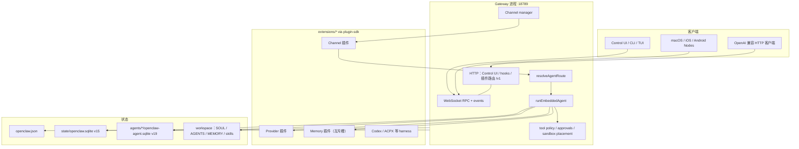
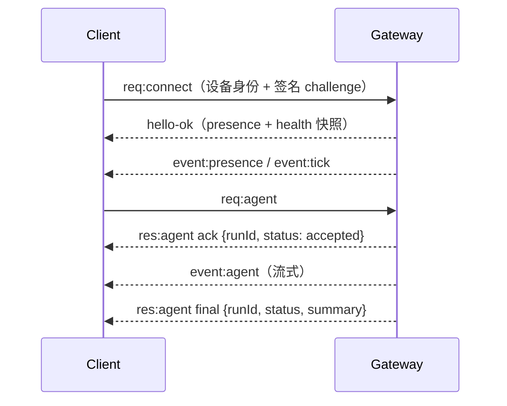
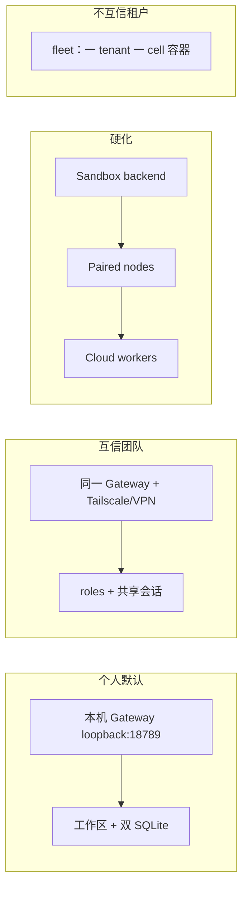

# OpenClaw 架构深度调研

> 更新时间：2026-09-02
> 调研模式：深度分析（tech-research skill / 模板 B 深度调研，聚焦架构）
> 调研对象：OpenClaw（本地 checkout + 官方文档交叉验证）
>
> **数据来源**（按来源级别排序）：
>
> | # | 来源 | 类型 | 级别 | 日期 / 版本 |
> |---|------|------|------|-------------|
> | S1 | 本地仓库 `openclaw/openclaw` @ `abb565ea5f9`（`package.json` `2026.8.1`） | 源码 + 仓库文档 | 一级 | 2026-09-02 |
> | S2 | [docs.openclaw.ai](https://docs.openclaw.ai) 对应源：`docs/concepts/architecture.md`、`docs/start/why-openclaw.md`、`docs/plugins/architecture.md`、`docs/reference/database-schemas.md` 等 | 官方文档 | 一级 | 与 S1 同源 |
> | S3 | `VISION.md`、`README.md`、`SECURITY.md`、`AGENTS.md` | 官方产品/治理文档 | 一级 | 与 S1 同源 |
> | S4 | GitHub API `repos/openclaw/openclaw` | 仓库元数据 | 二级 | 2026-09-02：388,611 ★ / 81,603 forks |
> | S5 | 本仓库既有对比文 [Hermes Agent vs OpenClaw](./hermes-agent-vs-openclaw.md) | 内部调研 | 三级 | 2026-04-13（Stars 等数字已过时效阈值，架构结论仍作交叉参考） |
>
> **时效性标注**：OpenClaw 属「快速迭代」类（阈值 12 个月）。本文架构事实均来自 2026-09-02 本地 `main` 与同源文档，**未过期**。S5 的 Stars / 版本数字已过期，文中不以 S5 为数量依据。
>
> **信心评级**：高 = 源码 + 官方文档一致；中 = 有官方依据但存在配置/默认差异；低 = 来源有限；推测 = 明确标出。

---

## 目录

1. [核心结论速览](#1-核心结论速览)
2. [概述与背景](#2-概述与背景)
3. [产品命题与信任模型](#3-产品命题与信任模型)
4. [仓库地图与分层架构](#4-仓库地图与分层架构)
5. [Gateway：唯一控制面](#5-gateway唯一控制面)
6. [一次对话的数据路径](#6-一次对话的数据路径)
7. [插件系统：核心保持无业务偏好](#7-插件系统核心保持无业务偏好)
8. [模型、Provider 与 Harness](#8-模型provider-与-harness)
9. [工具、策略与沙箱三分法](#9-工具策略与沙箱三分法)
10. [记忆、会话与双 SQLite](#10-记忆会话与双-sqlite)
11. [配置、Doctor 与升级契约](#11-配置doctor-与升级契约)
12. [客户端、Nodes 与 Companion Apps](#12-客户端nodes-与-companion-apps)
13. [安全架构](#13-安全架构)
14. [部署拓扑](#14-部署拓扑)
15. [性能特征与瓶颈](#15-性能特征与瓶颈)
16. [生态、成熟度与社区](#16-生态成熟度与社区)
17. [成本与学习曲线](#17-成本与学习曲线)
18. [优劣势总结](#18-优劣势总结)
19. [适用场景与建议](#19-适用场景与建议)
20. [知识盲区与待验证清单](#20-知识盲区与待验证清单)
21. [参考资料](#21-参考资料)
22. [自检记录](#22-自检记录)

---

## 1. 核心结论速览

OpenClaw 的架构不是「再做一个聊天机器人」，而是把 **常驻 Gateway 控制面**、**可替换的执行面**、**插件化的渠道/模型** 和 **版本化的本地状态** 拆开。读懂这四件事，就能判断它适不适合你的场景。

| # | 结论 | 信心 |
|---|------|------|
| 1 | **一进程 Gateway 是神经中枢**。默认 `127.0.0.1:18789`，同一端口复用 WebSocket 控制面 + HTTP（Control UI、OpenAI 兼容 API、插件路由）。渠道连接、会话、工具编排都在这里发生 | 高 |
| 2 | **一 Gateway = 一信任域**。适合单人或互信团队；不把互不信任的租户塞进同一进程。敌对多租户走 `openclaw fleet` 的一租户一 cell（仍标 experimental） | 高 |
| 3 | **Core 保持 plugin-agnostic**。产品能力优先以插件交付。本 checkout 有 **151** 个带 `openclaw.plugin.json` 的 `extensions/*` 包；渠道只做传输，Agent loop / 队列 / 工具策略归 core | 高 |
| 4 | **状态默认 SQLite，且双库**。全局控制面 `state/openclaw.sqlite`（schema **v15**），每 Agent 一份 `openclaw-agent.sqlite`（schema **v19**）。运行时禁止再给 OpenClaw 自有状态加 JSON sidecar；迁移权在 `openclaw doctor --fix` | 高 |
| 5 | **沙箱默认关闭**。开箱是「信任操作员的个人助手」，`exec` 跑在 Gateway 主机上。企业姿态是显式配置：sandbox / tool policy / elevated 三层正交，策略在代码里 fail-closed，不是靠系统提示词 | 高 |
| 6 | **工作区文件是人设与记忆的源**。`SOUL.md` / `AGENTS.md` / `MEMORY.md` / 日报 Markdown 对操作员可读；SQLite 负责会话、索引、审批、插件 KV。Memory 插件槽 **同时只能激活一个** | 高 |
| 7 | **延迟的计量单位是模型往返，不是毫秒**。没有官方 TPS benchmark。上下文有硬 cap；compaction / dreaming 是为窗口服务，不是为吞吐服务 | 高 |
| 8 | **整体成熟度 Alpha（68%）**。CLI / Gateway runtime / 若干宿主与 Discord 等表面评到 M4 Stable，但 Coverage 仍低（总分不算 Coverage）。实现存在 ≠ 可当生产默认 | 高 |
| 9 | **许可证 MIT**，基金会 501(c)(3) 托管，无企业版分叉。GitHub API 把 license 标成 `NOASSERTION`，与仓库根 `LICENSE`（MIT）不一致——以仓库文件为准 | 高 |

---

## 2. 概述与背景

### 2.1 是什么

OpenClaw 是一个 **自托管、多渠道的 AI 助手运行时**：模型、工具、即时通讯渠道、可选的手机/桌面节点，都接到同一个 Gateway 上。同一套代码既可当笔记本上的个人助手，也可当互信团队的共享助手，差别主要在配置，而不是另打一个「企业版」。**(高)**

官方一句话（`README.md`）：*Your assistant, on your devices, in your chats.*

`VISION.md` 把目标写得更硬：跑在你的设备上、出现在你已经在用的频道里、遵守你的规则；「真正做事」，而不是只聊天。

### 2.2 解决什么问题

传统 IDE 助手（Cursor、Claude Code）强在单次会话，弱在 **常驻、跨渠道、跨设备、带持久人格与记忆**。OpenClaw 站在另一条线上：

- 消息从 WhatsApp / Telegram / Slack / Discord 进来，归一化后进入同一套 Agent loop。
- 人格、记忆、技能以工作区文件 + 插件呈现，而不是锁在某个厂商的云账号里。
- 控制面（凭据、渠道长连接、策略）与执行面（沙箱、node、cloud worker）可以分开——这是它相对「单进程 harness」的架构卖点。**(高，S2 `docs/start/why-openclaw.md`)**

### 2.3 诞生与命名

演进链在 `VISION.md` 写死：Warelay → Clawdbot → Moltbot → OpenClaw。GitHub 仓库创建于 **2025-11-24**（S4）。托管方从个人项目转为 **OpenClaw Foundation**（独立 501(c)(3)）。语言选型是 TypeScript，理由明确写在愿景里：这是编排系统（prompt / tool / protocol / 集成），要保持可改、可读、可黑。**(高)**

### 2.4 基本信息

| 维度 | 值 | 来源 |
|------|----|------|
| 开发方 | OpenClaw Foundation | `package.json` `author`、`LICENSE` |
| 许可证 | MIT | 仓库根 `LICENSE`；GitHub API 误报 `Other` |
| 主语言 | TypeScript / Node.js | S4 + `package.json` engines |
| 运行时 | Node 22.22.3+ / 24.15+ / 25.9+（推荐 26；CI 仍钉 Node 24） | `AGENTS.md` Commands |
| 包管理 | pnpm workspace（根目录不支持裸 `npm install`） | `README.md` |
| 仓库内版本 | `2026.8.1` | `package.json` |
| 协议版本 | Gateway protocol **v4**（`MIN_CLIENT_PROTOCOL_VERSION = 4`） | `packages/gateway-protocol/src/version.ts` |
| 默认端口 | `18789` | `src/config/paths.ts` `DEFAULT_GATEWAY_PORT` |
| GitHub | [openclaw/openclaw](https://github.com/openclaw/openclaw) | 388,611 ★ / 81,603 forks / 6,051 open issues（2026-09-02） |
| 文档 | [docs.openclaw.ai](https://docs.openclaw.ai) | 源在本仓 `docs/` |
| 插件市场 | [ClawHub](https://clawhub.ai/) | `VISION.md` |

---

## 3. 产品命题与信任模型

### 3.1 架构要证明的七件事

`docs/start/why-openclaw.md` 把企业评估压成七条可检验命题。这不是营销列表，而是后续每一层设计的验收标准：**(高)**

1. **分开的信任边界**：执行可以进沙箱 / node / 一次性云机器，不携带 Gateway 常驻凭据。
2. **策略是代码**：拒绝是结构上的，不是「请模型遵守」。
3. **认证准入 + 有界角色**：默认拒绝；角色是协作护栏，不是租户隔离。
4. **密钥有主人**：可隔离的 SecretRef 失败只让对应 owner 降级；入口鉴权失败则不启动。
5. **版本化状态 + 受守护升级**：schema 向前迁移；新 schema 的库会被旧构建拒绝。
6. **可记录的出处**：记忆、审计、投递用记录下来的事实，而不是多信号拼凑。
7. **独立托管**：MIT、无企业版、签名发布。

### 3.2 默认姿态 vs 可硬化姿态

这里有一条必须先读懂的张力：**(高)**

- **默认**：loopback Gateway + 主机 `exec` + 沙箱 off。服务「一个信任自己的操作员」。
- **可配置**：Docker/Podman/SSH/OpenShell 沙箱、permission mode、exec approvals、pairing、Tailscale / trusted-proxy、Fleet cell。

官方自己写明：*Sandboxing is off by default*。拿 OpenClaw 做「企业安全对比」时，要比的是 **配置后的架构**，不是开箱默认。把默认说成已隔离，是误读。

### 3.3 明确不做的事

`VISION.md` 「What We Will Not Merge」是路线护栏：新 core skill 能上 ClawHub 就不进核心；不做全量人工翻译；云 sandbox 提供商做进 Crabbox 而不是 OpenClaw 插件；不包一层已有渠道；不重复 MCP / ACPX / 插件路径。**(高)**

---

## 4. 仓库地图与分层架构

### 4.1 顶层目录职责

| 目录 | 职责 |
|------|------|
| `src/` | 核心运行时：Gateway、agents、channels host、plugins loader、config、state、routing、CLI。公开插件面在 `src/plugin-sdk/` |
| `packages/` | 可复用库：`gateway-protocol`、`normalization-core`、`agent-core`、`llm-core`、`plugin-sdk`、`model-catalog-core` 等 |
| `extensions/` | 随仓插件（渠道、provider、memory、工具）。**禁止** import core `src/**`，只走 `openclaw/plugin-sdk/*` |
| `ui/` | Control UI（Lit + Vite），与 Gateway **版本 1:1 锁定**，无协议降级垫片 |
| `apps/` | macOS / iOS / Android / Linux 等 companion / node |
| `docs/` | 文档源；发布镜像为 `openclaw/docs` → `https://docs.openclaw.ai` |
| `skills/`、`scripts/`、`test/`、`qa/` | 捆绑技能、工程脚本、测试与成熟度证据 |

### 4.2 分层图



### 4.3 设计上的「税」

`VISION.md` 把扩展分成两层，税率不同：**(高)**

- **Core**：每个工具、每行 prompt、每个配置键都会打到 **每一个** 操作员的每一次模型请求上，审查最严。
- **插件 / 技能 / 渠道 / App**：没有这笔「人均税」，鼓励变多。

这解释了为什么仓库看起来巨大（上百个 extension），但核心仍反复强调 lean：增长发生在插件边界之外。

---

## 5. Gateway：唯一控制面

### 5.1 进程模型

一个长生命周期进程拥有：

- 渠道长连接（例如每主机一个 WhatsApp/Baileys 会话，不能在第二进程再开一份）。
- 类型化 WebSocket API（req / res / server-push event）。
- 同端口 HTTP：静态 Control UI、`/v1/*` OpenAI 兼容、hooks、canvas / A2UI（`/__openclaw__/canvas/`、`/__openclaw__/a2ui/`）。

启动链：`openclaw gateway` → `startGatewayServer`（默认端口 18789）→ `startGatewayServerCore`。实现上先创建 `WebSocketServer({ noServer: true })` 再 listen，避免 upgrade 处理器未挂上时出现静默 1006。**(高，`src/gateway/server.ts`、`server-runtime-state.ts`)**

### 5.2 线协议

| 规则 | 内容 |
|------|------|
| 传输 | WebSocket 文本帧 + JSON |
| 握手 | 第一帧必须是 `connect`；非 JSON / 非 connect → 硬断开 |
| 之后 | `{type:"req", id, method, params}` → `{type:"res", id, ok, payload\|error}`；事件 `{type:"event", event, payload, seq?}` |
| 鉴权 | `connect.params.auth.token` / `password`；Tailscale Serve 或 trusted-proxy 可用请求头满足；`mode: none` 仅限私有入口 |
| 幂等 | 有副作用的 `send` / `agent` 需要 idempotency key |
| Node | `role: "node"` + caps/commands；设备级 pairing |
| 事件 | **不重放**；客户端发现缺口必须自己刷新 |

协议 schema 在 `packages/gateway-protocol/`，TypeBox → JSON Schema → Swift 模型。`PROTOCOL_VERSION = 4`。**(高)**

### 5.3 连接生命周期



本地 loopback 可自动批准 pairing，以保持本机 UX；tailnet / LAN 即使同机也要显式批准。Gateway auth 对本地和远程连接都生效。**(高)**

### 5.4 为什么是「一台主机一个 Gateway」

渠道所有权（尤其 WhatsApp）和状态目录锁决定了这一点：另一份 Gateway 或 `openclaw agent --local` 不能同时占同一 `STATE_DIR`。同机多实例是刻意少见路径，必须拆 port + `OPENCLAW_CONFIG_PATH` + `STATE_DIR` + workspace。**(高)**

---

## 6. 一次对话的数据路径

以 Telegram 为例（其它渠道同构，差异在适配器）。**(高)**

```text
Bot API update
    → 持久 spool（ack/offset 前进之前先落盘）
    → ingress-drain 按 chat/topic 取道
    → resolveAgentRoute（bindings → agentId + sessionKey）
    → dispatchInboundMessage / runEmbeddedAgent
    → 会话入队（session lane + 可选 global lane）
    → 写入 activeWriterRunId（后续 transcript 提交必须带 expectedWriterRunId）
    → 组装 prompt（workspace + skills + 历史 + 硬 cap）
    → Provider 流式推理 + 工具循环（hooks / approvals）
    → 出站投递（可编辑式 streaming）
    → WS 客户端并行收到 agent/chat 事件
```

### 6.1 入口

| 入口 | 位置 |
|------|------|
| 渠道入站 | `src/auto-reply/dispatch.ts` → embedded runner |
| Gateway RPC `agent` / `agent.wait` | `src/agents/agent-command.ts` |
| CLI `openclaw agent` | 同上 |
| 渠道规范化 | `src/channels` 的 turn pipeline；插件走 `openclaw/plugin-sdk` 的 inbound helpers |

### 6.2 串行与写者声明

同一 `sessionKey` 同时只跑一个 turn（session lane），防止工具状态和 transcript 互踩。被打断 / steer 的旧 run 因为 writer claim 对不上，**不能**再提交过期 transcript。这是「静默写脏历史」的结构修复，而不是靠重试。**(高，`docs/concepts/agent-loop.md`)**

渠道侧还有 steer / followup / collect / interrupt 等队列模式，最终都喂进这套 lane。

### 6.3 渠道只做传输

插件不得从原始字符串推断产品命令（例如看到 `/` 就当 slash command）。审批、命令、URL、web-app、select 在编码进渠道前保持可区分类型；产品命令树属于 core / owner 插件。**(高，`AGENTS.md` Architecture + `src/channels/AGENTS.md`)**

本 checkout 带渠道能力的插件约 27 个，包括 `telegram`、`discord`、`slack`、`whatsapp`、`signal`、`imessage`、`feishu`、`matrix`、`msteams` 等。WebChat 走 Gateway WS，不算独立 channel 插件。

---

## 7. 插件系统：核心保持无业务偏好

### 7.1 加载流水线

发现 manifest → 启用/校验 → 进程内 `register(api)` → registry 消费。**(高，`docs/plugins/architecture.md`)**

- Manifest：`openclaw.plugin.json` + `package.json` 的 `openclaw` 块。
- 元数据快照在 Gateway 启动后 **进程内稳定**；热路径禁止 `stat` / 重读 JSON 做 freshness。
- 捆绑插件与第三方插件走同一 SDK 合同，才能让 ClawHub 安装而不分叉 core。

### 7.2 能力模型（Capability）

原生插件可注册一类或多类能力，而不是「有 hook 就算插件」：

| 能力 | 注册方法 | 例子 |
|------|----------|------|
| 文本推理 | `registerProvider` | `openai`、`anthropic` |
| CLI backend | `registerCliBackend` | 同上 |
| Embedding / Speech / Realtime / 图像 / 视频 / 音乐 | 对应 `register*Provider` | `openai`（hybrid）、`fal`、`elevenlabs` |
| 渠道 | `registerChannel` | `telegram`、`matrix` |
| Web fetch / search | `registerWebFetchProvider` / `registerWebSearchProvider` | `firecrawl`、`brave` |
| 迁移 | `registerMigrationProvider` | `migrate-claude`、`migrate-hermes` |

只注册 hooks 的是 hook-only；有工具/路由但无 capability 的仍被支持，但新捆绑插件应走显式 capability。**(高)**

形状分类：`plain-capability`（只注册一类）vs `hybrid-capability`（如 OpenAI 同时拥有推理、语音、媒体理解、生图）。

### 7.3 两种插件风格

`VISION.md`：

- **代码插件**：需要运行时 hook、provider、channel、in-process 工具。
- **Bundle 插件**：打包技能、MCP server、稳定外部面。接口更小、边界更好，能用 bundle 就不用代码插件。

分发偏好：npm 包 + 本地 extension 开发加载。进核心捆绑的门槛故意很高；发现与安全审查在 ClawHub。

### 7.4 规模（本 checkout）

| 口径 | 数量 |
|------|------|
| `extensions/` 目录 | 161 |
| 含 `openclaw.plugin.json` | **151** |
| 文档库存（生成） | 约 59 core npm + 90 official external + 3 source-only（以 `docs/plugins/plugin-inventory.md` 为准，生成物） |

数量会随仓移动，引用时以 manifest 计数或生成库存为准，不要混用。**(中：两套计数口径不同，上文已拆开)**

---

## 8. 模型、Provider 与 Harness

### 8.1 目录与路由

- 静态目录可写在插件 manifest 的 `modelCatalog`。
- 运行时由 `packages/model-catalog-core` + `src/agents/model-catalog.ts` 合并捆绑 / 发现 / 插件增强行。
- Failover：agent 默认主模型 + 配置的 `fallbacks` + alias；实现见 `model-fallback-candidates.ts` / `model-fallback-runner`。**(高)**

核心 **不** 把 `openai` 写进 generic loop；provider 拥有鉴权、目录、runtime hook。

### 8.2 OpenAI 与 Codex 的特殊关系

仓库硬规则： **OpenAI Codex = 提供者 id `openai`**。不再新增存活的 `openai-codex` 路由；旧配置由 doctor 修。**(高，`AGENTS.md`)**

运行时再拆一层：

| 所有者 | 职责 |
|--------|------|
| `extensions/codex` harness | 原生模型循环、thread resume、原生工具、原生 compaction |
| OpenClaw core | 渠道路由、会话、投递、动态工具、审批、transcript 镜像 |

这与「OpenAI HTTP provider 插件」不是同一块。兄弟 harness 还有 `acpx`、`copilot`、Anthropic Claude CLI 等。

### 8.3 模型可见上下文的预算

`AGENTS.md`：注入 prompt / tool schema / 上下文的每一项都有硬 cap；新增大段模型可见文本（约 1K tokens 量级）是 P0 审查点。技能类必须整份送达——给了 window 参数，模型会把第一窗当成全文。**(高)**

---

## 9. 工具、策略与沙箱三分法

这是安全架构里最容易被配错的三件事，官方为此单开一页：`docs/gateway/sandbox-vs-tool-policy-vs-elevated.md`。**(高)**

| 层 | 决定什么 | 不决定什么 |
|----|----------|------------|
| **Sandbox** | 工具跑在哪（`off` / `non-main` / `all`；backend：docker / podman / ssh / openshell） | Gateway 进程始终在主机 |
| **Tool policy** | 哪些工具存在；`deny` 永远赢 | 允许 `exec` 再 deny `write` **不会**让 shell 变成只读 |
| **Elevated** | 仅 `exec` 逃出普通沙箱 | 不能绕过 deny，也不能绕过「必须沙箱」的角色约束 |

Permission mode 在提交给模型之前就裁剪工具集（例如 `read-only` 会话根本看不到 `edit`/`write`）。Exec approvals 把批准绑定到规范命令、cwd、环境哈希、文件操作数内容哈希；漂移即拒绝；没有审批 UI 时默认 deny。**(高)**

### 9.1 核心工具 vs 插件工具

`src/agents/openclaw-tools.ts` 组装内建工具（sessions、gateway、web、cron、screen 等），再 merge 插件工具。Browser 是 `@openclaw/browser` 插件；code-mode 是可选路径（模型写 JS/TS，跑在 QuickJS-WASI），与 Codex 的 Code Mode 不是一回事。

### 9.2 技能（Skills）

技能 = 含 `SKILL.md` 的目录。加载优先级从高到低：工作区 `skills/` → 工作区 `.agents/skills` → `~/.agents/skills` → state-dir → 捆绑 → `extraDirs` / 插件技能。新技能默认上 ClawHub，不进 core。**(高)**

---

## 10. 记忆、会话与双 SQLite

### 10.1 两套源，两种读者

| 给谁看 | 形态 | 典型内容 |
|--------|------|----------|
| 操作员 / 模型（人格层） | 工作区 Markdown | `SOUL.md` 人设；`AGENTS.md` 操作规则；`USER.md` 用户模型；`MEMORY.md` 长期记忆；`memory/YYYY-MM-DD.md` 日报 |
| 运行时 | SQLite | 会话与 transcript、审批、插件 KV、memory 索引、auth profiles |

工作区 **不是** 沙箱：相对路径默认 cwd，绝对路径可以摸到主机，除非打开 sandbox。`AGENTS.md` 里的 `## Tools` 只是给模型看的约定，**不**控制工具可用性。**(高)**

`MEMORY.md` 不自动创建；主私密会话才注入，群聊默认不注入。子 agent 会话只注入 `AGENTS.md`。

### 10.2 Memory 插件互斥

同一时间只能激活一个 `kind: "memory"` 插件。捆绑选项包括 `memory-core`（默认，含 dreaming）、`memory-lancedb`。`memory-wiki` 是 wiki 工具面，不一定独占 memory kind。愿景写明未来会收敛到一条推荐默认路径。**(高)**

Dreaming（memory-core）：light → REM → deep；只有 deep 写 `MEMORY.md`。Consolidation 会丢掉 `untrusted` / `system` 候选。自动摄入排除 cron / heartbeat / subagent 会话。这些闸门 **挡不住** 有文件权限的工具直接写盘。**(高)**

### 10.3 双库合同

| 库 | 默认路径 | Schema | 内容 |
|----|----------|--------|------|
| 全局控制面 | `~/.openclaw/state/openclaw.sqlite` | **v15** | registries、approvals、插件状态、共享运行时 |
| 每 Agent | `~/.openclaw/agents/<agentId>/agent/openclaw-agent.sqlite` | **v19** | sessions、transcripts、memory 索引、agent 鉴权 |

版本写在两处：`PRAGMA user_version` 与 `schema_meta`。打开时向前迁移；遇到 **更新的** schema → 拒绝，Gateway **exit 78**（避免 systemd 死循环重启）。同版本只允许对旧读者安全的加法（新表，或已有表上「裸 nullable STRICT 列」）。**(高，`docs/reference/database-schemas.md` + `package.json` `openclaw.schemaVersions`)**

任务注册表、trajectory 等少数高流量面可以使用独立 SQLite，但不是默认给新功能开第三种文件状态。

### 10.4 会话与多 Agent

- 默认 agent id：`main`；主会话键：`agent:main:main`。
- 多 agent = 同一 Gateway 里多套 workspace + agentDir + 会话库，**不是**默认多 OS 进程。
- `bindings` → `resolveAgentRoute` 得到 `agentId` / `sessionKey` / `matchedBy`。
- `sessionKey` 是路由，**不是**授权。**(高)**

---

## 11. 配置、Doctor 与升级契约

### 11.1 `openclaw.json`

JSON5，默认 `~/.openclaw/openclaw.json`。类型 `OpenClawConfig`（`src/config/types.openclaw.ts`）顶层包括 `auth`、`agents`、`bindings`、`session`、`channels`、`gateway`、`models`、`plugins`、`secrets`、`tools`、`hooks`、`cron`、`memory`、`mcp`、`skills` 等。表面已经很大——仓库把「再加一个配置项」的门槛设得很高：先证明现有行为 / doctor 迁移解决不了。**(高)**

运行时 **只读当前规范 schema**。没有长期别名静默接受旧键。破坏性变更必须带 `openclaw doctor --fix`：检测旧形状、解释、必要时备份、改写成规范形。Core 配置归 core doctor；插件配置归该插件的 `doctorContract` / `legacyConfigRules`。**(高，`VISION.md`)**

### 11.2 密钥

SecretRef 类型：`env` / `file` / `exec`（1Password、Vault、Bitwarden、sops 走这条）/ 共享 store。可映射、可隔离的 owner 解析失败 → Gateway **降级启动**（该 owner 不可用，请求 typed error，不偷换别的凭据）。入口鉴权失败、未知所有权、非法 secret 配置 → **拒绝启动**。**(高，`docs/gateway/secrets.md`)**

模型凭据在支持的出口路径用进程内 sentinel 替换。这 **不是** 进程隔离；agent 若有文件工具，仍可能读到盘上明文。生产路径：迁完 ref + `secrets audit --check` + OS/容器隔离。

### 11.3 升级

- 日历版本；npm 不可变发布；stable / extended-stable / beta / dev 通道。
- `openclaw update` 若目标声明的 schema 能力老于磁盘上的库，则拒绝。
- 备份用 SQLite online-backup API，创建与发布时做完整性/哈希检查。
- 重启恢复有尝试预算；崩溃熔断让控制面仍可达，同时抑制渠道自启。**(高)**

---

## 12. 客户端、Nodes 与 Companion Apps

| 表面 | 角色 |
|------|------|
| Control UI (`ui/`) | Gateway 同端口托管的 Lit SPA；WebChat 也走同一 WS |
| CLI / TUI | 同一套协议上的操作员工具 |
| macOS / iOS / Android / Linux apps | 控制客户端或 `role: node`：摄像头、屏幕、位置、canvas 面板、设备侧技能 |
| OpenAI 兼容 HTTP | 给已经会说 `/v1/chat/completions` 的客户端 |

Node 与 Gateway 仍是 **同一操作员信任域**。配对后的远程执行是操作员级，不是把 Gateway 信任边界外移到不可信设备。Cloud workers：一次性机器、闭合 RPC 白名单、短 TTL 凭据、推理回源 Gateway、**持久 transcript 只在 Gateway**。**(高)**

Control UI 与 Gateway 锁版本：降低兼容矩阵，代价是不能混用新旧包。**(高，`ui/AGENTS.md`)**

---

## 13. 安全架构

### 13.1 威胁顺序

官方顺序：**Identity（谁能说话）→ Scope（工具/沙箱/群）→ Model（可被操纵）**。仅 prompt injection 通常不构成漏洞；硬边界是 pairing、工具裁剪和沙箱，不是「把系统提示词写得更凶」。**(高，`SECURITY.md`、`docs/gateway/security/index.md`)**

### 13.2 入站

| `dmPolicy` | 行为 |
|------------|------|
| `pairing`（默认） | 未知发件人拿到 pairing code，批准前忽略 |
| `allowlist` | 直接拒绝 |
| `open` | 公开（allowlist 需含 `"*"`） |
| `disabled` | 忽略 DM |

群聊常用 allowlist + `requireMention`。多用户 DM 建议 `session.dmScope: "per-channel-peer"`；个人默认常共享 `main` 会话。

### 13.3 角色不是租户

`gateway.roles` 给人级角色：别人会话的可见性、agent 白名单、与连接鉴权 **求交** 的 scope 天花板（只减不增）。省略 `gateway.roles` = 角色边界关闭。配置默认角色为 deny-all 才是硬化部署。**(高)**

把「多用户会话」理解成 SaaS 多租户隔离，是架构误读。正确扩张是 **一租户一 Gateway**（Fleet cell）。

### 13.4 审计的两种含义

- **配置漂移**：`openclaw security audit`（`--deep` / `--fix`）。
- **Execution identity**：可选诊断出处，**不是**授权；默认不采集。缺失/损坏的 provenance 不得改变审批决定。**(高，`docs/gateway/audit.md`)**

---

## 14. 部署拓扑



| 拓扑 | 要点 | 成熟度提示 |
|------|------|------------|
| 本机 Gateway + `onboard --install-daemon` | 默认路径；launchd/systemd | Gateway host 表面评到 M4，但 Coverage 仍低 |
| Docker / Podman | 镜像常暴露非 loopback bind → **必须配 auth**；沙箱可另开容器，Gateway 不必进容器 | M3 Beta |
| 远程 | 优先 Tailscale/VPN，其次 SSH `-L 18789:127.0.0.1:18789`；隧道不绕过 auth | — |
| macOS / 移动 App | 本机或远程 Gateway | iOS/Android app 质量分高，Coverage 0% |
| Team | 一信任域多人 | 文档：`docs/start/teams.md` |
| Fleet | 一租户一完整 Gateway 容器，独立状态/凭据 | **experimental** |

---

## 15. 性能特征与瓶颈

OpenClaw **没有**面向公众的「消息/秒」官方 benchmark。架构文档把延迟定义成 **模型往返次数**，而不是网关毫秒数：能合并的 act-then-observe 就不要拆成两轮工具。**(高，`AGENTS.md` Product Doctrine)**

可从设计直接推出的瓶颈（不是测出来的 TPS）：

| 瓶颈 | 机制 | 含义 |
|------|------|------|
| 每会话串行 | session lane | 同一会话无法靠加并发提高吞吐 |
| 上下文窗口 | 硬 cap + compaction | 长会话成本在摘要质量，不在 Gateway CPU |
| 渠道启动并发 | `CHANNEL_STARTUP_CONCURRENCY = 4` | 很多渠道的冷启动是排队的 |
| 热路径禁止 freshness I/O | 插件元数据进程内稳定 | 换插件/模型目录通常要重启或走 owner reload |
| Control UI 锁版本 | 无协议垫片 | 降低运行时分支，不降低包体积 |
| 单进程渠道所有权 | 一主机一 WhatsApp 等 | 水平扩展要加 Gateway，而不是在进程内加线程 |

发布流程里有 Full Release Validation 的 performance gates，但那是发行护栏，不是给选型用的公开数字。**（中：gates 存在于文档；具体阈值未在本次调研展开）**

---

## 16. 生态、成熟度与社区

### 16.1 成熟度分数卡

来源：`docs/maturity/scorecard.md`（taxonomy + QA 生成快照，勿当手改真理）。**(高)**

- 整体 **68% → Alpha**（Quality 64% Alpha + Completeness 71% Beta）。
- Coverage **16% Experimental**，**不计入**成熟度总分，但是否「能当真用于 release」的证据维度。
- 分档：Experimental 0–50 / Alpha 50–70 / Beta 70–80 / Stable 80–95 / Clawesome 95–100。

相对更熟（M4 Stable，完整度高、覆盖仍偏弱）：CLI、Gateway runtime、Linux/macOS Gateway host、Discord、Android/iOS app。

仍在 M3 Beta 的关键内核：Agent runtime、session/memory/context、channel framework、sandbox tools、plugins、security/auth/pairing/secrets。

读法：Gateway **作为进程** 比 Agent loop **作为产品** 更「像完成了」。把聊天渠道接到一个稳定控制面，和把记忆/沙箱/多模型 failover 做成可承诺行为，不是同一成熟度。

### 16.2 社区与治理

- Discord、ClawHub、Foundation 伙伴（文档列举 Atlassian、GitHub、Microsoft、NVIDIA、OpenAI、Tencent 等，属官方叙事）。
- GitHub 热度极高（S4：38.8 万星、6,051 个 open issues）——高星同时意味着 issue 噪声和支持负载，不单独等于内核稳定。
- 贡献规则刻意收：一 PR 一主题；超约 5,000 行只在例外时审。**(高，`VISION.md`)**

与 [Hermes Agent 对比文](./hermes-agent-vs-openclaw.md) 的关系：那篇是 2026-04 的产品向对比；本文用 2026-09 源码校正架构层。Stars 以本文 S4 为准。

---

## 17. 成本与学习曲线

### 17.1 成本结构

| 项 | 谁付 |
|----|------|
| 软件许可 | MIT，无企业版分成 |
| 自托管 | 操作员的机器 / VPS / 容器 |
| 模型推理 | 各 provider 账单（或本地模型电费） |
| 渠道 | 各平台 Bot / 商业 API（若有） |
| 沙箱 / cloud worker | 可选增量 |

对个人用户，账单几乎总是 **模型 token**，不是 OpenClaw 本身。对团队，真正的成本是：**把默认主机 exec 收成可审计姿态** 的工程时间，以及跟发行列车（schema、doctor、锁版本 UI）的运维纪律。**(中：无官方 TCO 数字，属结构推断，标为中)**

### 17.2 学习曲线

终端优先是产品决策：先让操作员看见鉴权、权限、安全姿势。代价是 `openclaw.json` 表面积大，渠道/模型/沙箱正交配置容易配出「能聊但不能 hardening」或「hardening 到不能干活」。

最低可运行路径短：`onboard` → dashboard 发一条消息。要达到 why-openclaw 里那七条命题，必须再读 security / sandbox / secrets / doctor。**(高)**

---

## 18. 优劣势总结

| 优势 | 劣势 / 约束 |
|------|-------------|
| 控制面与执行面可分离，策略在代码里 | 沙箱默认 off；拿默认值做安全对比会误判 |
| 渠道/模型/记忆以插件扩展，core 税率可控 | 151 个 extension + 巨大 config，认知负担高 |
| 双 SQLite + doctor 单一迁移主人，升级可拒绝不兼容 | 旧构建打不开新 schema（exit 78）；运维必须跟版本走 |
| 工作区 Markdown 可审计人格与记忆 | 工作区不是沙箱；文件工具等于主机能力 |
| 同一产品覆盖个人与互信团队 | **不是**敌对多租户 SaaS；Fleet 仍 experimental |
| 协议与 UI 锁版本，减少幽灵兼容 | 客户端必须与 Gateway 同步升级 |
| 基金会 MIT、无企业版分叉 | 整体成熟度仍 Alpha；Coverage 明显落后于实现 |
| TypeScript 可改 | 单进程编排，水平扩展靠加 Gateway 实例 |

---

## 19. 适用场景与建议

### 19.1 适合

- 个人想在 Telegram / Slack / Discord / WhatsApp 等 **已经在用的聊天里** 常驻一个能跑工具的助手。
- 互信小团队共享一个 Gateway、共享历史与 Git 署名，并能接受「一信任域」。
- 需要把 Claude Code / Codex / 多模型厂商接到同一套渠道与会话，而不是再锁进一个 IDE。
- 安全团队能接受「默认个人助手 + 可硬化」，并愿意跑 `sandbox explain` / `security audit` 当回归。

### 19.2 不适合（除非额外架构）

- 互不信任的终端用户共用一个 agent（应用层角色不够；需要 Fleet/分机/分 OS 用户）。
- 要求开箱即沙箱、开箱即多租户隔离、开箱即可对外暴露。
- 把 OpenClaw 当无状态 HTTP 推理代理（它是有状态控制面；`/v1` 只是附带门面）。
- 需要公开、可引用的吞吐 SLA 或官方 TPS——当前没有。

### 19.3 落地顺序（可操作）

1. 本机 `openclaw onboard`，只连 loopback，确认 Control UI 一轮对话。
2. 先配 **一个** 渠道的 pairing，不要一上来 `dmPolicy: open`。
3. 需要文件/shell 时，先 `openclaw sandbox explain` 看实际落点，再决定是否 `non-main` / `all`。
4. 凭据迁 SecretRef，跑 `secrets audit`。
5. 升级走 `doctor` + 对应发行通道；不要用旧二进制对着新 schema 硬启动。
6. 只有出现第二个不互信租户时，才评估 Fleet，而不是在现有 Gateway 上堆 roles。

---

## 20. 知识盲区与待验证清单

| 项 | 状态 |
|----|------|
| npm 上 `latest` 与仓内 `2026.8.1` 是否同一 SHA | 未查 registry；仓内版本只代表本 checkout |
| 公开 performance gate 的具体阈值与方法 | 文档确认有 Full Release Validation，数字未展开 |
| 38.8 万星中有多少是更名（Clawdbot/Moltbot）带来的继承 | 未做 star 来源分析 |
| 各渠道在生产流量下的真实故障模式 | 需 live / QA Lab 证据，本文只读了管道设计 |
| Memory 多后端的检索质量对比（builtin FTS vs LanceDB） | 无本次实测 |
| Fleet 离 production-ready 的具体缺口列表 | 仅知文档标 experimental |
| GitHub API `license: Other` 的检测原因 | 根 `LICENSE` 为 MIT；未深究 GitHub 分类器 |

---

## 21. 参考资料

| 主题 | 路径或 URL |
|------|------------|
| 愿景 | `VISION.md` |
| 为什么是这套架构 | https://docs.openclaw.ai/start/why-openclaw |
| Gateway 架构 | https://docs.openclaw.ai/concepts/architecture |
| Agent loop | https://docs.openclaw.ai/concepts/agent-loop |
| 插件内部 | https://docs.openclaw.ai/plugins/architecture |
| 数据库 schema | https://docs.openclaw.ai/reference/database-schemas |
| 沙箱三分法 | https://docs.openclaw.ai/gateway/sandbox-vs-tool-policy-vs-elevated |
| Secrets | https://docs.openclaw.ai/gateway/secrets |
| 成熟度 | https://docs.openclaw.ai/maturity/scorecard |
| 上手 | https://docs.openclaw.ai/start/getting-started |
| 仓库 | https://github.com/openclaw/openclaw |
| 与 Hermes 的产品对比（较旧） | [hermes-agent-vs-openclaw.md](./hermes-agent-vs-openclaw.md) |

源码锚点（本调研核对过）：

- `src/gateway/server.ts` — `startGatewayServer` 默认端口
- `src/config/paths.ts` — `DEFAULT_GATEWAY_PORT = 18789`
- `packages/gateway-protocol/src/version.ts` — `PROTOCOL_VERSION = 4`
- `src/config/types.openclaw.ts` — `OpenClawConfig`
- `package.json` — `version`、`openclaw.schemaVersions`

---

## 22. 自检记录

### 完整性

- [x] 架构 / 原理 / 特性 / 安全 / 部署 / 生态 / 成本 / 学习曲线 / 适用场景 九个维度均有独立章节
- [x] 每个关键结论至少有一级（源码或官方文档）来源；Stars 用 GitHub API 二级来源
- [x] 优劣势均覆盖；默认不安全姿态写进结论表
- [x] 知识盲区单列

### 准确性

- [x] 架构事实锚定 2026-09-02 `abb565ea5f9`；S5 旧 Stars 不采用
- [x] 已标注分歧：GitHub license 检测 vs 根 `LICENSE`；extension 目录数 161 vs manifest 151 vs 生成库存三套口径
- [x] Schema 15/19、协议 v4、端口 18789 均在源码交叉验证
- [x] 成本 TCO、水平扩展「加 Gateway」标为中/结构推断，未升格为高

### 可操作性

- [x] 第 19.3 节给出落地顺序
- [x] 风险按默认 vs 可硬化、单信任域 vs Fleet 分级
- [x] 替代路径：不互信用 Fleet/分实例；要开箱沙箱则不要用默认值，或选其它 harness
- [x] 决策依据是信任模型 + 成熟度分数卡，而不是 Stars

### 联动规则

- 无未标注的推测性关键结论
- 「中」信心项（成本、性能阈值、库存口径）未作为唯一决策依据
- 矛盾来源已在正文拆开

**自检结果：通过（深度模式三类清单）。**
