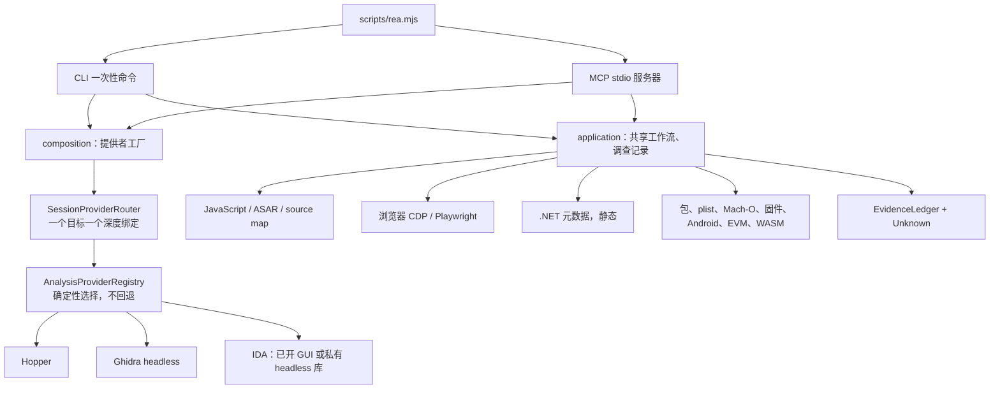

# REA 深度调研

> 更新时间：2026-10-12
> 调研模式：深度分析（tech-research skill / 模板 B 深度调研）
> 调研对象：REA（Reverse Engineer Anything），npm 包 `rea-agents`，仓库 [morluto/rea](https://github.com/morluto/rea)
>
> **数据来源**（按来源级别排序）：
>
> | # | 来源 | 类型 | 级别 | 日期 / 版本 |
> |---|------|------|------|-------------|
> | S1 | 本机 MCP `binary_session`（Cursor 客户端 `cursor-vscode`） | 运行中的服务器自述 | 一级 | 2026-10-12 13:08 UTC 启动；`rea-agents` **6.4.0**；技能期望版本 **37**；目录 **170** MCP 工具 / **127** CLI / **6** prompts |
> | S2 | [README.md](https://raw.githubusercontent.com/morluto/rea/main/README.md)、[docs/architecture.mermaid](https://raw.githubusercontent.com/morluto/rea/main/docs/architecture.mermaid)、[docs/installation.md](https://github.com/morluto/rea/blob/main/docs/installation.md)、[docs/roadmap.md](https://raw.githubusercontent.com/morluto/rea/main/docs/roadmap.md)、[SECURITY.md](https://raw.githubusercontent.com/morluto/rea/main/SECURITY.md)、[docs/adr/0001](https://github.com/morluto/rea/blob/main/docs/adr/0001-provider-selection-and-analysis-profiles.md)、[docs/provider-evaluation.md](https://github.com/morluto/rea/blob/main/docs/provider-evaluation.md) | 官方文档 / 仓库 | 一级 | 2026-10-12 抓取的 `main` |
> | S3 | npm registry `rea-agents/latest` | 发布元数据 | 一级 | 版本 6.4.0，更新于 2026-10-11；包创建于 2026-07-12 |
> | S4 | GitHub API `repos/morluto/rea` 与 `languages` | 仓库元数据 | 二级 | 2026-10-12：134,797 ★ / 30,191 forks / 283 open issues / 427 subscribers |
> | S5 | [Hopper 官网](https://www.hopperapp.com/)、[下载页](https://www.hopperapp.com/download)、[FAQ](https://www.hopperapp.com/faq.html)、[条款](https://www.hopperapp.com/terms.html)、[EULA](https://www.hopperapp.com/license_agreement.html) | 商业引擎厂商 | 一级（引擎许可） | 2026-10-12 抓取 |
> | S6 | [rea.tools](https://rea.tools/) / [morluto.github.io/rea](https://morluto.github.io/rea/) 产品页与案例叙述 | 官方产品站 | 一级 | 2026-10-12；计算器案例标注检查版本为 REA **4.1.0** |
> | S7 | GitHub issues [#1170](https://github.com/morluto/rea/issues/1170)、[#1994](https://github.com/morluto/rea/issues/1994)、[#1992](https://github.com/morluto/rea/issues/1992) | 维护者/用户问题单 | 四级 | 2026-10，用于 macOS 上 Ghidra 的实际边界 |
>
> **时效性标注**：REA 属「快速迭代」（阈值 12 个月）。npm 从 2026-07-12 的 0.2.1 到 2026-10-11 的 6.4.0。本文事实取自 2026-10-12 的 `main`、registry 与本机 6.4.0 会话，**未过期**。产品站上的计算器演示固定在 REA 4.1.0，只能说明当时的案例，不能代表 6.4.0 的字节级输出。
>
> **信心评级**：高 = 官方文档与本机会话或 registry 一致；中 = 有官方依据，但主机/版本边界存在差异；低 = 来源有限。推测性内容只放在文末待验证，不作为决策依据。

---

## 目录

1. [核心结论速览](#1-核心结论速览)
2. [概述与背景](#2-概述与背景)
3. [核心架构与原理](#3-核心架构与原理)
4. [关键特性](#4-关键特性)
5. [性能与基准](#5-性能与基准)
6. [部署与运维](#6-部署与运维)
7. [安全边界](#7-安全边界)
8. [生态、社区与成本](#8-生态社区与成本)
9. [学习曲线](#9-学习曲线)
10. [优劣势](#10-优劣势)
11. [适用场景与建议](#11-适用场景与建议)
12. [知识盲区](#12-知识盲区)
13. [参考资料](#13-参考资料)
14. [自检记录](#14-自检记录)

---

## 1. 核心结论速览

REA 是一个本地 MCP/CLI：Agent 用它检查没有源码的程序，拿回带证据和限制说明的结果，再自己解释或重写功能。它不替代 Ghidra、Hopper 或 IDA，而是把这些引擎和一组自带的静态/运行时检查接到同一套工具契约上。

| # | 结论 | 信心 |
|---|------|------|
| 1 | **当前发布版是 `rea-agents@6.4.0`**（2026-10-11）。本机 Cursor 已连上同一版本，技能契约版本 37，目录为 170 个 MCP 工具、127 条 CLI、6 个 prompt。仓库 `main` 仍在当天继续推送，发行版与文档会错开 | 高 |
| 2 | **深度原生分析必须选定一个引擎**。Hopper、Ghidra、IDA 能力重叠，同时可用时自动选择会失败为 `ambiguous`，不会静默换一家。本机三家都不可用：Hopper 未安装，Ghidra 未配置且本机 Java 是 Zulu 13，IDA MCP 未配置 | 高 |
| 3 | **在这台 Mac（darwin/arm64）上，不装原生引擎也能用的是应用层与运行时层**：JavaScript/Electron、浏览器、.NET 静态元数据、证据账本、进程捕获、PE 资源。会话里 170 个工具中 **60 个当前可调用，110 个不可调用**（68 个要先打开目标，42 个缺外部提供者） | 高 |
| 4 | **官方把 Ghidra 标成 Linux x64（精确 12.1.2 + JDK 21）和实验性 Windows x64 PE**。macOS 上有人用自编译 native 跑通 doctor，同时有「12.1.4 不带 macOS 反编译器」的未决问题。这台机器的正路是 Hopper，不是把 Ghidra 当已支持平台 | 高（文档矩阵）/ 中（macOS 能跑通的程度） |
| 5 | **分析在本机做，结果仍会进入 Agent 的模型上下文**。桥接用当前用户的 Unix socket 和一次性 capability token。官方明确写了：这不是沙箱，打不开「恶意解析器已经以你的用户身份运行」这种情况 | 高 |
| 6 | **许可证 MIT，第三方引擎另计**。Hopper 是永久许可证、含一年更新，演示版不能保存/导出、关掉调试器、单次 30 分钟。标价以 hopperapp.com 下单页为准，本次抓取没有拿到数字 | 高（许可结构） |
| 7 | **没有公开的吞吐或延迟基准**。官方案例证明的是「能把一条计算还原到可测试的 C」，例如 DX-Ball 声像函数对上 3,205 个原始 x86 用例并复现 63 个编译字节。大结果会在 MCP 传输层被截断，要改走证据分页 | 高 |
| 8 | **和本仓库 `projects/auto-reverser` 重叠在浏览器/Electron 请求与脚本，分工不同**。REA 是通用调查 MCP；auto-reverser 是面向页面加密参数的桌面工具 | 高 |

---

## 2. 概述与背景

### 2.1 是什么

REA（Reverse Engineer Anything）把逆向调查做成 Agent 能调用的本地工具面。同一套实现有两个入口：stdio MCP 服务器，以及 `rea` CLI。官方定位写在 README 标题下：一个 MCP，覆盖二进制、应用和运行时行为。**(高)**

npm 包名是 `rea-agents`。MCP Registry 条目是 `io.github.morluto/rea`，拉起的仍是这个 npm 包，没有第二份分发物。**(高，S2 installation.md)**

### 2.2 解决什么问题

逆向的贵时间通常花在：选对引擎、把函数/模块/请求串成一条证据链、再让结论可复核。REA 把这条链路收成固定动作：

1. 按目标类型选第一个工具（ASAR、APK、固件、浏览器页、原生二进制各有入口）。
2. 返回观察、推断和未知，并带 Evidence。
3. Agent 用这些结果解释行为，或在自己的工程里重写并测试。

产品站用 Windows 计算器的 `%` 键说明这件事：REA 交出处理函数的指令和伪代码，Agent 解释「加号之后的百分号是对第一个操作数取百分比」。该演示标注的检查版本是 REA 4.1.0、计算器 11.2508.4.0。**(高，S6；版本边界见文首)**

### 2.3 时间线

| 时间 | 事件 | 来源 |
|------|------|------|
| 2026-04-14 | GitHub 仓库创建 | S4 |
| 2026-07-12 | npm 首次发布 0.2.1，当天到 0.3.0 | S3 |
| 2026-07-13 | 1.0.0 | S3 |
| 2026-10-11 | 6.4.0 发布 | S3 |
| 2026-10-12 | 本机会话与本文抓取；API 显示仓库仍在推送 | S1、S4 |

从 7 月中到 10 月中跨过六个大版本。README 自己也写：发布频繁，遇到 bug 先升级。**(高)**

---

## 3. 核心架构与原理

### 3.1 分层

官方架构图把进程分成这些块（`docs/architecture.mermaid`，2026-10-12 的 `main`）：



领域层 `src/domain/` 被标成无副作用。契约在 `src/contracts/`。进程监督、超时、私有目录在 `src/process/`。语言以 TypeScript 为主：GitHub linguist 约 15.8M 字节 TypeScript，其次 JavaScript 1.9M、HTML、Python、Java。**(高，S2 + S4)**

### 3.2 一次调查怎么走

Agent 或 CLI 调用工具。应用层做目标分类和调查编排。若是深度静态分析，会话先绑定**一个**深度提供者，再把结果写入 Evidence。静态结论和运行时观察是两条证据，技能文本要求调用方不要把静态分析说成「已经跑过」。**(高，S2 + 本机技能契约 v37)**

ADR 0001 规定了选择规则，状态为已实现：**(高)**

- Hopper 与 Ghidra 实现的是同一族深度操作，不能放进「每个操作只有一条路由」的旧复合提供者里。
- 候选多于一个且没有偏好时，结果是 `ambiguous`。数组顺序不是策略。
- 分析配置（加载器、语言 ID、分析器集合）会规范化后进入配置摘要。换提供者或换配置就是另一份摘要。
- Ghidra 使用临时工程，不打开用户自己的 Ghidra 工程。

### 3.3 证据，而不是一段伪代码

结果默认带 Evidence。大图先要 `detail: "summary"`，再用 `inspect_analysis_view` 按 `parent_evidence_id` 翻页。MCP 传输层报 `resource_constraint` 时，完整记录仍在账本里，应分页或 `export_evidence_bundle`，而不是把同一次分析再跑一遍。客户端自己截断的预览也不能当成完整 JSON。**(高，技能契约 v37 与 S2 CLI/Evidence 文档指向一致；本机 `export_evidence_bundle`、`get_evidence_bundle`、`inspect_analysis_view` 均为可调用)**

未知项有单独账本：`list_unknowns`、`record_unknown`、`verify_unknown_resolution`。重构是否覆盖原行为走 `verify_reconstruction` 和 obligation ledger。**(高，S1 工具面)**

---

## 4. 关键特性

### 4.1 官方目标矩阵

README（`main`，2026-10-12）列出的目标与前提：

| 目标 | 返回什么 | 额外前提 |
|------|----------|----------|
| 原生二进制 | 伪代码、汇编、字符串、符号、调用和引用 | Hopper、Ghidra 或 IDA |
| 离线 ELF 布局 | 节、段、符号/重定位、静态缓解候选 | Linux x64 上调用方自备 pwntools |
| Go 二进制 | 编译器版本、模块、替换、构建参数 | 内置 ELF/PE/thin Mach-O，不需要 Go |
| WASM | 校验、节、import/export 的 WAT | 调用方自备 WABT 1.0.42 |
| EVM 字节码 | 选择子、偏移、推断的参数与可变性 | Linux x64；不做链上查询 |
| Linux core | 每个线程的寄存器、信号、原始 note | Linux x64 pwntools；可选 GDB/pwndbg |
| JavaScript / Electron | 模块、import、source map、路由、IPC、原生插件关系 | Node.js |
| 网站 | 页面结构、脚本、网络观察、按需截图 | Chrome 系浏览器 |
| 已保存抓包 | 请求、响应、暴露的载荷 | HAR；原生 mitmproxy 抓包在 Linux 上用 mitmdump |
| .NET | 元数据、CIL、声明的原生依赖、构建对比 | 无引擎，仅静态 |
| Android APK | 清单、类、反编译方法、引用 | 无头 JADX + 完整 JDK |
| Android 设备 | 设备、包、进程、日志、截屏、文件传输 | 调用方自备 adb |
| JEB | 工程单元与伪代码 | 调用方已启动的 JEB MCP |
| 固件 | 区域、提取、再交给原生分析 | Linux 上的 Binwalk / Unblob |
| 包与 Apple 资源 | 清单、摘要、plist、bundle 结构 | 格式解析器 |
| 进程行为 | 终端输出、交互、退出、文件系统差异 | Linux/macOS，原生 PTY |

静态 JavaScript 与 .NET **不启动目标程序**。运行时工具会按声明的生命周期启动或附加目标。**(高)**

### 4.2 本机 6.4.0 实际可调用面

`binary_session` 在未打开任何目标时的分类（2026-10-12）：

| 状态 | 数量 | 含义 |
|------|------|------|
| `available: true` | 60 | 工具已注册且当前主机不缺这个工具自己的提供者 |
| `target_required` | 68 | 要先 `open_binary` 或已有活动目标；其中大量还依赖上面三个原生引擎 |
| `provider_missing` | 42 | 主机上没有对应外部程序或环境变量 |

当前可调用、且不依赖 Hopper/Ghidra/IDA 的分组：

| 表面 | 工具数 | 代表能力 |
|------|--------|----------|
| session | 20 | 开关目标、证据导入导出、进程场景对比、未知项、重构校验 |
| application | 17 | JS/Web/托管图追踪、版本对比、重构覆盖率 |
| browser-provider | 12 | 列出已开页面、观察执行与网络、截图、HAR |
| electron-provider | 5 | ASAR/目录静态图、已开 Electron、运行时对照 |
| managed-provider | 3 | .NET 制品、成员、原生边界 |
| runtime-provider | 2 | 已有 JS 运行时 |
| native-provider | 1 | `inspect_pe_resources`（不需要活动目标） |

当前缺失的外部提供者（本机 remediation 原文要点）：

| 缺口 | 本机要求 |
|------|----------|
| 深度原生 | Hopper 启动器不存在：`/Applications/Hopper Disassembler.app/Contents/MacOS/hopper`；或配置 Ghidra / IDA |
| APK 代码 | `REA_JADX_MCP_JAR` 指向调用方自备的 `jadx-headless-mcp` **0.7.1** JAR |
| adb / apktool / JEB | 对应客户端未配置。JEB 默认 `http://127.0.0.1:8425/mcp`，REA 不负责安装或拉起 |
| 固件 | Linux，`REA_BINWALK_COMMAND`（Binwalk 3.1.x）或 `REA_UNBLOB_COMMAND`（Unblob 26.6.x） |
| ELF 布局 / core | Linux x64，`REA_PWNTOOLS_PYTHON` 且 pwntools **4.15.0** |
| EVM | 捆绑的离线配置目前只在 Linux x64 上做过真实验证 |
| JS 恢复 | Linux x64，`REA_WAKARU_COMMAND`（Wakaru ^1.13.0，验证过 1.14.0） |

**(高，S1)**

### 4.3 原生引擎差异

| | Hopper | Ghidra | IDA |
|--|--------|--------|-----|
| 获取 | setup 可在获批后安装；本机路径是 Mac .app | 自备，REA 不下载、不升级 | 自备，外加 [ida-pro-mcp](https://github.com/mrexodia/ida-pro-mcp) |
| 官方主机 | macOS 是其一等路径（本机候选指向 Hopper.app）；Linux 安装走厂商包 | Linux x64：Ghidra **12.1.2** + 64 位完整 JDK 21。Windows x64 为实验性 P0，只收原生 x86-64 PE | 已验证的 IDA 安装说明写的是 Windows；Linux/macOS headless 仍标未验证 |
| 会话 | REA 在需要时拉起；macOS 首次可能要在同一用户会话里完成演示/激活对话框 | 隔离临时工程，默认自动分析完成前不提供部分结果；取消会丢掉会话注释并在下次查询时重新导入 | 旧配置绑定已打开的 GUI（按 SHA-256）；新 headless 配置建私有库、结束时关闭且不保存 |
| 变更 | 注释落在引擎会话里 | 注释只改会话库元数据，不写回原始字节；GUI 与一部分变更语义故意不可用 | 现代直连调用方与未支持的 dossier 面保持未知 |

两边同时可用时必须显式指定 `provider_id`、`--provider` 或 `REA_ANALYSIS_PROVIDER`。**(高，S2 + S1)**

macOS 上的 Ghidra 是另一件事。安装文档和 provider 评估把已交付范围写成 Linux x64 与 Windows P0。Issue #1170 描述一台 arm64 Mac 用 Ghidra 12.1.4、自编译 native、Temurin JDK 21，`rea doctor --provider ghidra` 为健康，同时 `_main` 这个次级符号选不中函数。#1994（2026-10-11）要求文档说明「12.1.4 发行物不带 macOS 反编译器」。所以：**文档矩阵不含 macOS；有人在自编译 native 后跑通过 doctor；不能把它写成官方支持。** **(中)**

### 4.4 案例能证明什么

| 案例 | 官方声称的结果 | 不能外推的部分 |
|------|----------------|----------------|
| DX-Ball 声像 | 还原后的 C 通过 3,205 个原始 x86 用例，并复现该函数全部 63 个编译字节 | 这是一个函数的正确性，不是引擎速度 |
| Notion 剪贴板 | 从渲染进程 API 追到 preload、IPC、主进程和富文本格式 | 未给出自动化通过率 |
| TH04 弹幕环 | 从 PC-98 16 位指令还原固定角/瞄准角，并与历史编译器输出对比 | 依赖 Ghidra 的 16 位 DOS 路径 |
| 计算器 `%` | REA 4.1.0 对计算器 11.2508.4.0 的指令摘录；可读摘要借用了微软公开源码里的常量名 | 演示版本旧于 6.4.0 |

**(高，S2 README + S6)**

---

## 5. 性能与基准

公开材料里没有吞吐、延迟或「每秒函数数」一类基准。**(高：在 README、roadmap、provider 评估和 npm 说明中未找到此类数字)**

已经写明的瓶颈是工作流约束，不是跑分：

| 约束 | 来源 | 影响 |
|------|------|------|
| Ghidra 要等默认自动分析结束才提供结果 | provider 评估、本机会话限制文本 | 大二进制的首查时间由 Ghidra 分析决定；超时是失败，不是半成品 |
| `REA_GHIDRA_STARTUP_TIMEOUT_MS`、`REA_HOPPER_STARTUP_TIMEOUT_MS` | README | 大文件需要加长启动期限 |
| MCP 单帧过大 | 技能契约 | 客户端可能截断成功结果；应分页或导出证据包 |
| Hopper 演示版单次 30 分钟 | Hopper 下载页 | 未授权时长时间调查会被会话上限打断 |
| Java 桥一次只串行一个函数的反编译，直到完成或取消 | 本机 Ghidra `analyze_function` 限制 | 批量反编译不是并行加速 |

DX-Ball 的 3,205 用例是重构测试数量。**(高)**

---

## 6. 部署与运维

### 6.1 运行时

- Node.js **22.x（≥22.19）**、**24.x（≥24.11）** 或 **26+**，外加 npm。Bun 全局更新需要 Bun ≥ 1.2.17。**(高)**
- 安装方式：`npx --yes rea-agents@latest setup`（避免项目依赖或旧 npx 缓存选错版本）、`npm install --global rea-agents`，或 `npx -y rea-agents@latest <命令>`。setup 会展示计划、备份原配置，获批后才写入 MCP 与技能。**(高)**
- 支持的 setup 目标包括 Claude Code、Codex、Cursor、Gemini CLI、Grok Build 等。其他客户端手工登记：

```json
{
  "mcpServers": {
    "rea": {
      "command": "npx",
      "args": ["-y", "rea-agents@6.4.0", "mcp"]
    }
  }
}
```

可复现环境应钉死版本。`@latest` 会在客户端下次启动时跟着 registry 走。**(高)**

### 6.2 本机现状（darwin arm64，2026-10-12）

| 项 | 观察 |
|----|------|
| 包 | `rea-agents@6.4.0`，路径在 `~/.npm/_npx/.../node_modules/rea-agents`，`build_commit` 为空 |
| 客户端 | `cursor-vscode` 1.0.0；MCP 协议 2025-11-25；SDK 2.3.1 |
| 技能对齐 | 期望 `reverse-engineer-anything` 版本 37。`alignment.state` 为 `unknown`，因为这次查询没有提交期望的包版本/目录摘要；原因列表是空的，这不是已检出的偏差 |
| 会话 | 没有打开的目标 |
| Hopper | `executable_missing` |
| Ghidra | `GHIDRA_INSTALL_DIR` 未设置。`java` 指向 Zulu **13.0.12**。检查文本要求 64 位完整 JDK **21 或更新** |
| IDA | `REA_IDA_MCP_CONFIG` 未设置 |
| 平台检查 | Ghidra 候选里 `platform=darwin`、`architecture=arm64` 两项 `ok: true`。这只说明主机探测通过，不表示安装或官方支持矩阵已满足 |

**(高，S1)**

### 6.3 运维动作

- 升级：全局安装用 `rea update`，再用它打印的 setup 命令刷新 Agent 登记；npx 用户重跑 `npx rea-agents@latest setup` 后重启客户端。**(高)**
- 诊断：`rea doctor --json`，可按提供者过滤。技能文本写明：工具已经连上且登记不算陈旧时，不要每次调查前都跑诊断。**(高)**
- 监控：没有单独的指标服务。可看的是会话里的 `provider_operation_health`、启动超时，以及证据包。本次会话该字段为 `null`（尚未跑分析）。**(高)**
- setup **不会**安装或升级 Node、npm、Java、Ghidra、IDA、JADX、Binwalk、Unblob。Hopper 是唯一在获批后可由 setup 安装的分析引擎。**(高)**

---

## 7. 安全边界

| 主题 | 事实 | 信心 |
|------|------|------|
| 数据是否上传到 REA 项目 | 官方 FAQ：分析在本地进行。工具结果进入 Agent，模型供应商有自己的数据政策 | 高 |
| 是不是沙箱 | `SECURITY.md`：本地桥用随机 capability token 和当前用户 Unix socket，token 走私有会话描述符，不进参数或环境变量。同一 OS 用户下已经在跑的恶意进程不在保护范围内。打开不可信二进制等于把解析交给所选本地引擎，权限是你的用户权限 | 高 |
| Ghidra 隔离 | 打包的 HeadlessScript、临时工程、私有 home/cache/runtime；结束时删除临时工程。限制的是意外持久化和资源，不是把 Ghidra 变成沙箱。不打开用户的 Ghidra 工程 | 高 |
| Linux 上安装 Hopper | 只接受 Hopper HTTPS 元数据，包 URL 限制在厂商下载源，比对公布的校验和。公布的 SHA-1 被写成防损坏校验，不是现代包签名。依赖安装直接调用 apt/dnf/pacman 或 pkexec，不调用 `sudo`，不做 shell 拼接 | 高 |
| 漏洞报告 | 只修最新发布版。不要在公开 issue 里贴 PoC、凭据、私有二进制、Hopper 文档或 Ghidra 工程；走 GitHub Security 私密报告 | 高 |
| 用途 | README：合法研究、教育、互操作、软件保存，以及你拥有或获授权检查的软件。商业引擎（IDA、Hopper、JEB）必须自行合法取得，REA 不提供许可或破解 | 高 |
| 名称滥用 | npm 6.4.0 自带 README 写明：项目没有发行或背书任何代币 | 高 |

运行时工具的效果在本机会话里是逐操作声明的，例如 `observe_native_calls` 可以启动进程、显示 UI、访问网络并写文件系统。调用前要看该操作的 `effects`，而不是假设全部只读。**(高，S1 的 capabilities 文本)**

---

## 8. 生态、社区与成本

### 8.1 仓库

GitHub API，2026-10-12T13:25:07Z：**(高，S4)**

| 项 | 值 |
|----|-----|
| 创建 | 2026-04-14 |
| Stars | 134,797 |
| Forks | 30,191 |
| Open issues（含 PR 的 API 字段） | 283 |
| Subscribers | 427 |
| 默认分支 | `main`，语言 TypeScript |
| 许可证 | MIT |
| 主页 | https://rea.tools |
| 主题 | mcp、ghidra、hopper、reverse-engineering、agent-skills 等 |

同一天三份「星标」叙述不一致，这是文档滞后，不是两套仓库：

| 文本 | 数字 |
|------|------|
| GitHub API | 134,797 |
| `main` README 的星标致谢 | 110,000 |
| 已发布的 npm 6.4.0 README 致谢 | 60,000 |

约六个月到 13 万星，速度远高于常见逆向工具仓库。本文只记录 API 数字和文档滞后，**不对星标是否含异常增长作结论**（没有独立审计来源）。**(高：数字本身；增长性质见盲区)**

npm registry 给 `latest` 的周下载量为 **132,518**（页面对应 6.4.0，更新于 2026-10-11）。Dependents 为 0。**(高，S3；周下载是 registry 滚动窗口)**

社区入口：Discord、GitHub Issues/Discussions、技能市场 skills.sh 上的 `reverse-engineer-anything`。路线图的优先级是：扩大原生架构/类型/间接调用的验证、把静态发现和运行时观察接起来、混淆过的托管代码对比、进程/协议/文件系统/构建对比，以及在真实缺口出现后再加提供者。**(高，S2)**

### 8.2 成本

| 组件 | 费用 | 信心 |
|------|------|------|
| REA 本身 | MIT，无企业版分叉出现在许可证或 README 中 | 高 |
| Ghidra、JADX、Binwalk、Unblob、pwntools、WABT | 开源，自备版本必须落在 REA 声明的验证版本上 | 高 |
| Hopper | 永久许可证，购买日起一年更新，过期后仍可用当时版本；Personal 按人，Computer 按机器；演示版无保存/导出、无调试器、30 分钟会话。条款写明价格以网站下单时的欧元/美元/英镑标价为准。本次未打开到可用的价格数字 | 高（结构） |
| IDA / Hex-Rays、JEB | 商业许可，REA 不附带 | 高 |
| 模型调用 | 工具结果进入 Agent 上下文，费用在模型供应商一侧。无官方 token 消耗基准 | 高（结构）/ 盲区（数量） |

### 8.3 可替代路径

| 需求 | 更合适的选择 |
|------|----------------|
| 只要 JavaScript/Electron/浏览器/.NET 静态事实 | 继续用已连接的 REA，不必先买 Hopper |
| 这台 Mac 上的原生伪代码 | 安装并授权 Hopper，或把二进制放到官方支持的 Linux Ghidra 主机 |
| 已有 IDA 数据库和 Windows 许可证 | 按 IDA 提供者文档接已有 MCP，用 `open_binary` 指向原始二进制 |
| 页面加密参数、导出可复现脚本 | 本仓库 `projects/auto-reverser` 就是这条产品线；REA 能观察页面和脚本，但不是该工具的替代品 |
| 只想要 Ghidra GUI | 直接用 Ghidra。REA 的价值是无头契约、证据账本和 Agent 工作流 |

---

## 9. 学习曲线

会用的最小路径很短：钉住一个绝对路径和一个具体问题，例如「这个 ASAR 里导出数据的入口、调用和依赖，带源码位置」。技能负责选第一个工具，避免对完整源码仓库误开 REA。**(高)**

变贵的部分是契约，不是命令数量：

- 170 个工具里多数在本机当前不可调用，名字可见不等于主机支持。
- 证据、未知项、配置摘要、提供者绑定要分开读。
- 静态与运行时不能混写。
- 引擎版本被钉死（Ghidra 12.1.2、JADX MCP JAR 0.7.1、pwntools 4.15.0、WABT 1.0.42）。用「随便一个最新版」会在 doctor 阶段失败。

已有逆向背景的人，主要学习的是 REA 的证据纪律和主机矩阵。没有逆向背景的人，REA 降低的是工具切换成本，降低不了阅读伪代码和核对未知项的成本。**(高，由工具面与文档结构推出，属于工作方式描述)**

---

## 10. 优劣势

| 优势 | 劣势 |
|------|------|
| 一个 MCP/CLI 覆盖源码缺失时的多种制品，结果带证据和限制 | 深度原生能力完全取决于外部引擎的许可证、版本和主机 |
| 提供者选择是显式失败，不会静默换引擎 | macOS 上官方 Ghidra 矩阵未覆盖；本机 Java 13 也不满足 JDK 21 |
| JavaScript、Electron、浏览器、.NET 静态路径不需要商业引擎 | 固件、EVM、core、ELF 布局、Wakaru 恢复钉在 Linux |
| 证据分页、未知项账本、重构校验适合长调查 | 没有公开性能数字；大结果依赖调用方会翻页 |
| setup 只改获批项，且默认不安装无关软件 | 发布极快，`main`、npm README、产品站案例版本会同时不一致 |
| MIT，本地分析 | 同一用户权限；模型供应商仍能看到工具输出。演示版 Hopper 还有 30 分钟上限 |

---

## 11. 适用场景与建议

**适合现在就用 REA 的情况**

- 调查对象是本机已有的 JS/Electron 应用、ASAR、网页、HAR 或 .NET 程序集，问题能落到具体行为（导出、IPC、某个请求、某个类型）。
- 需要把「看到的行为」和「静态图」对照，并留下 Evidence 以便下一轮接着查。
- 授权范围内的互操作、保存或学习，且你接受结论必须带未知项。

**先补引擎再做的情况**

- 这台 Mac 上要看原生伪代码、ObjC/Swift 类型或调用图：安装 Hopper（演示版可评估，正式工作受 30 分钟和无导出限制），或把样本放到 Linux x64 上的 Ghidra 12.1.2 + JDK 21。
- Android 代码：自备 `jadx-headless-mcp` 0.7.1，并设置 `REA_JADX_MCP_JAR`。
- 固件、EVM、Linux core：换 Linux 主机，并按 remediation 装对应版本。

**不适合拿 REA 当唯一手段的情况**

- 仓库里已经有完整源码。技能明确要求这种分析走普通仓库工具。
- 需要 Ghidra/IDA 的交互式图形界面作为主工作台。REA 是无头契约。
- 把「工具返回了伪代码」当成行为已被运行时证实。

**建议的下一步（针对当前这台机器）**

1. JS/Electron/浏览器问题直接问，带绝对路径或已经打开的页面。
2. 原生问题先做 Hopper 的获批安装，或明确改到 Linux Ghidra。不要为了本机探测里 `platform ok` 就认为 Ghidra 已受支持。
3. 若要可复现，把 MCP 参数从浮动的 `@latest` 钉在 `rea-agents@6.4.0`，升级时再改一次。

---

## 12. 知识盲区

| 项 | 状态 |
|----|------|
| Hopper 当前标价 | 条款确认站点有欧元/美元/英镑价格；本次抓取的首页与条款没有数字。决策时打开下单页 |
| 星标在约六个月内到 13 万的构成 | 只有 API 计数，没有独立审计，本文不解释成因 |
| 6.4.0 相对 4.1.0 计算器案例的输出是否仍逐指令一致 | 未在本机重跑；产品站仍标注 4.1.0 |
| 模型上下文的 token 成本 | 无官方测量 |
| macOS arm64 上自编译 Ghidra native 的完整能力（反编译器是否随 12.1.4 发行） | 问题单未关闭，与官方矩阵矛盾，保持「未支持」 |
| `open_issues_count: 283` 里 issue 与 PR 的拆分 | GitHub API 该字段包含 PR，本文未再分页 |

---

## 13. 参考资料

- 仓库与文档：https://github.com/morluto/rea ，https://rea.tools/
- 安装与提供者：`docs/installation.md`、`docs/provider-evaluation.md`、`docs/adr/0001-provider-selection-and-analysis-profiles.md`、`docs/ida-provider.md`
- 架构：`docs/architecture.mermaid`
- 安全与用途：`SECURITY.md`、README Disclaimer、`DISCLAIMER.md`
- 发布：https://www.npmjs.com/package/rea-agents （registry 6.4.0，2026-10-11）
- 引擎：https://www.hopperapp.com/download ，https://www.hopperapp.com/faq.html ，https://www.hopperapp.com/terms.html
- 本机：Cursor MCP `user-rea` / `binary_session`，2026-10-12

---

## 14. 自检记录

| 清单 | 结果 |
|------|------|
| 完整性 | 通过。单一对象的架构、特性、性能、部署、安全、生态、成本、学习曲线、场景均有小节；优劣并列表；盲区单独列出 |
| 准确性 | 通过。关键数字来自 registry、GitHub API 或本机会话，并与 README 交叉。星标三套文案已并列。macOS Ghidra 的文档与问题单分歧已标明，且未升成「已支持」结论。无未标注的推测性关键结论 |
| 可操作性 | 通过。第 11 节按本机缺口给出「现在能做 / 先补什么 / 何时不用」，并给出钉版本与 Hopper-或-Linux-Ghidra 的决策依据 |

修正点：初稿若把 Ghidra 候选里 `platform ok: true` 写成「macOS 已受支持」，会被安装文档推翻。正文改为「主机探测通过，支持矩阵仍是 Linux x64 与 Windows P0」。Hopper 价格因没有抓到数字，从成本表撤出具体金额，只保留许可结构。
