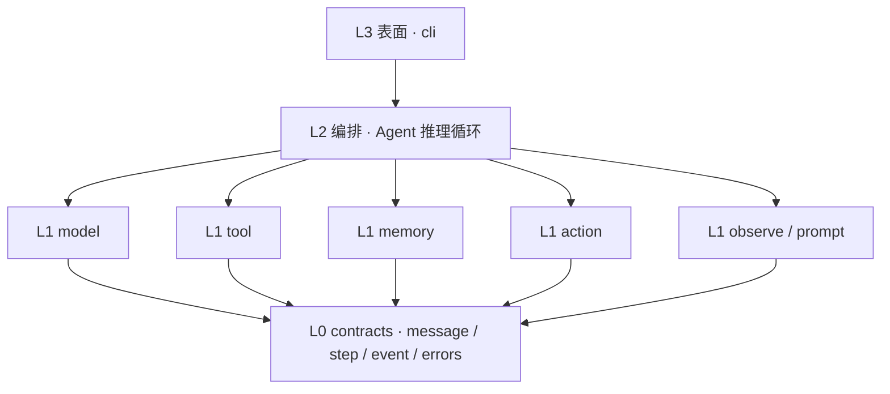
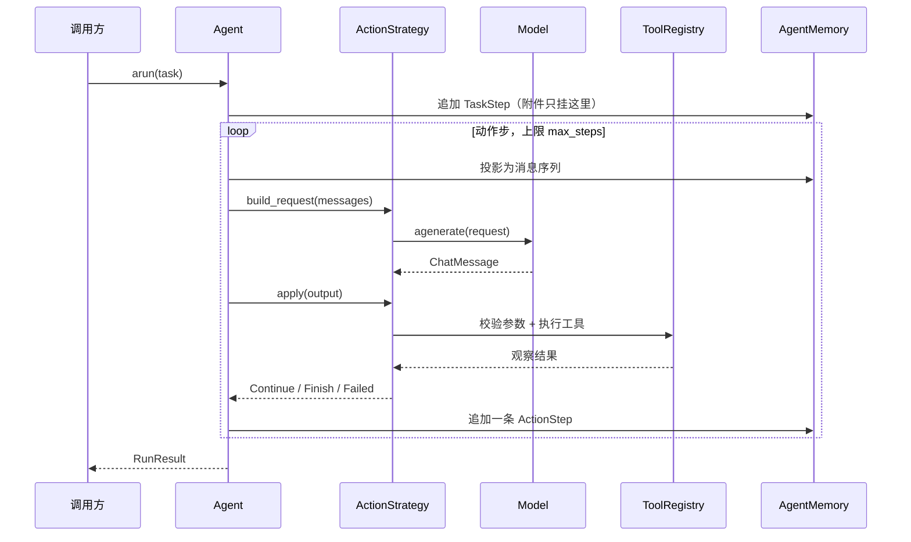

# littleagent 架构

> 文档类型：架构说明（explanation）
> 状态：设计定稿，实现见 `docs/roadmap.md` 的阶段划分
> 约束清单：`AGENTS.md`

## 1. 定位与边界

littleagent 是一个 **进程内、async-first、协议驱动** 的极简 Agent 框架。

一次调用的形状就是一次函数调用：

```python
from littleagent import Agent, tool, OpenAICompatModel

@tool
async def get_weather(city: str) -> str:
    """查询城市当前天气。

    Args:
        city: 城市名，例如「杭州」。
    """
    return f"{city} 晴，24℃"

agent = Agent(model=OpenAICompatModel(model="..."), tools=[get_weather])
result = await agent.arun("杭州现在适合出门跑步吗？")
print(result.answer)
```

**做**：多步推理循环、模型抽象、工具抽象、记忆投影、可插拔动作范式、流式事件、token 与耗时计量、取消。

**不做**：常驻服务、多租户、审批流、渠道接入、持久会话库、可视化平台。这些是运行时的问题域。littleagent 可以被嵌进那种运行时，但自己不长成那样。

两个奠基性决策，都无法后期无痛更改：

- **async 为核心**。流式输出、并行工具调用、外部协议客户端、HTTP 服务化，本质都是异步的。同步核心要靠线程池绕，且取消无法贯穿。所以核心全 async，同步入口只是一层薄包装，`asyncio.run` 在整个仓库只出现一次。
- **动作范式是注入的，不是继承的**。把「模型如何表达动作」做成 Agent 子类，会让推理循环在每个子类里重复一遍。littleagent 只有 **一个** `Agent` 循环，动作范式是实现 `ActionStrategy` 协议的对象。新增范式是新增一个文件，不是改循环。

## 2. 分层

四层，依赖严格单向向下，由 `import-linter` 机检。



不变量：

- L0 不 import 包内任何其它模块。
- L1 只能 import L0，且 **L1 内部各模块互不 import**。`model/` 不认识 `tool/`，两者只通过 L0 的 `ToolSchema` 之类的数据形状对话。
- L2 只依赖协议，不依赖具体实现类。
- `__init__.py` 是唯一 re-export 点与唯一公开 API 面；子模块路径不是公开契约。

L1 内部互不依赖这条约束值得单独解释：它保证每个能力都能被单独测试和单独替换。一旦 `model/` 开始 import `tool/`，「换一个模型后端」就会牵动工具系统。

## 3. 目录结构

```
littleagent/
├── AGENTS.md                  # 硬约束
├── README.md
├── pyproject.toml             # 依赖与工具配置（唯一来源）
├── environment.yml            # 只记解释器与 channel
├── Makefile                   # make check 单一入口
├── docs/
│   ├── architecture.md
│   └── roadmap.md
├── src/littleagent/
│   ├── __init__.py            # 唯一公开 API
│   ├── contracts/             # L0
│   │   ├── message.py         # Role / ToolCall / TokenUsage / ChatMessage
│   │   ├── step.py            # TaskStep / ActionStep / FinalAnswerStep / Timing
│   │   ├── event.py           # StreamEvent 封闭联合
│   │   └── errors.py          # AgentError 异常树
│   ├── model/
│   │   ├── base.py            # Model 协议 / ModelRequest / ToolSchema
│   │   └── openai_compat.py   # 唯一内置后端
│   ├── tool/
│   │   ├── base.py            # Tool 抽象
│   │   ├── decorator.py       # @tool：从签名与 docstring 生成 schema
│   │   ├── registry.py        # ToolRegistry：唯一名 + 边界校验 + 调度
│   │   └── builtin/
│   │       └── final_answer.py
│   ├── memory/
│   │   └── steps.py           # AgentMemory：steps -> messages 投影
│   ├── action/
│   │   ├── base.py            # ActionStrategy 协议 / ActionOutcome
│   │   └── toolcall.py        # Tool Calling 范式
│   ├── observe/
│   │   └── logging.py         # 结构化日志 + 计量收口
│   ├── prompt.py              # 类型化 prompt 构造函数
│   ├── agent.py               # L2 唯一推理循环
│   └── cli.py                 # L3
├── tests/
│   ├── contracts/ model/ tool/ memory/ action/
│   ├── test_agent_loop.py
│   └── fakes.py               # FakeModel：唯一测试替身入口
└── examples/
```

## 4. 核心契约

### 4.1 消息与步骤（L0）

```python
type Role = Literal["system", "user", "assistant", "tool"]

@dataclass(frozen=True, slots=True)
class ToolCall:
    id: str
    name: str
    arguments: dict[str, object]

@dataclass(frozen=True, slots=True)
class ChatMessage:
    role: Role
    content: str | None = None
    tool_calls: tuple[ToolCall, ...] = ()
    tool_call_id: str | None = None      # role == "tool" 时必填
    usage: TokenUsage | None = None
```

步骤记录全部 frozen，且 **在步骤结束时一次性构造**（成功、失败、取消三条路径都构造），以此保证「每个动作恰好一条记录」。

```python
@dataclass(frozen=True, slots=True)
class ActionStep:
    index: int
    model_output: ChatMessage
    tool_calls: tuple[ToolCall, ...]
    observations: tuple[ChatMessage, ...]
    error: AgentError | None
    usage: TokenUsage | None
    timing: Timing
```

### 4.2 Model 协议

模型层只认识数据形状，不认识 `Tool` 对象。请求打包成一个对象，让协议保持在两个方法、一个参数。

```python
@dataclass(frozen=True, slots=True)
class ToolSchema:
    name: str
    description: str
    parameters: dict[str, object]        # JSON Schema

@dataclass(frozen=True, slots=True)
class ModelRequest:
    messages: tuple[ChatMessage, ...]
    tools: tuple[ToolSchema, ...] = ()
    stop: tuple[str, ...] = ()
    max_output_tokens: int | None = None

class Model(Protocol):
    async def agenerate(self, request: ModelRequest) -> ChatMessage: ...
    def agenerate_stream(self, request: ModelRequest) -> AsyncIterator[StreamEvent]: ...
```

### 4.3 Tool 与边界校验

`@tool` 从函数签名与 docstring 生成 pydantic 参数模型，`ToolSchema` 的 JSON Schema 直接由该模型导出。模型返回的参数字典在 `ToolRegistry` 处校验一次，之后内部只传强类型对象。这是「外部边界用 pydantic，内部用真类型」的落点。

参数不合法产生 `ToolInputError`，它是 **可重试** 的：错误信息会作为观察喂回模型，让模型自己纠正。工具内部抛出的异常包成 `ToolExecutionError`，同样可重试。两者都不中止整个 run。

### 4.4 ActionStrategy：全框架最关键的缝

```python
@dataclass(frozen=True, slots=True)
class Continue:
    observations: tuple[ChatMessage, ...]

@dataclass(frozen=True, slots=True)
class Finish:
    answer: object

@dataclass(frozen=True, slots=True)
class Failed:
    error: AgentError
    retryable: bool

type ActionOutcome = Continue | Finish | Failed

class ActionStrategy(Protocol):
    def build_request(self, messages: Sequence[ChatMessage]) -> ModelRequest: ...
    async def apply(self, output: ChatMessage) -> ActionOutcome: ...
```

`ActionOutcome` 是封闭联合，循环用穷尽匹配处理，新增分支时类型检查会强制所有调用点跟上。结束循环 **只能** 通过 `Finish`——不用异常做控制流，因为一旦用异常，用户代码里的 `except` 就可能意外吞掉或意外拦住结束信号，那需要更脏的手段去绕。

### 4.5 错误与结果

```
AgentError
├── ModelError            # 模型调用失败 → 中止 run
├── ToolNotFoundError     # 模型点名了不存在的工具 → 可重试
├── ToolInputError        # 参数校验失败 → 可重试
├── ToolExecutionError    # 工具内部失败 → 可重试
├── MaxStepsExceeded      # 步数耗尽
└── RunCancelled          # 被取消
```

「可重试」的含义是把错误作为观察喂回模型继续下一步；不可重试则中止 run 并把错误放进结果。

```python
@dataclass(frozen=True, slots=True)
class RunResult:
    answer: object | None
    status: Literal["succeeded", "max_steps_exceeded", "failed", "cancelled"]
    steps: tuple[Step, ...]
    usage: TokenUsage
    timing: Timing
```

`status` 是封闭字面量，不再另设 `success: bool` 之类的派生字段——两个字段就会有不一致的可能。

## 5. 一次 arun 的数据路径



要点：

- `max_steps` 解析用 `None` 哨兵：`budget = self.max_steps if max_steps is None else max_steps`。传 `0` 抛 `ValueError`，绝不静默回落到默认值。
- 每轮迭代 **必然** 往 memory 追加一个 `ActionStep`，包括 `Failed` 与取消路径。
- 步数耗尽时不静默返回空答案：产出 `MaxStepsExceeded`，`status` 为 `max_steps_exceeded`，并附最后一步的记录。
- 取消由 asyncio 原生取消传播，模型请求与工具执行都在可取消范围内；取消后仍构造该步记录，`status` 为 `cancelled`。

## 6. 关键不变量及其理由

- **每个动作恰好一条记录**——「什么都没发生也没有记录」是最难排查的一类缺陷，比崩溃更糟。
- **默认值不吞合法值**——`x or default` 会把 `0`、`""`、空容器误判为「未传」。用 `None` 哨兵。
- **事实记录在其发生之处**——同一批数据重复注入每一步会让上下文线性膨胀；任务附件属于 `TaskStep`，工具产物属于产生它的那步。
- **取消贯穿全链路**——「在下一步开头检查布尔标志」这种实现，在长工具调用期间完全停不下来。
- **超时即取消，不承诺硬杀**——外部进程可能仍在运行，语义必须诚实。
- **计量在记录处收口**——按步骤类型挂回调，新增步骤类型就会静默漏统计。
- **序列化从字段派生**——手写导出字典必然随字段增加而漏项，配 round-trip 测试锁住。
- **代码执行不是安全边界**——若引入代码执行，本地执行器永不宣称隔离；隔离要靠进程或容器边界。

## 7. 扩展点：后续能力如何插入而不改循环

这是分层设计要买到的东西——每一项后续能力都落在既有缝上：

- **新动作范式**（例如让模型用代码表达动作）：新增一个 `ActionStrategy` 实现 + 对应执行器。`agent.py` 不动。
- **新模型后端**：新增一个 `Model` 实现。
- **多层 Agent**：让 `Agent` 自己实现 `Tool` 协议，作为工具注入给上层 Agent。不需要「子 Agent」这个额外概念。
- **外部工具协议客户端**：一个产出 `Tool` 列表的工厂，接进 `ToolRegistry`。
- **持久化记忆**：`AgentMemory` 的另一个实现。
- **规划步**：唯一需要触碰循环的一项——以可选的 planner 协议注入，循环里只有一处分支。这一处例外要在实现时明确记录。

## 8. 依赖与工具链

解释器、环境、依赖的完整管理规则见 `docs/python-environment.md`（唯一权威定义）。这里只说与架构相关的部分。

**核心运行时依赖只有两个**：`httpx`（异步 HTTP）与 `pydantic`（边界校验与 JSON Schema 导出）。这个预算是架构约束，不是偏好——每个核心依赖都会成为使用者环境里的强制项。

两处刻意不引依赖：

- **prompt 不用模板引擎**，改成类型化构造函数。收益是 prompt 拼装也进入 `mypy --strict` 的覆盖范围；模板引擎里的变量缺失只能在运行时暴露。
- **日志不用渲染库**。结构化日志是数据，渲染是调用方的事。

其余能力一律 extras，永不进核心。

`make check` = `ruff format --check` + `ruff check` + `mypy --strict` + `lint-imports` + `pytest`。单一入口，人和 AI 用同一条命令。其中 `lint-imports` 承担第 2 节那些分层不变量的机检职责。
