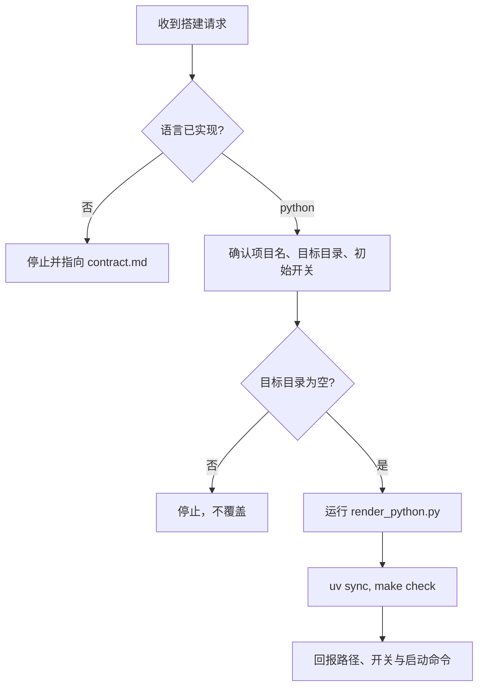

# 服务脚手架

生成一个可运行的 HTTP 服务。语言差异见语言包，Python 是当前唯一语言包。

> 子文件都在本目录，引用使用 `./xxx`。迁移时整目录复制。
>
> - 语言包与后端模块契约：[./contract.md](./contract.md)
> - Python / FastAPI：[./languages/python.md](./languages/python.md)

## 工作流程



## Step 1: 确认语言

已实现的语言只有 `python`。用户要 FastAPI、Python HTTP 服务，或没指定语言时，用 `python`，并阅读 [./languages/python.md](./languages/python.md)。

用户指定了其他语言时停止。告诉用户当前只实现了 Python，新增语言按 [./contract.md](./contract.md) 增加语言包，不要临时手写一套项目。

## Step 2: 确认输入

已知的信息不要重复追问。缺项目名时才问。用户没提开关时，四个开关都保持关闭，不要为了开关再追问。

| 输入 | 规则 |
|------|------|
| 项目名 | 小写蛇形，用作目录名和 pyproject name |
| 目标目录 | 默认 `<workspace>/projects/<project>/`。目录必须不存在，或存在但为空 |
| 初始开关 | `mysql`、`redis`、`kafka`、`rabbitmq` 的子集。没指定就是空 |

目标目录里已有文件时停止，不覆盖。

## Step 3: 生成

在本 skill 目录执行渲染脚本。不要手抄模板，也不要按开关删掉 `app/core` 里的模块。

```bash
python3 scripts/render_python.py \
  --dest "<目标目录>" \
  --project "<项目名>" \
  --title "<服务标题>" \
  --enable "mysql,redis"
```

`--enable` 省略或传空字符串表示四个开关都是 `false`。服务标题默认用项目名；用户给了人类可读名称时用那个名称。

脚本只用标准库。它复制 `templates/python/`，替换 `{{project}}` 和 `{{title}}`，再写 `.env`。

## Step 4: 检查

在生成出的目录执行：

```bash
uv sync
make check
```

`make check` 跑 Ruff、mypy、import-linter 和 pytest。本机有 `docker` 时再执行 `docker compose config`。

任一命令失败就停下并报告输出。没有 `uv` 时停止，并说明安装 uv，不要改成 pip 或 conda 布局。

## Step 5: 回报

告诉用户：

- 生成目录
- `.env` 里哪些 `*_ENABLED` 是 `true`
- 本地启动：`uv run fastapi dev app/main.py`
- 完成检查：`make check`
- 连同某个后端启动：`docker compose --profile mysql up --build`（多个后端就重复 `--profile`）
- 之后改开关只改 `.env`。同一种再加一条连接用双下划线，例如 `MYSQL__ANALYTICS__ENABLED`。不需要重新生成
